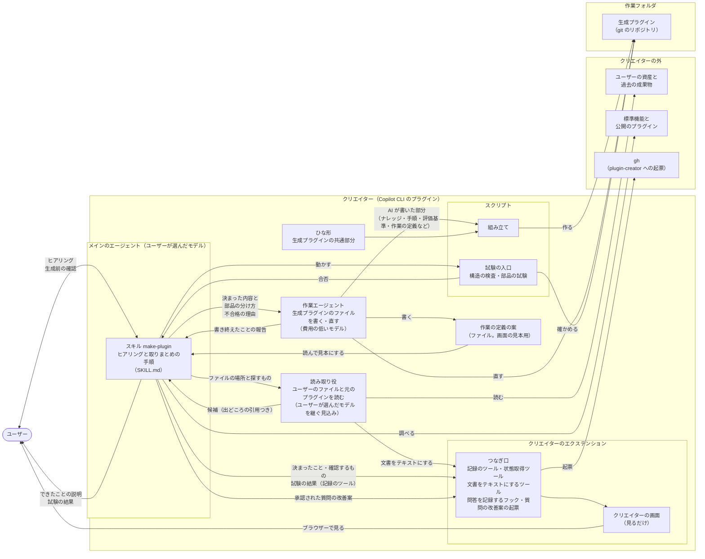
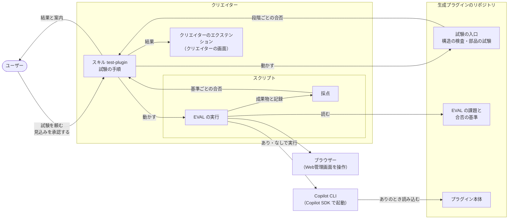
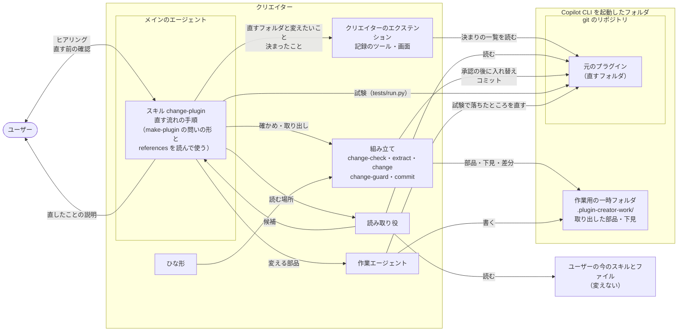

# クリエイターの構造

クリエイターがどんな部品でできていて、どうつながって生成プラグインを作り、直し、試験するかを示す。仕様は [作る流れの要件](../specs/creation-requirements.md)、[改善・設計変更の要件](../specs/improvement-requirements.md)、[出力の要件](../specs/output-requirements.md)、[試験の要件](../specs/test-requirements.md) にある。ユーザーからナレッジを引き出すヒアリングの進め方は、[ヒアリングの設計](hearing.md) にある。

## 1. 全体の図

作るとき：

試験を頼まれたとき：

今のプラグインを直すとき（3.4、4.1）：

## 2. 部品

| 部品 | 役割 | 対応する要件 |
| --- | --- | --- |
| マニフェストと README | クリエイターの `plugin.json`（Agent Plugins の形式）と説明書き。README には、モデルの選び方と、使うために要る準備（試験的機能を有効にすることと、読み込むときの確認を許可すること。試験的機能は、初めて使うときは `copilot --experimental` で起動して有効にし〔一度付ければ設定に残り、次からは付けなくてよい〕、起動した後なら `/settings experimental on` で有効にする〔Copilot CLI が自動で再起動し、今の会話は終わる〕。確認の意味と許可する理由、選び方とその違いは 4.3）と、会話例のページへの案内を書く。答えが来ないとき（質問を Ctrl+D で断る、Esc で閉じる、autopilot）は、聞きたかったことと続け方（チャットに答えを書く、autopilot を切る）を示して止まることと、`-p` と `--no-ask-user` ではヒアリングを始めないことと直し方も書く（REQ-023、[ヒアリングの設計](hearing.md) 5.5）。今のプラグインを直す頼み方（頼み方の例、`/<クリエイターの名前>:change-plugin`、直す前に要ること〔git でコミット済み、Copilot CLI を起動したフォルダの中〕、直した後の読ませ直し方）も書く | REQ-023、REQ-037、REQ-047、REQ-052 |
| スキル make-plugin | メインのエージェントが使う。ヒアリングと取りまとめの手順を持つ。最初の手順として、クリエイターの画面を開くツール（`<クリエイターの名前>_open`）を呼び、URL をチャットに示す（REQ-043）。そのあと、ヒアリング（実物を受け取る、読む、前回の1回、決まりの確かめ、項目の点検、資産と公開のプラグイン、画面）と生成前の確認を進める。段階、問いの形、記録、作り直しのときの違い、SKILL.md の組み立ては [ヒアリングの設計](hearing.md) にある。作る中で高い推論力が要る判断（部品の分け方など）もここで行い、決まった内容とあわせて作業エージェントに渡す。生成の後は、構造の検査と部品の試験を行い、不合格なら作業エージェントに直させる（4.1）。そのあと、できたことの説明（生成プラグインが Issue を起票できるようにする手順を含む。REQ-022）を示し、最後に、自分の質問を振り返って質問の改善案を示す（4.5）。description には、何ができあがるかを手順でない短い1句で書き、続けて、呼ばれる場面（作業の自動化や既存のプラグインの作り直しを頼まれたとき）と、呼ばれてはいけない似た頼み（手元のプラグインのフォルダのまま機能を足したり設計を変えたりする頼みを含む）を書く。手順の要約は書かない。手元のプラグインのフォルダのまま機能を足す・設計を変える・機能を消す頼みで呼ばれたときは、記録を作らずに change-plugin に移る。フォルダを示して「作り直したい」とだけ頼まれたときは、記録を作る前に、元のフォルダを直すか新しいフォルダに作るかを聞き、直すなら change-plugin に移る | REQ-015〜REQ-024、REQ-026、REQ-027、REQ-032〜REQ-036、REQ-038、REQ-039、REQ-043、REQ-045、REQ-049、REQ-052 |
| スキル change-plugin | メインのエージェントが使う。ユーザーが示した今のプラグインを、そのフォルダのまま直す（改善・設計変更）手順を持つ。最初に画面を開くツールを呼んで URL を示し、直すフォルダを組み立ての `change-check` で確かめてから、直す流れの記録を作る（3.4、4.3）。ヒアリングの段階の名前と順は make-plugin と同じで、変えるところだけを聞く（[ヒアリングの設計](hearing.md) 3.4）。問いの形、記録のしかた、疲れ・急ぎ、始められないときは、make-plugin の SKILL.md の節と references を読んで使い、直す流れだけの手順は名前が `change-` で始まる references に置く（同 10.5）。直す前の確認の後に、組み立てで直し、試験と直し、コミット、直したことの説明、質問の改善案を、この順に進める（3.4、4.1、4.5）。description には、何をするかと、呼ばれる場面（足したい、変えたい、作業役を分けたい、消したい、今使っているスキルを組み込みたい）と、呼ばれてはいけない似た頼み（新しく作る、新しいフォルダに作り直す、試験、仕事そのもの）を書く | REQ-018、REQ-019、REQ-026、REQ-027、REQ-043、REQ-044、REQ-048、REQ-049、REQ-052〜REQ-061 |
| スキル test-plugin | メインのエージェントが使う。ユーザーが生成プラグインの試験を頼んだときの手順を持つ。最初の手順として、クリエイターの画面を開くツールを呼び、URL をチャットに示す（REQ-043）。そのあと、道具の用意、構造の検査と部品の試験、EVAL の見込みと承認、EVAL、結果の説明、質問の改善案を、この順に進める（4.2、4.5）。description には、今あるプラグインに機能を足したり設計を変えたりする頼みには使わないことも書く | REQ-024、REQ-040〜REQ-044、REQ-048、REQ-049 |
| 読み取り役 | カスタムエージェント。メインのエージェントが `task` で頼む。ユーザーが示したファイルとスキル、作り直す・直す元のプラグインを読み、候補を出どころの引用つきで返す。docx・xlsx・pptx は、クリエイターのエクステンションの文書をテキストにするツールで読む。`model` と `tools` の決め方と、直すときに返すものは [ヒアリングの設計](hearing.md) 9章 | REQ-017、REQ-018、REQ-033、REQ-045、REQ-054、REQ-055 |
| 作業エージェント | 渡された内容に沿って、生成プラグインのうち作業ごとに違う部分のファイルを書く。作業の定義（合否の基準、作業ごとの画面）の案も、ユーザーが見本で直した分も、この1人が書く（4.3）。試験で不合格になったところも直す（4.1）。直すときは、作業用の一時フォルダに取り出した部品のうち、頼まれた差し込み口とファイルだけを書く（3.4）。ルールのスキルとそのスクリプトの書き方の決まりも持つ（[生成プラグインの構造](generated-plugin-structure.md) 4.9）。費用の低いモデルで動く（3.3） | REQ-028、REQ-031、REQ-039、REQ-046、REQ-055、REQ-061、REQ-062 |
| スクリプト：組み立て | ひな形と、AI が書いた部分を合わせて、作業フォルダの中に生成プラグインを作り、git のリポジトリにする。ひな形のファイルはバイトのまま写し、差し込み口を埋めるのは文字のファイルだけにする（0 のバイトがあるファイル、たとえば同梱のフォントは見ない）。番号と種類を付けたナレッジの一覧と、EVAL の課題（合否の基準の番号と文の写し、採点のしかた）も、テストのフォルダに入れる。合否の基準そのものは、作業の定義に入る。入力は、ヒアリングの記録と、AI が書いた部分と、manifest.json（生成プラグインの名前、部品の分け方、EVAL の課題の入力の実物のファイルの一覧 `eval_inputs` など）である。eval.json を、ユーザーが生成前の確認で確かめた課題と突き合わせ、違えば断る。課題は頼むときの言葉で結び、実物の入力のファイルは `eval_inputs` と結ぶ。同じ実物を2つ以上の課題で使うときは、`eval_inputs` に課題ごとの置き場所を1つずつ持たせ、課題のフォルダの中の置き場所と結ぶ。確かめていない入力のファイルは入れない。結果は JSON で出し、断ったときは理由の文の一覧を返す。終了コードは、成功が 0、断った・失敗したが 1、使い方の誤りが 2 である。組み立ての後と、作業エージェントが直すたびに、土台のファイル（`extension.mjs`、`adapter.mjs`、`core/`、`ui/` と、テストの土台。3.4）がひな形と同じかを確かめる（4.1）。作り直しのときも新しいフォルダに作り、元のプラグインのフォルダは変えない。今のプラグインを直すときの子コマンド（`change-check`、`extract`、`change`、`change-guard`、`commit`）は 3.4 にある | REQ-001、REQ-021、REQ-036、REQ-038、REQ-053、REQ-057〜REQ-059 |
| スクリプト：構造の検査 | 生成プラグインが公式仕様に沿っているかと、作業の定義が決まりの形に合い、EVAL の課題の基準の写しが作業の定義と同じか、確かめたナレッジがすべて入っているか（番号の突き合わせ）、外した決まりの番号を指したままの箇所がないか、入口のほかのスキルが単体で使える形か（部品の独立性）、要件の追跡の表（[生成プラグインの構造](generated-plugin-structure.md) 8章）がそろっているかを確かめる（同 10章）。クリエイター自身には、会話例の版と、スキル（make-plugin、test-plugin、change-plugin）の SKILL.md の本文の行数とトークン数と、references の大きさも確かめる（[試験の設計](testing.md) 2章、6.6、10.3、[ヒアリングの設計](hearing.md) 12章）。ひな形に入れる1段目の自己試験は、ひな形の外の `tests/creator/stage1/` に置く。クリエイター自身の1・2段目の入口は `tests/creator/run.py` である | REQ-004、REQ-037、REQ-039、REQ-058、REQ-061、REQ-062 |
| スクリプト：部品の試験 | 生成プラグインのスクリプト、フック、MCP サーバー、Web管理画面を動かして確かめる（[試験の設計](testing.md) 2章） | REQ-039 |
| スクリプト：試験の入口 | 道具がそろっているかを確かめてから、構造の検査と部品の試験を1つのコマンドで動かし、段階ごとの合否を出す。入口・構造の検査・部品の試験は、ひな形にも写しを入れる（[試験の設計](testing.md) 10.2） | REQ-039、REQ-042、REQ-048 |
| スクリプト：EVAL の実行 | 始める前の見込みを出す。Copilot SDK で、生成プラグインあり・なしで課題を実行し、Web管理画面を操作して、記録を残す。擬似の機器を使う課題では、課題の差し替えのスクリプトのフォルダを、実行の `PATH` の先頭に足す（[試験の設計](testing.md) 8.2、10.4） | REQ-040、REQ-041、REQ-061 |
| スクリプト：採点 | 成果物と記録を、合否の基準で採点する。決めたエージェントが動いたかは、実行の記録で見る。開発の試験の内側の EVAL と同じもの（[試験の設計](testing.md) 10.4、10.5） | REQ-041、REQ-061 |
| スクリプト：会話例の作成 | 外側の EVAL の記録から、会話例を作る。開発のときだけ使う（`tests/dev-eval/runner/examples-build.mjs`。[試験の設計](testing.md) 6.6） | REQ-037 |
| 開発の試験：変換スクリプト | クリエイターと生成プラグインを、Claude Code 向けに置き換える（`tests/dev-eval/convert.py` と、その試験。[試験の設計](testing.md) 4章） | 開発の試験 |
| 開発の試験：EVAL の実行の仕組み | 外側の EVAL（`tests/dev-eval/runner/outer*.mjs`。改善・設計変更の場面は `outer-change.mjs` と `outer-grade-change.mjs`）、ユーザー役（`user-role*.mjs`）、対照のクリエイター（`tests/dev-eval/control-creator/`）、内側の EVAL（`inner*.mjs`）と、共通の部品（[試験の設計](testing.md) 5〜7章） | 開発の試験 |
| 開発の試験：模擬ユーザー | 外側の EVAL でユーザー役が演じるユーザーの決まりとファイル（`tests/dev-eval/personas/`）と、その形の確かめ（`validate.mjs`。[試験の設計](testing.md) 6.1）。改善・設計変更の模擬ユーザーと、直す題材のリポジトリ（`tests/dev-eval/fixtures/`）もある（同 6.8） | 開発の試験 |
| 開発の試験：擬似の機器 | 本物の機器の代わりに、内側の EVAL で使う架空の機器（`tests/dev-eval/device/`。[試験の設計](testing.md) 7章） | 開発の試験 |
| 開発の試験：呼ばれ方の試験 | 頼みごとに、どのスキルが最初に呼ばれるかを見る（`tests/dev-eval/trigger/`。[試験の設計](testing.md) 6.9） | 開発の試験 |
| 開発の試験：ユーザー役の試験 | ユーザー役だけを試験する（`tests/dev-eval/runner/user-role-test.mjs`。[試験の設計](testing.md) 6.2） | 開発の試験 |
| クリエイターのエクステンション | クリエイターの画面（決まったことの一覧、生成前の確認と直す前の確認で示すもの、試験の結果、会話例、Web管理画面の見本。見るだけ）と、画面に知らせる記録のツール、状態取得ツール、文書をテキストにするツール、ヒアリングの問答を記録するフック、質問の改善案の起票を持つ。今のプラグインを直すときは、直す流れの記録を作るツールが、元のプラグインの決まりの一覧などを取り込む。ヒアリングの記録が、ヒアリングの状態のただ1つの元になる（[ヒアリングの設計](hearing.md) 7章）。Web管理画面の土台の一部を流用する。作り方とツールとフックの一覧は [生成プラグインの構造](generated-plugin-structure.md) 9章（4.3） | REQ-015、REQ-017、REQ-027、REQ-043、REQ-044、REQ-049、REQ-052、REQ-054、REQ-056〜REQ-058、REQ-060、REQ-061 |
| 会話例のファイル | 模擬ユーザーごとに1つの Markdown。スキルのフォルダの外に置き、README とクリエイターの画面から開く（4.4） | REQ-037 |
| ひな形 | どの生成プラグインにも共通する部分（土台）。クリエイターの直下の `template/` に置く（スキルのフォルダの外。3.4）。Web管理画面とそれを動かすエクステンション、統括・作業・検証のエージェントの決まった手順、生成プラグインの憲章・仕様書・設計書のひな形、生成プラグインの README（初めの「できること」と「使い方」の枠と、使うために要る準備と、任せたいツールを前もって許可するしかた。「できること」と「使い方」の作業ごとの文は作業エージェントが書く。生成プラグインの構造 4.1、4.9、4.14）、テスト（試験の入口と、1・2段目のスクリプトの写し、偽物のつなぎ口）。エージェントがルールのスキルを絶対パスで読むしくみ（生成プラグインの構造 4.7）も持つ。中身は [生成プラグインの構造](generated-plugin-structure.md) にある | REQ-001〜REQ-014、REQ-025、REQ-029〜REQ-031、REQ-050、REQ-051、REQ-062 |

## 3. 分け方の考え方

### 3.1 推論の重さで分ける

クリエイターの仕事を、推論の重さで分け、担当を決める（憲章 第16条）。

| 分類 | 仕事 | 担当 |
| --- | --- | --- |
| 高い推論力が要る | 対話で仕様を決めること（ヒアリングの問いと聞き直し、実際の1回をたどる、ファイルから決まりを推し量る、資産や公開のプラグインが使えるかの見極め、振る舞いの案と直し）。作る中での判断（生成プラグインの部品の分け方、生成プラグインのスキルの description） | メインのエージェント。ユーザーのファイルと元のプラグインの読み取りは読み取り役 |
| 費用の低いモデルで足りる | 決まった内容に沿って、生成プラグインのうち作業ごとに違う部分のファイルを書くこと（仕様書・設計書の作業ごとの部分、SKILL.md の手順、エージェントへの指示と評価基準、スクリプト、画面の定義、テスト） | 作業エージェント |
| AI が要らない | 組み立て、構造の検査、git のリポジトリにすること | スクリプト |

- 読み取り役は `model` を書かない。読み取りも決まりを推し量る仕事なので、親のセッションのモデル（ユーザーが選んだモデル）を継がせる。継ぐかは実機で確かめる（REQ-045、[ヒアリングの設計](hearing.md) 9章、14章）。分ける理由と読み取り役の決まりも、[ヒアリングの設計](hearing.md) 9章にある。
- 部品の分け方（どの手順をスクリプトにし、どこを AI に任せるか）は、生成プラグインの出来を左右するので、メインのエージェントが決める。スキルの description も、スキルが呼ばれるかどうかを決めるので、メインのエージェントが書く（ナレッジ「スキル」）。入口のスキルの description は、作業エージェントに言い換えずに渡し、作業エージェントはそのまま書く。ルールのスキル（[生成プラグインの構造](generated-plugin-structure.md) 4.9）は、今のプラグインを直すときは、メインのエージェントが名前と description を決めて直す前の確認で示し、同じく言い換えずに渡す。新しく作るときは、ルールのスキルの description を渡さず、作業エージェントが 4.9 の書き方で書く。
- 生成プラグインのファイルを書くこと以外の仕事（できたことの説明など）は、費用の低いモデルで足りるものでも、メインのエージェントが行う。作業エージェントを起動して内容を渡す手間のほうが大きいためである。
- 画面の見本は、作業エージェントが書いた作業の定義の案で出す（[生成プラグインの構造](generated-plugin-structure.md) 9章）。
- 作業エージェントは1つにする（憲章 第10条）。
- 今のプラグインを直すときも、同じ分け方にする。範囲や決まりの確かめ、直す前の確認、部品の分け方（変える差し込み口とファイル、作業エージェントを足すか、ルールのスキルの名前と description。直す前の確認で示す）はメインのエージェント、元のプラグインと示されたスキルの読み取りは読み取り役、変える部品と試験で落ちたところの直しは作業エージェント、取り出し・入れ替え・コミットはスクリプトである（3.4）。
- この分け方は、クリエイター自身の構成である。生成プラグインの構成（統括・作業・検証のエージェント。憲章 第19条）は、ひな形から作る。

### 3.2 メインのエージェント

- ユーザーが Copilot CLI で話している相手である。モデルは、ユーザーが `/model` などで選んだものになる。Copilot CLI のプラグインのマニフェストにはモデルの項目がなく、プラグインからは決められない。
- そのため、対話には思考力の高いモデルが向いていることを、README で知らせる（REQ-047）。
- ユーザーへの質問は、メインのエージェントだけが行う。理由は次の2つである。
  - Copilot CLI の公式ドキュメントに、サブエージェントがユーザーに質問できる（`ask_user` を使える）という記述がない。
  - 試験に使う Claude Code では、サブエージェントは質問のツールを使えない（[試験の設計](testing.md) 4章）。

### 3.3 作業エージェント

- カスタムエージェントとして `com.github.copilot/agents/` に置く。Agent Plugins の形式のまま、Copilot CLI 固有の部品を入れる場所である（ナレッジ「プラグイン」）。
- メインのエージェントが、組み込みの `task` ツールで仕事を頼む。
- 作業エージェントは会話を見ていない。メインのエージェントは、生成前の確認でユーザーがよいと答えた内容（ナレッジの一覧と振る舞いの案）と、作る中で決めたこと（部品の分け方など）を、すべて渡す。渡していないことは、生成プラグインに入らない。
- 使うモデルは、フロントマターの `model` に、優先する順のリストで書く（例：`model: [gpt-6-luna, claude-haiku-5.5]`）。ユーザーのプランで使える最初のモデルが使われ、どれも使えないときは、メインのエージェントのモデルになる。

  | 順 | モデル（Copilot CLI の ID） | 選んだ理由 |
  | --- | --- | --- |
  | 1 | `gpt-6-luna`（GPT-6 Luna） | ユーザーが例に挙げたモデル。GPT-6 の中で最も費用が低い（100万トークンあたり、入力 0.10 ドル、出力 0.50 ドル）。Copilot Pro 以上のプランで使える |
  | 2 | `claude-haiku-5.5`（Claude Haiku 5.5） | GPT-6 Luna と同じ価格で、同じプランで使える。組織の設定などで GPT-6 Luna が使えないときの代わり。試験で Claude Code 向けに置き換えるときも、このモデルにする（[試験の設計](testing.md) 4章） |

- ユーザーがモデルを Auto にしているときは、`model` に関係なく、作業エージェントも Auto が選んだモデルで動く（Copilot CLI の決まり）。このことも README で知らせる（REQ-047）。
- スキルを呼べないように、`tools` をファイルの読み書きと検索（`read`、`edit`、`search`）に絞る。サブエージェントにもプラグインのスキルが見え、スキルの手順を最初から始めてしまうことがあるためである（ナレッジ「カスタムエージェント」）。`tools` に `skill` を書かなければ、スキルのツールは載らない（Copilot CLI 1.0.102 で確かめた）。別名 `search` で検索のツールが渡る（Claude の族は grep・glob、GPT の族は rg・glob）。生成プラグインの作業・検証と同じである（[生成プラグインの構造](generated-plugin-structure.md) 4.7、11章）。
- この書き方は、Copilot CLI 1.0.98 の実装（パッケージに含まれるプログラム、付属の説明、更新履歴）で確かめた。組み込みのエージェントの定義も `model` にリストで書き、方針の項目は `model-policy` である。今の公式のコマンドリファレンスは、`model` を1つのモデル、優先する順のリストを `models`、方針を `modelPolicy` としていて、実装と食い違う。設計では実装で確かめた `model` のリストを使う。`model` のリストは Copilot CLI 1.0.102 で効いた（先頭のモデルが使われた）。`models` で書いたときに効くかは要確認とする（[生成プラグインの構造](generated-plugin-structure.md) 4.6、11章 #18）。

### 3.4 スクリプトとひな形

- 決まった処理（組み立て、検査）はスクリプトにし、推論が要ることだけをスキルと作業エージェントに書く（ナレッジ「スキル」）。
- 生成プラグインのうち、どれにも共通する部分はひな形から作り、作業ごとに違う部分（ナレッジ、手順、評価基準）だけを AI が書く。毎回同じ品質で作るためである（ナレッジ「プラグインを作るプラグイン」）。作業エージェントは費用の低いモデルで動くので、AI が書く量を、ひな形でできるだけ減らす。
- ひな形は、スキルのフォルダの外（クリエイターの直下の `template/`）に置く。Copilot CLI は、スキルを読むたびに、そのスキルのフォルダの全ファイルの名前を Related files としてモデルに足すためである。ひな形をスキルのフォルダの外に移すと、Related files は97件から16件になった。

**今のプラグインを直すとき**（REQ-053、REQ-055、REQ-057〜REQ-059）

組み立てのスクリプトに、直すための子コマンドを足す。build の、部品を読んで突き合わせる部分と描く部分は共通の関数にし、build と `change` で使う。同じことを2か所に書かないためである。結果の出し方と終了コードは build と同じである（2章）。断る文には、何がよくないかと直し方（実際のコマンド）を書き、change-plugin がそのまま示す。

| 子コマンド | いつ | すること |
| --- | --- | --- |
| `change-check` | 始まり（記録を作る前）と、`change` の中 | 読むだけで、直すフォルダを確かめる（REQ-053）。マニフェストがある。Copilot CLI を起動したフォルダの中にある。インストールやマーケットプレイスの写し（`<COPILOT_HOME>/installed-plugins/` とキャッシュの場所）の中にない。git のリポジトリの中にあり、マニフェストが git で管理され、フォルダが .gitignore で外されていない。外されたファイルは、ひな形の `.gitignore` に当たるものと作業用の一時フォルダだけである。フォルダの中にコミットしていない変更がない（作業用の一時フォルダを除く）。マージ・リベース・チェリーピック・リバートの途中でない（途中だと、直した後のコミットで初めて止まるため） |
| `extract` | 直す前の確認の前 | 元のプラグインの git が管理するファイルから、差し込み口の文と作業ごとのファイルを取り出して部品にし、作業の定義の案（元の作業の定義から合否の基準を除いたもの）を書く。今のひな形で下見を描いて元と比べ、下見に1段目を当てる。返すもの：上書きされる土台のファイルとその差分、1段目で落ちるところ、消すファイル（以前の形式のマニフェストと、シンボリックリンクなどのふつうのファイルでないもの。作っていないプラグインでは、ひな形と重なるファイルも）、取り込んだスキルとプラグインのスキルの名前の重なり、取り出したフォルダの実パスとそのときの HEAD のコミット（`change` が使う）。フォルダの中にコミットしていない変更があれば断る（下の「取り出した後の変更」）。書くのは作業用の一時フォルダの中だけである |
| `change` | 承認の後 | 直す直前の確かめ（承認、確認の版と基準の番号、記録の直すフォルダ、`change-check` のやり直し、取り出した後の変更）、決まりの番号の合わせ、名前の重なりの確かめをしてから、一時フォルダに描き、元のフォルダの git が管理するファイルと入れ替える。描いたものにないファイルは消し、.gitignore で外されたファイル、作業用の一時フォルダ、git のサブモジュールには触れない。失敗したら HEAD に戻して断る。描き直しで変わったファイルの一覧を一時フォルダに残す。コミットはしない |
| `change-guard` | 試験の直しのたび | `change` が残した一覧の外で、HEAD から変わったファイルを示す。`--restore` で HEAD に戻す（4.1） |
| `commit` | 最後 | フォルダの中のファイルだけをコミットし（作業用の一時フォルダを除く）、印のタグを付け直し（4.5）、作業用の一時フォルダを消す。push はしない |

- 土台を上げる：元のプラグインから差し込み口の文を取り出し、今のひな形で描き直す（REQ-059）。今の版と違う土台のファイルは、`extract` の差分で直す前の確認に示す（REQ-057）。生成したときのひな形の版は記録しない（憲章 第10条）。
- 生成プラグインかの見分け方：マニフェストの `name` で、`tests/knowledge.json` と `com.github.copilot/extensions/<name>/task.json` の両方があれば、クリエイターが作った生成プラグインとする。あるのに読めないときは、理由を示して断る。エクステンション、`change-check`、`extract` は同じ決め方にし、`change` は記録と `extract` の結果が違えば断る。別々に決めると、決まりの一覧を1回で聞いたのに作っていないプラグインとしてファイルを消す、といった食い違いが起きるためである。
- 作っていないプラグイン：`extract` は差し込み口を取らず、ひな形と重なるファイルと以前の形式のマニフェストを、消すファイルに並べる（REQ-057）。作業の定義の案と部品の分け方（manifest.json）は書かない。
  - 入口のスキルと作業エージェントの名前はまだ決まっていないので、その置き場所（`skills/<名前>/`、`com.github.copilot/agents/<名前>.agent.md`）にある元のファイル（例：プラグインと同じ名前のスキル、`worker.agent.md`）は、消すファイルに入れず、部品に残す。名前を決める前に消すと、ユーザーが消すと頼んでいないスキルやエージェントが消えるためである（REQ-054）。
  - メインのエージェントは、入口のスキルと作業エージェントの名前を、残したファイルと重ならないものに決める。`change` は、選んだ入口のスキルのフォルダか作業エージェントの定義の場所に残したファイルが重なれば、別の名前を付けるよう断る。断られたら、change-plugin は名前を変えて動かし直す。作業エージェントの名前を変えるときは、作業の定義の案、部品の分け方、差し込み口のファイルの名前と、その名前を指すところ（作業エージェントに直させる）も合わせる。
- 書く役：作業の定義の案を作業エージェントが書く・直すのは、画面の設定や表示を変えるとき、エージェントの組み方を変えるとき、1段目の結果で案が決まりに合わないとき、作っていないプラグインのとき（1から書く）だけである。部品の分け方はメインのエージェントが書く・直す（作業エージェントを足すときは、その一覧に足す）。差し込み口は、作業エージェントが変えるものだけを直し、作っていないプラグインではすべてを書く。変えた内容に合わせて、README、仕様書、設計書、要件のたどり方の差し込み口も直す（REQ-059）。変えない部品は、スクリプトが元から取り出したまま使う。
- ルールのスキルへの書き直し（REQ-055、REQ-062）：change-plugin は、作業エージェントへの頼みに、入れる決まりの番号と文（決まりの値を含む）と、示されたスキルの使い方と説明（写したスクリプトの使い方〔`--help` に出ること〕、環境の条件〔`compatibility`〕、出力の意味の説明。読み取り役が「使い方と説明」の欄に返し、資産の候補の説明に記録したもの）を書き、そのスキルにそのまま書かせる。`compatibility` は、ルールのスキルの `compatibility` に文のまま写させる。作業の画面の設定から来る値は、設定の名前で書かせず、直す前の確認の振る舞いの案で決めた使い方（決めていなければ「頼みに書かれたもの。なければ確かめた値」）で、チャットで頼まれたときにも使える書き方にさせる（[ヒアリングの設計](hearing.md) 6.3）。決まりの文が画面の設定と同じものの値を固定で決めているときは、確認の前に、決まりの文にも同じ使い方（頼みや画面になければ決まりの値）を入れて記録してあるので、作業エージェントは文のまま書けばよい。ルールのスキルは、チャットで単体で頼まれたときも、そのスキルだけで作業できなければならないためである。よいと答えた決まり・振る舞いの案・スクリプトの使い方にない振る舞い（例：既定の値があるのに、足りないと止まる）は足させない。外側の EVAL（改善）の1回目では、確かめたアドレスがルールのスキルに入らず（画面の設定の名前だけ）、スクリプトの既定の出力先が「足りなければ止まる」に変わった。
  - 作業エージェントの定義には、ルールのスキルの書き方として、次も置く（作るときも同じ）。1つのルールのスキルの中では、1つの決まりの番号の文を1回だけ書き、合否の決め方の決まりが手順の決まりと同じことを言うときは、1か所にまとめて両方の番号を添える。合否の決め方の文の「ほかの場合は当てはまらないので合格とする」（[ヒアリングの設計](hearing.md) 6.3）は合格の条件のための言葉なので、ルールのスキルには書かない。「<場合> のときは」は、そのスキルがその場合だけのものなら、各決まりから外して初めに1回だけ書き、ほかの場合も受け持つスキルでは残す。外すと、ほかの場合にも当てはまる決まりに読め、ほかの場合の決まり（ふだんは〇〇を使う、など）と食い違うためである。決まりの文に人に聞くことが書かれていても、ルールのスキルには止めて示す形で書く。決まりを、それを使う2つのルールのスキルに文を分けて書くこと（ビルドの失敗と転送の失敗など）は、今までどおりにする。どちらのスキルも単体で、自分の入力と失敗の扱いを持つためである。外側の EVAL（改善）の3回目では、同じ決まりが手順と合否の決め方の2つの番号で同じスキルに2回入り、合格の条件のための文が3つのルールのスキルに写って1段目の検査に落ち、人に聞く文が1つのルールのスキルに入った。
  - 直すときは、作業エージェントの定義に次も置く。今あるルールのスキルに、新しい番号の決まりと同じ中身の行（番号のない行）があれば、その行を、番号を添えた決まりの文に置き換え、別の場所に足さない。付け直した決まり（中身を直して新しい番号にした決まり）なら、新しい番号の文はその行に置き、そのルールのスキルの中の元の番号の行の文は消す。古い番号の箇所をすべて新しい番号にする決まりのままだと、元の番号の行も新しい番号になり、1つのルールのスキルに同じ番号の文が2回入るためである。同じ中身の新しい番号が2つあれば、その1か所に両方の番号を添える。外側の EVAL（改善）の4回目では、ルールのスキルに書き足されていた1行と同じ中身の決まりが2か所に入った。直す前の確認でメインのエージェントが、読み取った候補を確かめずに「同じ中身なので重ねない。文は今のまま残す」と示し、作業エージェントへの頼みでも、その行を残すよう書いたためである。候補を確かめずに外すことは、ヒアリングの側で止める（[ヒアリングの設計](hearing.md) 3.4 の段階「読む」）。
- 外した決まりの渡し方（REQ-054、REQ-057、REQ-058）：作業エージェントに、文も番号も残さないよう渡すのは、元のプラグインの決まりの一覧（`tests/knowledge.json`）にあった外す決まり（記録の状態のツールの「外した決まり」。中身を直して付け直した元の番号は、番号の付け直しとして渡すので入らない）だけである。元のプラグインから読んだ候補（記録で、引き継いだ印のない行）のうち「違う」と答えたものは、直す前の確認の「変わること」で消す文と場所を1件ずつ示したうえで、文と、記録の抜き書きにある読み取った場所（ファイルと箇所）だけを渡し、その場所のその文だけを消させる。決まりではない・決まらなかった候補の文は消さずに残す（確認で示していない変更をしないため）。ほかの候補（示されたスキルから読んだものなど）は渡さない。候補の文を渡すと、似た文の機能の説明（仕様書の要件など）まで消すおそれがあるためである（[ヒアリングの設計](hearing.md) 6.3）。
- 取り込んだスキルと名前の重なり（REQ-055）：取り込んだスキルは、流用する資産のうち、`SKILL.md` のあるフォルダ（か `SKILL.md`）である。`extract` は、ヒアリングの記録を受けると、取り込んだスキルの名前（`SKILL.md` の `name`、なければフォルダの名前）と元のプラグインのスキルの名前の重なりを返す。メインのエージェントは、足すルールのスキルの名前を重ならないものに決め、description と一緒に直す前の確認で示す。重なりに出た元のプラグインのスキルも新しい名前を決め、元の名前 → 新しい名前を示す（change-plugin が部品の中でフォルダを移し、そのスキルを指すところを作業エージェントに直させる）。`change` も、描いたスキルの名前で、最後の守りとして確かめる。承認の後に初めて断られると、確認と違う名前で直すことになるためである（REQ-057）。示されたスキルのフォルダが元のプラグインの中にあるときと、資産のファイルが `SKILL.md` のあるフォルダの下にあるのにそのフォルダが資産にないときも断る。前者は入れ替えでスキルの中身が変わり、後者は記録の漏れで重なりの確かめが黙って素通りするためである。
- 決まりの番号の合わせ（REQ-058）：`change` は、元の `tests/knowledge.json`、`tests/knowledge-removed.json`（[生成プラグインの構造](generated-plugin-structure.md) 7章）、記録の決まったナレッジを突き合わせる。元の番号は、記録に同じ中身（種類・項目・文）であるか、記録にない（外す）かのどちらかでなければならない。新しい番号は、元の2つのファイルのどの番号より大きくなければならない。中身を直した行の元の番号は、今回外すものでなければならない。合わなければ断る。書くのは、knowledge.json に記録の決まったナレッジ、knowledge-removed.json に前からの行と今回外したもの、である。合否の基準の番号は、エクステンションが記録に付けたもの（[ヒアリングの設計](hearing.md) 7.3）を確かめて使う。
- 版：`change` は、描いた `plugin.json` の version を、直す前の確認でよいと答えた版にする（REQ-057）。
- マニフェストの引き継ぎ（REQ-054）：`extract` の下見と `change` は、描いた `plugin.json` に、元のマニフェストの `author`、`homepage`、`repository`、`license`、`keywords`、`extensions` を元の値のまま書く。Agent Plugins 1.0.0 のマニフェストの項目のうち、ひな形が書かないもの（ひな形は `$schema`、`name`、`version`、`description` だけを書く）で、描き直すと消えるためである。下見でも引き継ぐので、土台の差分には出ない。以前の形式の項目（`skills`、`agents` など）は、Agent Plugins の形式では読まれないので引き継がない。
- git のサブモジュール（REQ-054）：git がコミットの番号だけを管理するサブモジュールは、ファイルでないので、`extract` は取り出さず、注意（`warnings`）に出す。`change` も入れ替えず、消さずにそのまま残す。断るより、ユーザーが変えると頼んでいない部品を変えずに残すほうがよいためである。
- 取り出した後の変更（REQ-053、REQ-057、REQ-058）：部品と確認で示したものは、取り出したときの中身でできている。その後にフォルダが変わると、`change` がその変更を消してしまうので、次のとおり止める。どの断りでも、フォルダは変わっていない。
  - `extract` は、フォルダの中にコミットしていない変更があれば断る（`change-check` と同じ文）。コミットしていない変更を取り出すと、ユーザーがその変更を後で消しても、`change` が書き戻すためである。change-plugin は、返った文（コミットのコマンドが入っている）を示して止まり、ユーザーがコミットするか変更を消して頼み直したら、取り出し直す。変更に決まりの一覧（`tests/knowledge.json`）があれば、それをコミットすると直す段階で断られることも示す（下の4つ目）。
  - change-plugin は、承認の問いの前にも、`change-check` と、取り出したときの HEAD から今の HEAD までのフォルダの差分を確かめる。変わっていれば、取り出し直して確認を示し直す。承認の後に分かると、確認をやり直せないためである。
  - `change` は、取り出しの結果が別のフォルダのものか、取り出したときの HEAD のコミットがないとき、生成プラグインかの見分けが取り出したときと違うときに断る。また、取り出したときの HEAD から今の HEAD までに、フォルダの中身が変わるコミットがあるときも断る（同じリポジトリのほかのフォルダだけのコミットでは止めない）。後者で断られたら、change-plugin は、よいと答えた作業の定義の案を残して取り出し直す。変わったファイルが、確認で引き継ぐと示した部品の中だけにあり、取り出し直した結果（土台の差分、1段目、消すファイル、名前の重なり、取り出せなかった差し込み口）が確認で示したものと同じなら、部品の用意からやり直して直す。比べる相手は、部品の用意の初めに一時フォルダに残した、承認したときの取り出しの結果の写し（`confirmed-extract.json`）で、短いコマンドで同じかを見る。取り出し直すと結果のファイルは上書きされ、確認で示した文はファイルの名前を出さず何のためのものかで書く（[ヒアリングの設計](hearing.md) 6.3）ので、どちらとも比べられないためである。そうでなければ、よいと答えた内容と食い違う。前者で断られたときも、何が変わったかを確かめられない。どちらも、段階「生成」では確認をやり直せないので、`/clear` してから同じ頼みをし直すよう示して止まる。
  - `change` は、生成プラグインで、`tests/knowledge.json` の番号が、記録の取り込んだ決まりの番号（[ヒアリングの設計](hearing.md) 7.1 の `change`）と違えば断る。取り込んだときの一覧で確かめた内容で直すと、その後の決まりの変更を消してしまうためである。同じフォルダの記録には決まりを取り込み直さないので、change-plugin は、`/clear` してから同じ頼みをし直すよう示して止まる。新しいセッションでは今の一覧から取り込み直し、残った作業用の一時フォルダは、記録を作る前（`change-check` の結果を見てから、別のコマンドで）に消す。記録を作るツールの返り値を受けた後の手順を、返り値にあるこれからの流れの文を書くことだけにするためである（[ヒアリングの設計](hearing.md) 3.4）。
- 作業用の一時フォルダ：作るときと同じ `<作業フォルダ>/.plugin-creator-work/` を使い、終わったら消す。起動したフォルダが元のプラグインのフォルダと同じときは、その中にできる。そのため、`change-check` の未コミットの確かめ、入れ替え、`change-guard`、`commit`、1段目の検査のすべてで除き、ひな形の `.gitignore` にも入れる。
- 土台の確かめ（4.1）の範囲に、テストの土台（`tests/run.py`、`tests/stage1/`、`tests/stage2/` の `adapter/`・`core/`・`ui/`・`fake-*.mjs`）を足す。描き直しで試験の土台も上がるので、作業エージェントが試験を書き換えて通すのを止めるためである。違う・ないだけを見て、増えたファイルは見ない。
- インストールの写しの確かめでは、`COPILOT_CACHE_HOME` の場所と、その下の `copilot` の両方を断る。どちらを指すかが公式の文書から分からないためである。`<COPILOT_HOME>/plugin-data/` は、実行時のデータの場所でプラグインの写しではないので、断らない。
- 子コマンドが返すファイルの場所は、すべて元のプラグインのフォルダからの相対の POSIX パス（区切りは `/`）にする。
- 子コマンドは、組み立ての2段目の試験（`tests/creator/scaffold/test_change.py`）で確かめる。始める前の確かめで止まる場面のすべてと、止まってもフォルダが変わらないこと、取り出して変えずに描き直すと版のほかは同じになること、作っていないプラグイン、作業エージェントを足すこと、消した機能のファイルが消えること、番号の合わせ、名前の重なり、マニフェストの引き継ぎ、サブモジュール、取り出した後の変更、入れ替えとコミットの範囲（作業フォルダが元のプラグインのフォルダと同じときを含む）である。

### 3.5 作業エージェントが書いたものの確かめ方

- 専用の確認の手順や検証エージェントは置かず、生成プラグインの試験（[試験の要件](../specs/test-requirements.md)）の中で確かめる。
- メインのエージェントは、生成前の確認でよいと答えたナレッジに、番号と種類（合否の決め方か、それ以外か）を付けて渡す。作業エージェントは、ナレッジを入れた箇所に、その番号を書く。
- 構造の検査で、種類ごとの置き場所に番号があるかを突き合わせる（REQ-039）。合否の決め方のナレッジは作業の定義の合否の基準に、それ以外は作業の定義とテストのフォルダを除くファイルに書く（[生成プラグインの構造](generated-plugin-structure.md) 6.4、[試験の設計](testing.md) 10.3）。抜けた番号があれば、どのナレッジが抜けたかを示す。
- 合否の決め方のナレッジに例外があるときは、作業エージェントは、検証のエージェントの作業ごとの指示（その基準の確かめ方）にも、例外のときに何なら合格かを書く。書かないと、例外どおりの成果物を不合格にするためである。ただし、その決まりをルールのスキルで確かめるときは、スキルの場所と番号に「例外も含めて見る」と添えるだけにし、例外の文は写さない。例外もそのスキルにだけ書くので、写すと、構造の検査が同じ文の2か所目として不合格にする（[生成プラグインの構造](generated-plugin-structure.md) 10章）。合格の条件の文そのものは、記録のときに、例外のときも合格が分かる形にしてある。決まりの確かめのときと、後で種類を「合否の決め方」に変えるときで、後者は記録のツールの返り値で促す（[ヒアリングの設計](hearing.md) 6.1、7.5）。
- 作業エージェントは、流用すると決めたファイルを書き換えない。合わないときは、足りなかったこととして返す（REQ-035）。直すときは、引き継ぐ部品の書き換えを、指示だけでなく `change-guard` で止める（4.1）。eval.json の頼むときの言葉・入力・設定の値・基準の組は、ユーザーが確かめた課題のとおりに写す（組み立てが突き合わせる。2章）。
- ナレッジが正しい意味で効いているかは、EVAL で、ユーザーと確かめた合否の基準によって確かめる（REQ-041）。

## 4. 試験・画面・会話例

### 4.1 生成した直後と直した後の試験と直し

- 組み立てが断ったときは、断られた理由のファイルを書いた者が直す。メインのエージェントが書いたもの（manifest.json、写したファイル、仮の入力のファイル、出力先）はメインのエージェントが、作業エージェントが書いたものは作業エージェントが直す。作業エージェントの直しは、下の直しの上限の回数に数える。
- 作業エージェントが足りないことを返したときに、メインのエージェントが補えるのは、生成前の確認でよいと答えた内容と、部品の分け方など自分で決めたことだけである。ユーザーにしか分からないことは補わず、何が足りないかを、できたことの説明で示す。
- 部品の分け方では、生成前の確認で示した振る舞いの案にない振る舞いを足さない。ユーザーが確かめていない振る舞いが、生成プラグインに入るためである。
- 生成プラグインの名前を `plugin-creator` にしない。生成プラグインの記録のツールとマーケットプレイスの名前が、クリエイターのものと重なるためである。組み立てのスクリプトも断る。
- 組み立ての後と、作業エージェントが直すたびに（入口で試験をやり直す前に）、土台のファイル（`extension.mjs`、`adapter.mjs`、`core/`、`ui/` と、テストの土台。3.4）がひな形と同じかを、組み立てのスクリプトが確かめる。直しのたびに確かめるのは、試験を通すために作業エージェントが土台を書き換えるのを見つけるためである。生成プラグインの1段目には入れない。クリエイターがない環境では比べられず、ユーザーが土台を直すと必ず落ちるためである（[生成プラグインの構造](generated-plugin-structure.md) 7章）。違うときは不合格とし、違うファイルを示して、ひな形から入れ直す。
- 続けて、メインのエージェントは、生成プラグインの試験の入口で、構造の検査と部品の試験を行う（REQ-039）。道具が足りないときは、先に用意する（4.2 と同じ）。
- 不合格のときは、落ちた試験とその理由を作業エージェントに渡して直させ、入口でやり直す。ナレッジが抜けたときは、抜けたナレッジの文も渡す。作業エージェントは会話を見ていないためである（3.3）。
- 直しの上限は3回である。上限の回数まで直しても合格しないときは止めて、残った不合格の試験とその理由を示す。
- 合否は、生成プラグインのフォルダで動かした試験の結果で決める。試験のスクリプトが出し、作業エージェントは自分の直しを判定しない（3.5）。メインのエージェントも合否を決めない。不合格の原因がファイルにないと思っても、別の場所に写して試し直したり、自分の判断で合格としたりせず、作業エージェントに直させる。直らなければ、残った不合格を示して止まる（REQ-039）。
- 試験の道具を入れる承認に答えが来なかったときは、止まらず、入れないと答えたときと同じに進める（試験をせず、そのことを示す）。
- 試験と直しが終わったら（合格しても、上限で止めても、試験をしなかったときも）、直しをコミットし、軽いタグ `plugin-creator-generated`（印のタグ。名前の決め方は 4.5）を付けて「生成したときの状態」とする。後で、作業エージェントの直しとユーザーの直しを、この印からの差分で見分けるためである（4.5）。

**今のプラグインを直すとき**（REQ-059〜REQ-061）

- `change` で元のフォルダを直した後（3.4）、元のプラグインの試験の入口（`tests/run.py`）で、構造の検査と部品の試験を行う（REQ-061）。道具が足りないときは、作るときと同じく、足りない道具を示して入れてよいかを聞き、入れないと答えたら試験をせずに進む（REQ-048）。
- 不合格のときは、作業エージェントが元のフォルダで直す。頼みには、落ちた試験と理由と、変えてよいファイル（`change` が残した一覧）を書く。直すたびに、土台の確かめと `change-guard` を行い、一覧の外のファイルが変わっていれば HEAD に戻して、そのことを作業エージェントに伝える。流用・引き継いだ部品の書き換えを、指示だけでなく仕組みで止めるためである。直しの上限と、合否を試験の結果だけで決めることは、作るときと同じである。
- 試験と直しが終わったら（合格しても、上限で止めても、試験をしなかったときも）、`commit` でコミットし、印のタグを付け直す。コミットには元のフォルダの中のファイルだけを入れ、ほかのフォルダで git add してあった変更は入れない（REQ-059）。push はしない。
- サンドボックスなどで印のタグを付けられなかったときは、コミットを残し、タグがないことを直したことの説明で示す。コミットまで済んだ直しを、タグのために失わないためである。
- 直したことの説明（REQ-060）では、変わったこと（消したファイルは名前で）、足した・直した・外した決まり（外した決まりは、元のプラグインの決まりの一覧にあったもの）、流用した資産（公開のプラグインを使うときは、その入れ方）、試験の結果（しなかったときはそのこと）、コミットと戻し方（`git -C <フォルダ> revert --no-edit <コミット>`）、試験のしかた、Copilot CLI に読ませ直すやり方（入れ方ごとの実際のコマンド）、マーケットプレイスの一覧に載せているときは一覧を手で直すこと、Issue を起票できないときの手順、作っていないプラグインに元からあったテストを残したこと（クリエイターの試験では動かしていないこと）を示す。示されたスキルは変えずに残すので、そのスキルと直した後のプラグインのルールのスキルが同じ頼みで呼ばれうることと、示されたスキルに、違うと答えた決まり（古い既定の値など）が残っていることも示す。外側の EVAL（改善）の2回目では、これを示さなかった。説明では、ひな形を「plugin-creator が用意した共通の形」と言う（make-plugin の words.md）。
- コンパクションの後にどこから続けるかは、[ヒアリングの設計](hearing.md) 8章にある。

### 4.2 試験を頼まれたとき

- ユーザーが試験を頼むと、メインのエージェントが、スキル test-plugin の手順で進める。試験は、生成の後に別の会話で頼まれることもあるので、make-plugin と分け、description で呼ばれる場面を分ける（ナレッジ「スキル」）。
- 道具を入れる前と、EVAL を始める前には、チャットでユーザーの承認を得る（REQ-048、REQ-040）。EVAL の道具を入れるかは、EVAL を始めると答えた後に聞く。始めるかを決める前に入れるかを聞かないためである。そのため、承認が2回続くことがある。
- 進め方は [試験の設計](testing.md) 10章にある。

### 4.3 クリエイターのエクステンション

- クリエイターの画面は、クリエイターのエクステンションとして動き、生成プラグインの Web管理画面の土台の一部を流用して、見るだけの使い方にする（憲章 第15条2項）。作り方、ツールの一覧、画面の見本（REQ-027）、ナレッジの一覧の扱い、起動と終了、サンドボックスとの関係は、[生成プラグインの構造](generated-plugin-structure.md) 9章にある。
- 画面を開くツール（`<クリエイターの名前>_open`。9章の表）は、make-plugin、test-plugin、change-plugin のどれも最初に呼ぶ（2章）。生成プラグインの `<名前>_open` と取り違えない名前にしている。返り値は、1行目を「plugin-creator の画面：<URL>」にし、2行目で、上の1行だけをほかのツールを呼ぶ前にチャットに書くよう、メインのエージェントに求める（[ヒアリングの設計](hearing.md) 3.1）。「この1行」と書くと2行目そのものとも読め、2行ともチャットに写すおそれがあるためである。ツールの説明には、ほかのツールと同じ応答では呼ばないことを書く。
- 今のプラグインを直すときは、change-plugin が、直すフォルダの確かめ（3.4 の `change-check`）の後に、直す流れの記録を作るツール（`<クリエイターの名前>_change`）を呼ぶ。git の確かめをエクステンションでせずにスクリプトで行うのは、エクステンションが子プロセスを `gh` にしか使わないためである。ツールの引数と返り値は [ヒアリングの設計](hearing.md) 7.5、ツールの一覧は [生成プラグインの構造](generated-plugin-structure.md) 9章にある。
- エクステンションは試験的な機能なので、クリエイターを使うにも試験的機能を有効にする。初めて使うときは `copilot --experimental` で起動する（一度付ければ設定に残り、次からは付けなくてよい）。起動した後なら `/settings experimental on` にする（Copilot CLI が自動で再起動し、今の会話は終わる）。
- 画面を開くツールがないとき、スキルは、試験的機能を有効にしていないか、読み込みのときの確認を断ったか、`/extensions mode` が Disabled になっている（以後のセッションにも残る）かとみなし、3つの直し方を示して止まる（REQ-023）。Disabled からの戻し方は、公式のコマンドリファレンスの Extension modes にある。
- クリエイターのエクステンションは、確認を省くツール（[生成プラグインの構造](generated-plugin-structure.md) 9章）とフック（[ヒアリングの設計](hearing.md) 7.4、8章）を登録するので、読み込みのときに確認が出る（[生成プラグインの構造](generated-plugin-structure.md) 4.1）。
- README とスキルの案内は、生成プラグインの入口のスキルと同じにする。同じにするのは、確認の意味、許可する理由、「Yes」と「このフォルダでは常に許可」の違いである。README と設計書は、確認の選択肢を4つ（ほかに、フォルダが分からないときに出る「このセッションでは聞かない」と、断る No）書くが、スキルは、選ぶ2つ（Yes と常に許可）だけを書く（[生成プラグインの構造](generated-plugin-structure.md) 4.1、4.7、11章 #1）。確認の意味には、フックが問答を手元のファイルに記録し、コンパクションの後に1回だけモデルに知らせることも入れる。
- 起票のツールは確認を省かない（4.5）。

### 4.4 会話例

- 外側の EVAL の記録から、スクリプト「会話例の作成」で作る。選び方と、版の確かめ方は、[試験の設計](testing.md) 6.6 にある。
- 会話例は、外側の EVAL を回した模擬ユーザーごとに1つ作る。今は週報の1つだけである（ほかの模擬ユーザーでは外側の EVAL を回していない）。見ない模擬ユーザーの会話は載せない。
- クリエイターのスキルのフォルダの外に置き、README とクリエイターの画面から同じファイルを開く。クリエイターのモデルに読ませないためである。

### 4.5 質問の改善案

- 生成の後、今のプラグインを直した後、頼まれた試験の後に、メインのエージェントが、対話と試験の結果を振り返って質問の改善案を作る（REQ-049）。対話を見ているのはメインのエージェントだけなので、作業エージェントには任せない（3.1）。
- 印のタグ（4.1）の名前は、プラグインのフォルダが git のリポジトリの直下なら `plugin-creator-generated`、そうでなければ `plugin-creator-generated-<plugin.json の name>` にし、直すたびに付け直す。1つのリポジトリに複数のプラグインがあると、同じ名前のタグがぶつかるためである。頼まれた試験の後の振り返りで見る差分も、`git -C <フォルダ> diff <印のタグ> -- .` でそのフォルダに絞る。印がなければ、`plugin.json` を足したコミットからの差分で見る（[ヒアリングの設計](hearing.md) 11章）。
- 改善案の対象の判定（ヒアリングの記録から機械的に見るものと、問答の記録を読んで見つけるもの）と、Issue の案に書く決まった言葉は、[ヒアリングの設計](hearing.md) 11章にある。Issue の案は、1件に1つの項目にする。
- 案は、チャットで示し、承認を得てから plugin-creator に起票する。起票は、承認された案ごとに、メインのエージェントがクリエイターのエクステンションのツールを呼び、エクステンションが `gh issue create` で行う。題と本文の渡し方と、`gh` のログインに任せて環境変数（`GITHUB_TOKEN` など）を求めないことは、生成プラグインの起票と同じである（[生成プラグインの構造](generated-plugin-structure.md) 4.11）。起票のツールは、許可の確認を省く設定（`skipPermission`）にせず、起票のコマンドを前もって許可しないよう案内する。承認された案を起票するときに出る Copilot CLI の許可の確認を、承認の歯止めにする。そのため、クリエイターのエクステンションは許可の求めに答えず（`onPermissionRequest` を登録しない）、確認はチャットに出る。生成プラグインの土台のエクステンションも、許可の求めに答えない（見るためだけに登録し、`no-result` を返す。[生成プラグインの構造](generated-plugin-structure.md) 4.14）。`gh` がないときやログインしていないときは、入れ方とログインのしかたを示す。
- 起票の承認に答えが来なかった案は、止まらず、出さないと答えたときと同じに扱う（出さない）。
- 最後の案に答えてもらったら、出した案と出さなかった案の数を1文で示して終える。できたことの説明は、すでに示したので繰り返さない（REQ-024）。

## 根拠

- 憲章 第4条、第6条3項（部品の表で、すべての要件を部品にたどれるようにする）、第10条、第12条〜第14条、第15条2項、第16条、第17条、第18条、第19条
- 作る流れの要件、改善・設計変更の要件、出力の要件、試験の要件

## 出典

- [GitHub Copilot CLI command reference](https://docs.github.com/en/copilot/reference/copilot-cli-reference/cli-command-reference)（カスタムエージェントの `model`・`models`・`modelPolicy`・`tools`、組み込みのツール `task` と `ask_user`、モデルが Auto のときの決まり、`/model`、Extension modes の `/extensions mode`）
- [GitHub Copilot CLI plugin reference](https://docs.github.com/en/copilot/reference/copilot-cli-reference/cli-plugin-reference)（マニフェストの項目、`com.github.copilot/agents/`）
- [About extensions for GitHub Copilot CLI](https://docs.github.com/en/copilot/concepts/agents/copilot-cli/about-cli-extensions)（エクステンションが試験的な機能であること）
- [Supported AI models in GitHub Copilot](https://docs.github.com/en/copilot/reference/ai-models/supported-models)（プランごとに使えるモデル）
- [Models and pricing for GitHub Copilot](https://docs.github.com/en/copilot/reference/copilot-billing/models-and-pricing)（モデルごとの価格）
- [GitHub Changelog: OpenAI's GPT-6 Sol and GPT-6 Luna now available](https://github.blog/changelog/2026-09-22-openais-gpt-6-sol-and-gpt-6-luna-now-available)（GPT-6 Luna の位置づけ）
- [Copilot CLI changelog](https://github.com/github/copilot-cli/blob/main/changelog.md)（1.0.83 の項）
- [Claude Code: Create custom subagents](https://code.claude.com/docs/en/sub-agents)（サブエージェントは質問のツールを使えない）
- Copilot CLI 1.0.98 の npm パッケージ（`@github/copilot`）に含まれるプログラム、更新履歴（`changelog.json`）
