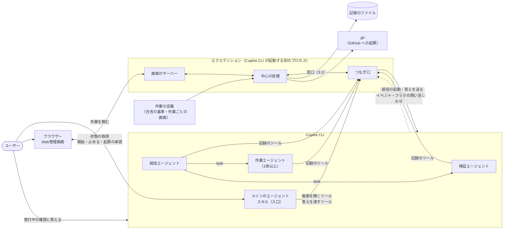
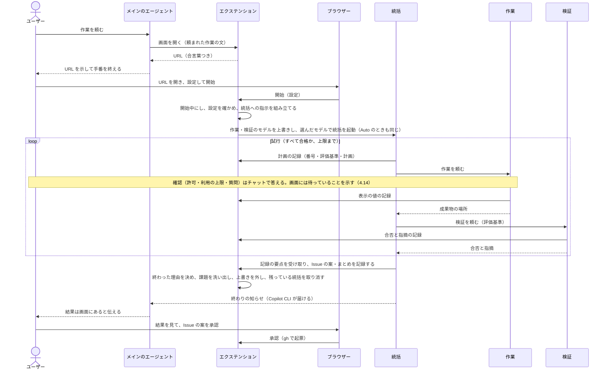
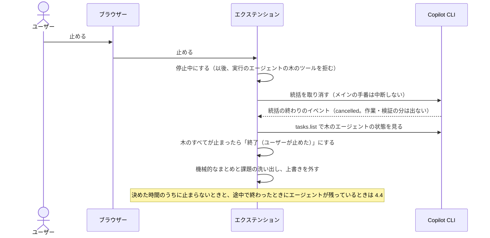
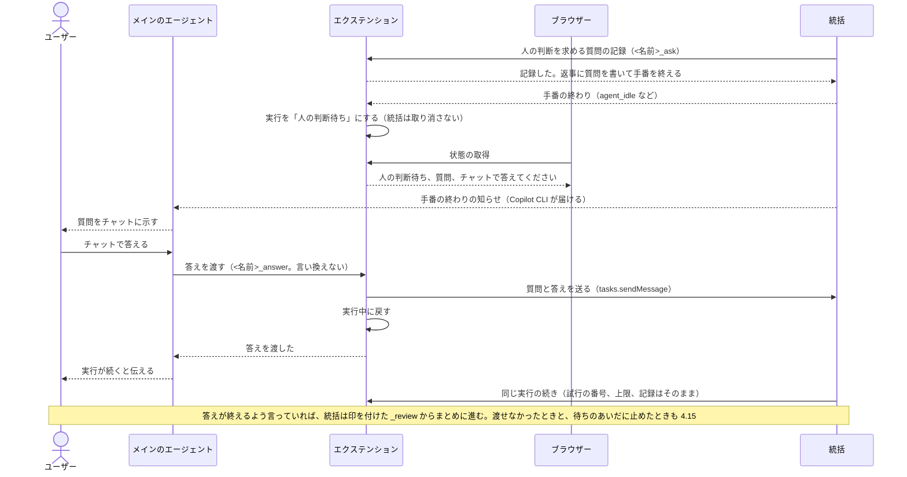
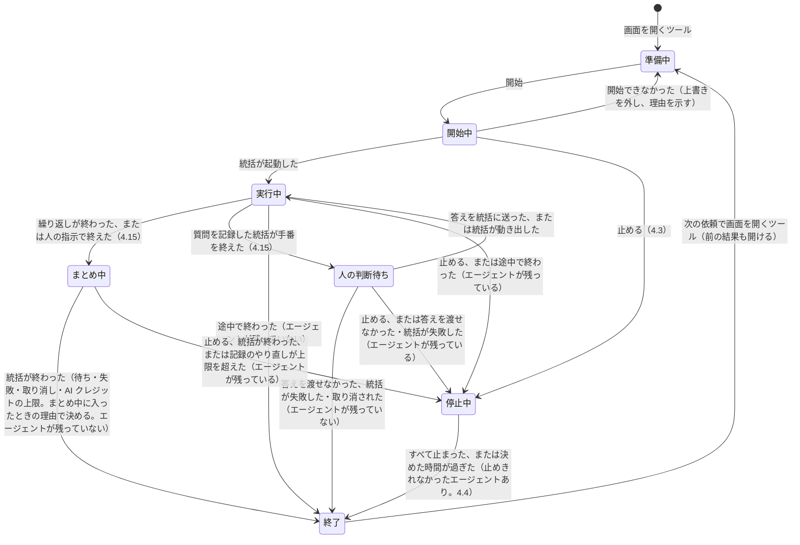

# 生成プラグインの構造

生成プラグインがどんな部品でできていて、どう動くかを示す。中心は、どの生成プラグインにも共通する「土台」（ひな形の共通部分。憲章 第15条2項）である。仕様は [出力の要件](../specs/output-requirements.md) にある。クリエイターがこの構造をどう作るかは [クリエイターの構造](creator-structure.md)、どう試験するかは [試験の設計](testing.md) にある。

## 1. 範囲

| 区分 | 中身 | 書く人 |
| --- | --- | --- |
| 土台 | Web管理画面とその仕組み、エージェントの決まった手順、記録と課題の洗い出し、Issue の起票 | クリエイターのひな形 |
| 作業ごとの部分 | 作業の手順とナレッジ、合否の基準、作業ごとの画面の定義、作業ごとのスクリプトや MCP サーバー | クリエイターの作業エージェント（[クリエイターの構造](creator-structure.md) 3.1） |

この設計書では、土台の作りと、作業ごとの部分を入れる場所と形を定める。

## 2. 設計で重視すること

ユーザーがこれまでに経験した失敗（ナレッジ「ハーネスエンジニアリングの目的と人間の役割」）が起きないことを、具体的な場面で決め、それぞれを満たす決定に結び付ける。重視することごとに、こうなれば満たす場面と、要件、決定を示す。

- **開始で確実に動き出す**（要件：REQ-005。決定：4.3）
  - 画面で開始を押すと、チャットで何もしなくても統括エージェントが動き出し、画面が「実行中」になる。
  - 2回押しても、起動が時間切れになった後に遅れて起動しても、動く統括は1体だけ。
- **確認はチャットで答え、待ちは画面で分かる**（要件：REQ-005。決定：4.14）
  - 設定・開始・監視・結果確認・起票の承認は、画面だけで行える。
  - この実行のエージェントがツールの許可、利用の上限の確認、質問を求めると、画面に「チャットで確認を待っています」と、何の確認かが出る。答えはチャットで行い、答えが出ると画面の待ちが消える。
  - ユーザーがチャットでしているほかの作業の確認は、画面に出ない。
- **すぐ止まる**（要件：REQ-009。決定：4.4）
  - 止めるを押すと、この実行のエージェントが取り消され、その後この実行のエージェントはツールを使えない。
  - チャットでのほかの作業は巻き込まない。
  - 止まったことを確かめてから、押してから10秒のうちに、画面が「終了（ユーザーが止めた）」になる。
  - 決めた時間のうちに止まらないエージェントが残ったら、そのエージェントと止め方を示し、「止めきれなかったエージェントあり」と分けて示し、そのエージェントのツールを拒み続ける。
- **表示が実際とずれない**（要件：REQ-008。決定：4.5、4.14）
  - エージェントの開始・終了・失敗・確認の待ちが、再読み込みなしで約1秒のうちに画面に出る。
  - 終わったエージェントが「実行中」のまま残らない。
- **人の判断を待っても、同じ実行が続く**（要件：REQ-051。決定：4.15）
  - 統括が人に質問して手番を終えても、実行は終わらず、画面に「人の判断待ち」と質問が出る。
  - ユーザーがチャットで答えると、答えが言い換えられずに同じ統括に届き、試行の番号も上限も記録も、同じ実行のまま続く。
  - 待っているあいだも、止めるで止まる。待っていた時間は、詰まりの課題にならない。
- **途中で切れても残らない**（要件：REQ-008、REQ-012。決定：4.13、6.5）
  - `/clear` でエクステンションが読み込み直されても、前の実行が「実行中」のまま残らず、次に画面を開いたときに「途中で終わった（途中で切れた）」と示される。
  - 実行中は `/clear` しないことが、画面とチャットに示される。
  - ほかのセッションで動いている実行は巻き込まない。
- **サーバーが残らない・ぶつからない**（要件：REQ-029。決定：4.2）
  - いつもの番号が使われていても起動する。
  - Copilot CLI を終えると、異常終了でもサーバーのプロセスが残らない。
- **手元だけで開ける**（要件：REQ-006。決定：4.2、6.3）
  - ほかのマシンからも、同じマシンのほかの Web ページからも、エージェントが作ったファイルの中のスクリプトからも、開始・停止・起票を送れない。
- **費用の低いモデルでも同じ画面**（要件：REQ-028、REQ-030、REQ-031。決定：4.9、4.16）
  - 作業ごとの画面は、AI が決まった形の定義を書くだけでできる。
  - 見た目と動きは土台が決める。見た目は、AI が作ったと分かる画面の癖を避けた「設計図風」で、書体は同梱する（4.16）。
- **作ることと判定することが混ざらない**（要件：REQ-010、REQ-011。決定：4.7、4.8）
  - 検証エージェントは成果物を書き換えられない。
  - ユーザーと確かめた基準は、評価基準から外せない。
- **Copilot CLI がなくても土台を試せる**（要件：REQ-039、REQ-042。決定：3.2）
  - 偽物のつなぎ口（3.2）で画面と中心の処理を、偽物の Copilot SDK のセッションでつなぎ口を、試験できる。

## 3. 全体の構成

### 3.1 部品のつながり

- エクステンションは、Copilot CLI がセッションの始めに別のプロセスとして起動する Node.js のプログラムである。ツールとフックの登録、イベントの受け取り、エージェントの起動と取り消しができる（4.1）。
- 統括・作業・検証は、どれもカスタムエージェント（サブエージェント）である。
- メインのエージェントは、作業の依頼を受け取って画面を示すだけで、作業には加わらない（4.7）。
- メインのエージェントは、ユーザーの依頼を受け付ける Copilot CLI のチャットの相手で、憲章 第19条の構成（統括1体・作業1体以上・検証1体）には数えない。
- 実行中にエージェントが求める確認（許可、利用の上限、質問）には、ユーザーがチャットで答える。エクステンションは確認に答えず、待っていることを画面に示すだけである（4.14）。
- 統括が人の判断を求める質問（REQ-051）にも、ユーザーはチャットで答える。メインのエージェントが、答えを渡すツールでエクステンションに渡し、エクステンションが待っている統括に送る（4.15）。

### 3.2 エクステンションの中の分け方

エクステンションの中を3つに分ける。Copilot CLI に依る部分を薄くし、それ以外を Copilot CLI なしで試せるようにするためである。

| 部分 | 役割 | Copilot CLI への依存 |
| --- | --- | --- |
| つなぎ口 | 起動したときに、記録のツールとフックと、見るためだけの許可の求めの受け口（4.14）を登録する。入口の `extension.mjs`（SDK を読み込んで渡すだけ）と、つなぎの関数の `adapter.mjs` の2つのファイルにする | Copilot SDK（Copilot CLI をプログラムから操作する公式の部品。以下 SDK）だけを使う |
| | Copilot CLI のイベント、ツールの呼び出し、フックの問い合わせを、中立のイベント（Copilot CLI に依らない形のイベント。下の窓口の表）に直して中心の処理に渡す | |
| | 中心の処理の頼みを、Copilot CLI の呼び出しに直す | |
| 中心の処理 | 実行の状態、決まりの確かめ（基準、上限、呼んだエージェント）、終わった理由、課題の洗い出し、記録、起票 | なし |
| 画面 | 画面のサーバーと、HTML・CSS・JavaScript の画面。共通の描画の部品で、作業ごとの画面の定義を出す | なし |

中心の処理とつなぎ口は、次の窓口でだけやり取りする。

| 向き | 窓口 | つなぎ口が使う Copilot CLI の機能 |
| --- | --- | --- |
| 中心 → つなぎ口 | 統括を起動する | `session.rpc.tasks.startAgent` |
| | エージェントを取り消す／動いているエージェントの一覧 | `session.rpc.tasks.cancel`、`session.rpc.tasks.list` |
| | 待っている統括に、続きのメッセージを送る（送れたかを返す。4.15） | `session.rpc.tasks.sendMessage` |
| | サブエージェントのモデルと思考の深さを上書きする／外す | `session.rpc.tools.updateSubagentSettings` |
| | 今のモデルと、選べるモデルの一覧を返す | `session.rpc.model.getCurrent`、`session.rpc.model.list` |
| | チャットに書く | `session.log` |
| つなぎ口 → 中心 | 中立のイベント：エージェントの開始・設定・終わり（最後の返事、取り消されたか）・失敗 | `subagent.started`、`subagent.configured`、`subagent.completed`（`cancelled`）、`subagent.failed`、フック `onSubagentStop` の `response` |
| | 中立のイベント：ツールの開始（引数つき）・終わり | `tool.execution_start`、`tool.execution_complete` |
| | 中立のイベント：確認の待ち（許可の求め、返事の待ち、利用の上限の待ち。エージェントの番号と、何の確認かつき。4.14） | `permission.requested`（見るためだけに登録した `onPermissionRequest` があるときに届く。11章 #21）、`user_input.requested`、`session_limits_exhausted.requested` |
| | 中立のイベント：待ちの終わり（`requestId` つき。答えが出ると届く。許可は確かめた。ほかは要確認、11章 #21） | `permission.completed`、`user_input.completed`、`session_limits_exhausted.completed` |
| | 中立のイベント：エージェントが手番を終えて待ちに入った（エージェントの番号と、最後の返事つき） | `system.notification`（`data.kind.type` が `agent_idle`。11章 #19）、フック `onSubagentStop` の `response` |
| | 記録のツールが呼ばれた（呼んだエージェントの番号つき） | ツールの登録（`ToolInvocation.agentId`） |
| | ツールを使ってよいかを問う（エージェントの番号と親の番号つき） | フック `onPreToolUse` |

- 実機で分かったイベントの届き方と、つなぎ口の補い方は次のとおりである。
  - ツールの終わりのイベントには、ツールの名前がない。つなぎ口が、開始のイベントで覚えた名前で補う。
  - ツールの開始のイベントには、引数を付けて中心の処理に渡す。同じツールを同じ引数で繰り返した跡を、課題にするためである（4.10）。
  - エージェントの開始のイベントの種類は、`<プラグイン>:<エージェント>` の形で届く。
  - 親の番号は、エージェントの開始のイベントにあり、`tasks.list` にはない。つなぎ口は開始のイベントで覚えるので、エクステンションが起動し直した直後は、それより前に始まったエージェントの親の番号が分からない。
  - エージェントの開始のイベントの `model` は、Copilot CLI では付くが、開発の試験の Agent SDK では始まりの時点で分からず、あとの設定のイベント（`subagent.configured`）で届く。そのため、始まりの `model` は省かれることがあるものとして扱う。
  - エージェントの最後の返事は、フック `onSubagentStop` から取る。
  - 統括が2回目からの手番を終えたとき（4.15）は、`subagent.completed` が出ず、`agent_idle` だけが出る。そのため、覚えた最後の返事は、`agent_idle` のイベントにも付けて渡す（11章 #19）。
  - 画面の「担当」（4.5）に出す説明は、統括の `task` の呼び出しの開始のイベントの引数 `description` を覚えておき、エージェントの開始のイベントに付く呼び出しの番号（`toolCallId`）で結んで取る。エージェントの開始のイベントの表示名は `worker`・`verifier` のような短い名前で、説明ではない。
- 選べるモデルの一覧は `session.rpc.model.list()` で取る。`rpc.models.list` はクライアントの窓口で、エクステンションの公開の API からは呼べない。返り値の要素の形は、型で決まっていない（11章 #10）。
- 試験では、つなぎ口を偽物に差し替えて、中心の処理と画面を動かす。つなぎ口そのものは、偽物の Copilot SDK のセッションを `adapter.mjs` に渡して試す（偽物は `tests/stage2/adapter/` にある）。偽物は生成プラグインのテストのフォルダに置き、プラグイン本体には試験のためだけの機能を入れない。
- 開発の試験（Claude Code で行う）では、試験の仕組みが Agent SDK 用のつなぎ口を持ち、同じ中心の処理と画面を動かす（[試験の設計](testing.md) 4章）。

### 3.3 どこで動くか

| 部品 | 動く場所 | 起動 | 終了 | サンドボックス（4.12） |
| --- | --- | --- | --- | --- |
| メイン・統括・作業・検証のエージェント | Copilot CLI のプロセス | ユーザーの依頼、開始ボタン | 手番（エージェントが返事をし終えるまでのひと区切り）の終わり、取り消し | エージェントが動かすコマンドは中 |
| エクステンション（画面のサーバーを含む） | Copilot CLI が起動する別のプロセス | セッションの始めと `/clear` のとき、同じセッションのまま起動し直されたとき（エージェントによる `extensions_reload`、`/extensions mode` の切り替え。4.13）。サーバーは画面を開くツールが初めて呼ばれたとき | Copilot CLI の終了と `/clear` のとき、起動し直されるとき（4.2、4.13） | 外の見込み（要確認） |
| 画面 | ユーザーのブラウザー | URL を開いたとき | タブを閉じたとき | 対象外 |
| gh | エクステンションが起動する短い子プロセス | 承認ボタン | 起票が終わったとき、時間の上限で止めたとき（4.11） | エクステンションと同じ |

### 3.4 部品と要件

| 部品 | 置き場所（例） | 役割 | 書く人 | 対応する要件 |
| --- | --- | --- | --- | --- |
| マニフェストと README | `plugin.json`、`README.md` | Agent Plugins の形式の名前・版・説明・リポジトリ。README は使う人に向けた説明で、初めに「できること」と「使い方」を置く（4.9）。その後に、試験的機能の有効にしかた〔初めては `copilot --experimental` で起動、起動した後なら `/settings experimental on`〕と、読み込みのときの確認（4.1）、任せたいツールを前もって許可するしかた（4.14）を書く | ひな形と組み立て、「できること」と「使い方」の作業ごとの文は作業エージェント | REQ-004、REQ-005、REQ-014、REQ-050 |
| スキル（入口） | `skills/<名前>/SKILL.md` | メインのエージェントの手順（4.7、4.15） | 手順はひな形、description はクリエイターのメインのエージェント、作業の説明は作業エージェント | REQ-004、REQ-005、REQ-008、REQ-051 |
| 統括エージェント | `com.github.copilot/agents/orchestrator.agent.md` | 計画・実行・評価の繰り返し、人の判断待ち（4.15）、振り返り | 手順はひな形、作業ごとの指示とナレッジは作業エージェント | REQ-010、REQ-011、REQ-013、REQ-051 |
| 作業エージェント | `com.github.copilot/agents/worker.agent.md`（1つ以上） | 成果物を作る | 作業エージェント（ひな形の決まりつき） | REQ-010 |
| 検証エージェント | `com.github.copilot/agents/verifier.agent.md` | 評価基準ごとの合否と指摘 | 手順はひな形、作業ごとの見方は作業エージェント | REQ-010、REQ-011 |
| つなぎ口 | `com.github.copilot/extensions/<名前>/extension.mjs`（入口）、同じフォルダの `adapter.mjs` | 3.2 | ひな形 | REQ-005、REQ-007〜REQ-009、REQ-029、REQ-051 |
| 中心の処理 | 同じフォルダの `core/` | 3.2 | ひな形 | REQ-005〜REQ-014、REQ-051 |
| 画面 | 同じフォルダの `ui/` | 3.2 | ひな形 | REQ-005〜REQ-008、REQ-012〜REQ-014、REQ-025、REQ-030、REQ-031、REQ-051 |
| 作業の定義 | 同じフォルダの `task.json` | 合否の基準、作業ごとの画面、繰り返しの上限の既定（6.4） | 作業エージェント | REQ-007、REQ-011、REQ-031、REQ-038 |
| 作業ごとの部品 | `mcp.json`、`scripts/` など | 作業に要るスクリプトや MCP サーバー | 作業エージェント | 作業ごと |
| 憲章・仕様書・設計書 | `docs/` | 生成プラグインを保守するための文書 | 共通部分はひな形、作業ごとの部分は作業エージェント | REQ-001〜REQ-003 |
| テスト | `tests/` | 1・2段目の入口、偽物のつなぎ口と偽物の Copilot SDK のセッション、ナレッジの一覧、EVAL の課題 | ひな形と組み立て、EVAL の課題は作業エージェント | REQ-001、REQ-039、REQ-042 |

## 4. 設計の決定

### 4.1 画面と Copilot CLI のつなぎ方

- 決めたこと：Web管理画面は、生成プラグインに入れたエクステンション（`com.github.copilot/extensions/<名前>/extension.mjs`）で動かす。
- 理由：開始で動き出す、すぐ止まる、Copilot CLI の終了でサーバーも終わる、の3つを1つの公式の部品で満たせるのは、エクステンションだけである。
- 引き換えになること：
  - Copilot CLI 1.0.102 でも試験的な機能で、ユーザーが試験的機能を有効にする必要がある（有効にしないと、エクステンションのツールが載らない）。初めて使うときは `copilot --experimental` で起動する。一度付ければ設定に残り、次からは付けなくてよい。起動した後なら `/settings experimental on` で有効にでき、Copilot CLI が自動で起動し直す（今の会話は終わる）。`/experimental on` も動くが、非推奨である。Copilot CLI の更新で使い方が変わることがある。
  - また、エクステンションは確認を省くツール（4.14）とフック（4.4）を登録し、許可の求めを見る（4.14）。そのため、Copilot CLI は読み込みのときに、これらを許すかの確認（`kind` が `extension-permission-access`）をチャットに出す。確認の文は「This extension wants to: skip tool permission prompts, register hooks, handle permission requests. Denying will prevent this extension from loading.」の形で、断るとエクステンションは読み込まれない（確かめた、11章 #1・#21）。
  - 確認の題は `Extension "plugin:<プラグイン>:<フォルダ>" wants elevated permissions` の形である。
  - 確認の選択肢は「Yes」「Yes, and always allow "<名前>" in this directory」「No (Esc)」である。作業フォルダが Git のリポジトリのときは、「always allow」の文が `in this repo (<場所>)`（このリポジトリでは常に許可）になる。フォルダの場所が分からないときは、「always allow」の代わりに `Yes, and don't ask again for "…" this session` が出る作りである（Copilot CLI のコードの文字列。実機では出せていない）。
  - 「Yes」だと、Copilot CLI を起動するたびと `/clear` のたびに出る。「always allow」（このフォルダでは常に許可）だと、その作業フォルダについて `permissions-config.json` に残り、次から出ない（`/clear` の後も、起動し直しても）。ほかのフォルダでは、また出る。初めての起動では、フォルダーの信頼の確認の後にセッションが作り直され、確認が2回出た。起動し直した後も、確認が続けて2回出ることがある（確かめた、11章 #1）。
  - Copilot CLI 1.0.101 から、Assisted の許可を使っていても、この確認は必ず人に出る。
  - README と入口のスキルで、この確認の意味と、許可する理由と、2つの選び方とその違い（「Yes」は毎回出る、「always allow」はそのフォルダでは次から出ない）を示す（REQ-004、クリエイターは REQ-023）。確認の意味は、記録のツールが確認なしで画面の状態だけを書く、止めたエージェントのツールを拒む、許可の求めを見るだけで答えない、である。許可する理由は、許可しないと画面で開始も監視もできない、である。
  - エクステンションのツールがないとき、メインのエージェントは、試験的機能を有効にしていない、確認を断った、`/extensions mode` が Disabled になっている、のどれかとして直し方を示して止まる（4.7、REQ-004）。

| 代案 | 採らなかった理由 |
| --- | --- |
| フックとシェルのコマンド | エージェントを取り消せず、ツールを拒むことしかできない |
| | 開始を、AI がコマンドを繰り返し実行することに頼る |
| | 既定の設定のサンドボックスでは、Linux でフックから画面のサーバーに届かない（サンドボックスの既定は、1.0.100 からローカルネットワークを許すようになったので、この理由は確かめ直す。4.12） |
| MCP サーバーの中で画面を動かす | ツールの呼び出しは既定で30秒で時間切れになる |
| | サンドボックスを有効にすると、既定でその中で動く（サンドボックス自体は既定でオフ） |
| | セッションにメッセージを送る手段が、公式の資料に見当たらない |
| canvas（エクステンションが出す画面の窓） | エクステンションの一部で、これも試験的である |
| | GUI（窓やボタンで操作する画面）のない環境では、OS の窓（ブラウザーではない、パソコンの画面に直接開く窓）が開かず、URL を示すだけになる |
| | 将来、ブラウザーの代わりに使える |

- 実行環境：
  - エクステンションは JavaScript で、`import` で部品を読み込む書き方（ES モジュール）で書く。
  - Copilot CLI 1.0.98 のプログラムでは、エクステンションを Copilot CLI 自身の実行ファイルで起動する（`cli-main.js` の `launcherProgram: process.execPath`）。起動された側は、起動用の `extension_bootstrap.mjs` を受け取ると自分でそれを読み込む（`index.js`）。更新履歴 1.0.55 にも「CLI を1つの実行ファイルとして動かすときも、エクステンションが正しく起動する」とある。そのため、ユーザーは Node.js を別に入れなくてよい。実機でも、エクステンションは Copilot CLI の実行ファイルで動いた（`process.execPath` が copilot の実行ファイル。11章 #2）。ただし、確かめたマシンには Node.js も入っていた。
  - 画面は素の HTML・CSS・JavaScript で、組み立ての手順（ビルド）も外部の配信元（CDN）も使わない。手元だけで、毎回同じに動かすためである。

### 4.2 画面のサーバー

- エクステンションと同じプロセスで動かし、子プロセスを作らない。エクステンションと一緒に終わるので、Copilot CLI を終えるとサーバーも終わる（REQ-029）。
  - Copilot CLI は終了時にエクステンションを止める（終了の合図、5秒後に強制終了）。
  - 異常終了でも、エクステンションは親のプロセスがいなくなったことを約1秒で見つけて終わる（要確認、11章 #17）。
- 待ち受けるのは 127.0.0.1 だけにする（REQ-006）。番号は土台の既定を使い、ほかのプログラムに使われていたら、OS に空いている番号を選ばせる。
- 起動ごとに乱数の合言葉を作り、画面の URL に入れる（例：`http://127.0.0.1:8731/?k=<合言葉>`）。
  - 画面は、サーバーへの問い合わせのたびに合言葉を付け、サーバーは合言葉がない問い合わせを断る。
  - あわせて、問い合わせ先の名前（Host）が 127.0.0.1 か localhost で、番号が合っていることを確かめる。
  - ユーザーのブラウザーで開いているほかの Web ページから、手元のサーバーに開始・停止・起票を送られないようにするためである。
  - 代案の「合言葉なし（127.0.0.1 だけ）」は、同じマシンのほかの Web ページから開始や起票を送られるので採らない。
  - 「ログインの画面」は、1人が手元で使うには手間が多く、URL を開くだけで使えなくなるので採らない。
- 1つのセッションでは、同時に1つの実行だけを扱う。
  - 実行中に画面を開くツールがまた呼ばれたら、新しく始めず、頼みの文は受け付けない。返すのは、今の画面の URL と、「いまの実行が終わるまで新しい作業は始められません」という知らせと、ユーザーに伝えること（実行中は `/clear` しない、確認はチャットで答える）である。メインのエージェントが、実行中であることを見分けられるようにするためである。終わった後に呼ばれたら、新しい実行の準備に戻す。
  - 準備中の画面からも、前の実行の結果と、承認していない Issue の案を開ける（記録のファイルの `result.json` と起票の印から出す。6.5）。
  - 前の実行は、同じセッションの最後の実行に限る（同じセッションの実行がなければ、同じ作業フォルダの最後の実行）。エクステンションが起動したときに「途中で切れた」とした実行（4.13）を示すのも、この範囲に限る。

### 4.3 開始

- 開始ボタンを押すと、中心の処理は実行を「開始中」にし、設定を確かめる（必須の項目、上限の回数が1以上、選んだモデルと思考の深さが選択肢にあるか）。つなぎ口が次を行う。
  1. 作業・検証のモデルと、エージェントごとに選んだ思考の深さ（統括を含む。4.6）を、このセッションに限って上書きする（`updateSubagentSettings`）。キーは `<プラグイン>:<エージェント>` の形である（確かめた、11章 #5）。
  2. 統括を、選んだモデルで、裏で動くエージェントとして起動する（`tasks.startAgent`）。`agentType` は `<プラグイン>:<エージェント>` の形である。渡す名前（`name`。`tasks.list` の `displayName` に出る）に実行の番号を入れる。結果の番号（`agentId`）は、イベントの `agentId` と同じで、実行のエージェントの木の根にする（4.4）。統括は選んだモデルで動く（`modelSelectionSource` が `explicit_override`。確かめた、11章 #4）。
- Copilot CLI のモデルが Auto のときも、同じ手順で行う（4.6）。
- 起動できたら「実行中」にする。
- 失敗したとき（使えないモデル、時間切れなど。6.1）は、上書きを外し（4.6）、「準備中」に戻して理由を画面に示す。ユーザーは設定を変えて、もう一度開始できる。
- 時間切れのときは、起動したかが分からない。
  - そこで、準備中に戻す前に `tasks.list` でその名前のエージェントを探し、見つかれば取り消して、拒む一覧（4.4）に入れる。
  - 見つからなくても、その実行は「開始できなかった（起動したかは分からない）」として記録に残す。
  - その後に届いた、どの実行の根でもない統括の `subagent.started` も、取り消して拒む一覧に入れる。遅れて起動した統括が、画面に出ないまま動き続けないためである。
- 開始の処理は、今のモデルの取得、上書き、起動が、それぞれ待ち時間の上限（10秒。6.1）つきで続くので、全体では最大約30秒かかりうる。全体の上限は置かない。
- 開始ボタンは、押すとすぐに押せなくなる。開始中か実行中に届いた開始は断るので、統括は1体だけ起動する。
- 開始中に止めるが届いたときは、押してから10秒のうちに終了の表示にする（REQ-009）ため、次のとおりにする（6.1）。
  - 止めるは届いた時点で受け付けて、実行を「停止中」にし、画面にすぐ出す。
  - 開始の処理は、Copilot CLI の呼び出しを待つたびに止めるが届いていないかを見る。届いていたら待ちを打ち切り、上の時間切れの扱い（`tasks.list` で名前から統括を探して取り消し、拒む一覧に入れる）に進む。
  - 止まっていないと決めるまでの時間（8秒。4.4）は、止めるを押した時点から数える。
- 統括への指示文は、中心の処理が決まった形で組み立てる。中身は、頼まれた作業の文、繰り返しの上限、作業ごとの設定の値、ユーザーと確かめた合否の基準（作業の定義から、番号と文をそのまま）である。
  - 指示文の先頭には、「あなたの定義の手順で、この実行を進めてください。成果物は作業エージェントに、確かめは検証エージェントに、`task` で頼みます。」の1文を置く。Copilot CLI 1.0.102 は、サブエージェントに「親の仕事は自分で終わらせる」という指示を足す（4.7）ので、親の文が任せることをはっきり求めていないと、統括の定義と食い違うためである。
  - 頼まれた作業の文と合否の基準が食い違うときは、基準を優先する。統括は、頼まれた作業の文の食い違う部分を使わないことを、計画とまとめに書き、画面で見せる（4.8）。基準を変えたいときは、ユーザーが生成プラグインを直す。
- 代案の「メインのエージェントにメッセージを送って、統括を呼ばせる（`session.send`）」は、動き出すかが AI の判断に頼り、統括のモデルを画面で選べない（REQ-007）ので採らない。
- 「メインのエージェント自身が統括になる」は、プラグインからメインのエージェントのモデルを決められず（[クリエイターの構造](creator-structure.md) 3.2）、統括のモデルを画面で選べないので採らない。

### 4.4 止める

- 止める範囲は、この実行のエージェント（統括と、その下の作業・検証）だけにする（REQ-009）。メインのエージェントの手番は中断しない。ユーザーがチャットでしているほかの作業を巻き込まないためである。
- 中心の処理は、イベントとフックの入力から、実行のエージェントの木を持つ。根は統括の番号（4.3）で、親の番号（`parentAgentId`）が木に入るエージェントを、その下に足していく。木に入れたエージェントの番号は、記録のファイルにも書く（6.5）。
- 止めるボタンを押すと、中心の処理は実行を「停止中」にし、つなぎ口が統括を取り消す（`tasks.cancel`）。開始中に押されたときの扱いは 4.3 にある。
  - 統括を取り消すと、統括の下の作業・検証と、作業が動かしていたシェルの処理まで止まる。呼び出しはすぐ返り、`tasks.list` ではすべて `cancelled` になる（確かめた、11章 #6）。
- 中心の処理が実行を終えると決めた時点で、まだ動いているエージェントがあれば、止めると同じ手順を通す。
  - 終えると決めた時点とは、途中で終わったとき、まとめ中に統括が終わったとき、記録のやり直しが上限を超えたとき、人の答えを統括に渡せなかったときである（4.8、4.15、6.1）。
  - 手順は、停止中にする → 木を取り消す → 木のツールを拒む → 止まったのを確かめて終了にする、である。止めきれなければ、下の止めきれなかったときの扱いにする。
  - 実行が終わった後に待ち（idle）で残った統括の取り消しは 6.1 にある。
- 何を拒むか：エクステンションのフック（ツールを使う前に呼ばれる `onPreToolUse`）で、入力のエージェントの番号（`agentId`）が拒む一覧に入るツールの使用だけを拒む。
  - ほかのエージェントのツールは拒まないので、拒むのをやめる処理は要らない。止まらないエージェントが残っても、ユーザーはほかの作業を続けられる。
  - 同じフックで、統括が使ってよいツールの一覧（4.7）にないツールも拒む。拒む順は、止めた実行（拒む一覧）が先で、次に統括の一覧である。拒む理由の文は、両者で違う（止めた実行は「作業を終えてください」、統括は「作業エージェントに頼んでください」の向き）ので、順を決めておく。中心の処理が失敗しても、統括の拒みは効かせる。
  - フックは、統括と作業のツールの前にも呼ばれ、入力に `agentId`・`agentType`・`parentAgentId` が入る。拒んだツールは「Denied by preToolUse hook」で失敗し、チャットの許可の確認は出ない（確かめた、11章 #13）。
- 拒む一覧の中身：このセッションの、終わったすべての実行の木を合わせたもの（終わった理由で分けない）である。停止中にした時点か実行が終わった時点で、その実行の木を入れ、親の番号が一覧に入るエージェントも足していく。エクステンションが起動したときの作り直しは 6.5 にある。
- フックは安全網であり、頼り切らない。
  - コマンドのフック（公式の記述）：時間切れは通す側に倒れ（公式のフックの説明、更新履歴 1.0.67）、エラーのときは拒む側に倒れる（同、更新履歴 1.0.57）。
  - エクステンションのフック（確かめた、11章 #13）：関数が例外を投げると、拒まずに進む（いつもの許可の確認が出る）。時間切れはなく、150秒かかっても Copilot CLI は返るまで待った。
  - そのため、フックの関数は例外を投げない作りにし、すぐ返す（拒む一覧を引くだけにする）。中で失敗したときも、そのエージェントが拒む一覧に入っていれば拒む。
  - 組織の設定（`allowManagedHooksOnly`）で止められることもある（更新履歴 1.0.85）。
- 統括の `subagent.completed`（`cancelled`）と、`tasks.list` の木のエージェントの状態で、木のすべてが止まったことを確かめたら、実行を終了にする（終わった理由は 4.8）。取り消しのとき、統括の下の作業・検証の終わりのイベントは出ないので、イベントだけで木のすべての終わりを待たない（11章 #6）。
  - 決めた時間（止めるを押してから8秒）のうちに終わりを確かめられないエージェントや、取り消しの呼び出しが時間切れになったエージェント（6.1）は、画面に「止まっていないエージェント」として示す。あわせて、止め方（チャットで Esc を2回押す、または Copilot CLI を終える）を案内する（REQ-009）。
  - 決めた時間を8秒にするのは、画面の取り直しの間隔（1秒。4.5）を足しても、押してから10秒のうちに画面が終了の表示になる（REQ-009）ためである。
  - そのうえで、終わった理由に「止めきれなかったエージェントあり」を添え、ふつうの終わり方と分けて示す（REQ-012）。止めた後に作業を続けるエージェントがないことを満たせなかったと、ユーザーが分かるようにするためである。
  - 止めきれなかったエージェントが残っていても、次の開始はできる。古いエージェントのツールは拒み続け、画面には残っていることを示す。
- チャットで確認を待っていた作業も取り消しで止まるが、チャットの確認は残る。残った確認に「Yes」と答えても、ツールは動かなかった（確かめた、11章 #6）。画面の終了の表示と README で、「チャットに残った確認は、どちらで答えても動きません」と示す。
- 作業エージェントがそのまま待つシェルの処理は、取り消しで止まる（確かめた、11章 #6・#14）。裏に回したシェル（`detach` したもの）は残ることがある（rpc.d.ts の `cancelAllBackgroundAgents` の説明に、裏に回したシェルは残るとある）。残るかと、残った処理を止める手段は要確認（11章 #14）。止めても止まらなかったエージェントは、課題の一覧に入れる（4.10）。シェルの処理は課題にしない。中心の処理が受け取る動いているものの一覧は、つなぎ口が `tasks.list` からエージェントだけを取り出したものだからである。
- 代案の「セッション全体を止める（裏のエージェントをすべて取り消し、メインの手番も中断する）」は、実行と関係のない裏の作業や、ユーザーのチャットまで止めるので採らない。
- 「フックでツールを拒むだけにする」は、エージェントが次にツールを使うときにしか効かず、フックが失敗すると通す側に倒れるので採らない。

### 4.5 状態の届け方

- つなぎ口は、中立のイベント（3.2）を中心の処理に渡す。サブエージェントの中で起きたイベントには、そのエージェントの番号が付く。中心の処理は、イベントからエージェントごとの状態（6.1）、担当している作業（統括が `task` を呼んだときの引数 `description`。結び方は 3.2）、使っているモデル、最後に動いた時刻を作る。
- 画面のエージェントの枠は、役割ごとに決まった数で出す（統括1、作業は定義の数、検証1）。試行ごとに起動し直したエージェントは、同じ枠の中で入れ替わる。起動ごとの履歴は、結果の試行ごとの表に出す。
- 計画・実行・評価のどれかは、動いているエージェントで決める。検証が動いていれば評価、作業が動いていれば実行、そのどちらでもなく統括が動いていれば計画とする。AI の申告に頼らないので、表示が実際とずれない。今が何回目の試行かは、統括の計画の記録（4.8）で決める。
- エージェント間のデータの受け渡しの図は、構成が決まっているので土台が描く（統括 → 作業 → 統括 → 検証 → 統括）。今まさに受け渡しているところを、動いているエージェントから強調する。
- 画面は、1秒ごとにサーバーから状態の全体を取り直す。
  - 状態は小さく、全体を取り直せば、取り逃しも、つなぎ直しの処理も要らない。
  - 状態の全体に入れる返事は要約だけにし、全文は、ユーザーが開いたときに別の窓口で取る（6.3）。
  - サーバーにつながらなくなったら（Copilot CLI を終えたときなど）、画面にそう示す。
  - 実行中は、`/clear` しないこと（4.13）も画面に示す。
- 代案の「サーバーから変化を送り続ける（SSE）」は、届くのは速いが、つなぎ直しと取り逃しの処理が要り、表示が止まる失敗の元になるので採らない。1秒の遅れは、人が見て監督するには十分短い。
- 「統括にフェーズを申告させる」は、AI が申告を忘れると表示が実際とずれるので採らない。

### 4.6 役割ごとのモデルと、エージェントごとの思考の深さ

- 統括は起動時のモデルの指定（4.3）、作業と検証はセッションに限った上書きで、画面で選んだモデルを効かせる。上書きは `settings.json` には書かれず、`/clear` の後は効かなくなる（確かめた、11章 #5）。
- 実行が終わったら、上書きを外す（`null` を渡す）。
  - 今の上書きの値を読む窓口が見当たらず、設定はまとめて置き換わる恐れがある（rpc.d.ts の `SubagentSettings`、`UpdateSubagentSettingsRequest`）。そのため、前の値には戻さない。
  - 外すと、このセッションのほかのサブエージェントの上書きも消えるので、そのことを開始前の設定に示す（11章 #5）。
- 役割ごとの既定は、エージェントの定義の `model`（優先する順のリスト）の1か所にだけ書き、画面の初めの値はそこから読む。
  - 統括と検証は思考力の高いモデル、作業は費用の低いモデルである。上書きが効かないときの備えにもなる。
  - 選択肢は、選べるモデルの一覧（`session.rpc.model.list()`。3.2）から出す。返り値の要素の形は型で決まっていないので、要確認とする（11章 #10）。
- 定義の書き方は、公式と実装で食い違う。
  - 今の公式のコマンドリファレンス（Custom agent frontmatter fields）は、`model` を1つのモデル、優先する順のリストを `models`、方針を `modelPolicy` としている。
  - Copilot CLI 1.0.98 の実装は、`model` にリストを受け付ける（runtime.node の文字列 "Expected a non-empty list of model names"、組み込みの `definitions/explore.agent.yaml` が `model: [..]`）。方針の項目は `model-policy` である。
  - `model` のリストは、Copilot CLI 1.0.102 で効いた（先頭のモデルが使われた。11章 #18）。2番目への切り替わりは確かめていない。公式の `models`・`modelPolicy` との食い違いは、1.0.102 でも残る。
  - 設計では実機で効いた `model` のリストを使い、`models` で書いたときに効くかは要確認とする（11章 #18）。
  - 公式のリファレンスには、`reasoningEffort` と `include-custom-instructions`（4.7）も載った。
- 実行の前に、今のモデルを取得する（`model.getCurrent`）。
  - Auto のときも、役割ごとのモデルを選べるようにし、選んだモデルで統括を起動し、作業・検証の上書きもする（4.3）。
  - Auto のとき、公式に書かれているのは、サブエージェントが定義の `model` に関係なくセッションのモデルを引き継ぐことだけである。起動時の指定と上書きが効くかは要確認（11章 #7）。
  - そこで、画面に「Auto のため、役割ごとのモデルが効かないことがあります」と示す（REQ-007）。
- 実際に動いたモデル（`subagent.started` などのイベントの `model`）を、Auto のときも含めて、エージェントごとに画面に出す（REQ-007）。選んだモデルと違うときは、そのことを示し、課題の一覧にも入れる（4.10）。
- 思考の深さ（Copilot CLI の reasoning effort）は、エージェントごとに画面で選ぶ（REQ-007）。
  - 選ぶのは、統括、作業エージェントのそれぞれ（作業が2体以上なら、その数だけ）、検証である。モデルと違い、作業が2体以上でも、作業ごとに分ける。
  - 選択肢は「変えない」と、`low`・`medium`・`high`・`xhigh`・`max` である（公式のコマンドリファレンスの `--effort` の値）。初めの値は「変えない」で、上書きに入れない。
  - 「変えない」のエージェントは、定義に `reasoningEffort` があればその値、なければ親の値で動く（公式のコマンドリファレンス Custom agent frontmatter fields）。定義の `reasoningEffort` が効くことは、開発者が確かめた。
  - 効かせ方は、作業・検証のモデルと同じ上書き（`updateSubagentSettings`）で、項目は `effortLevel` である（rpc.d.ts の `SubagentSettingsEntry`、公式の設定のリファレンスの `subagents.agents`）。
  - 統括の思考の深さも、この上書きで渡す。統括の起動（`tasks.startAgent`）には、思考の深さの項目がない（Copilot CLI 1.0.103 の rpc.d.ts の `TasksStartAgentRequest`）。統括の上書きには `model` を入れないので、統括のモデルは起動時の指定のままである。
  - 公式のコマンドリファレンスは、`task` で呼んだときも直接起動したときも、`subagents` の上書きが定義の `reasoningEffort` より先に効くとしている。上書きで効くか（とくに、`tasks.startAgent` で起動した統括）は、実機で確かめていない（11章 #29）。
  - 選んだモデルが受け付けない深さは使われない。公式のコマンドリファレンスは、使えない深さは失敗にせず、セッションの値で動くとしている。更新履歴 1.0.88 も、定義の深さをモデルが受け付けないときは使わないとしている。そのことを、開始前の設定に示す。上書きの深さで同じになるかは、11章 #29 で確かめる。
  - 選択肢をモデルごとに絞らないのは、選べるモデルの一覧の要素の形が決まっていない（11章 #26）ためである。
  - 外すときは、モデルの上書きと一緒に外れる（`null`）。そのため、開始前の設定の注意の文は「モデルと思考の深さの指定も消えます」とする。

| 代案 | 採らなかった理由 |
| --- | --- |
| 統括に、`task` の呼び出しのたびにモデルを渡させる | Copilot CLI の組み込みの指示は、ユーザーが明示的に求めたときだけモデルを渡すよう AI に求めている |
| | プラグインの指示で渡すかは確かめられず、AI の判断に頼る |
| | 上書きが効かないと分かったときの代わりにする |
| エージェントの定義のファイルを書き換える | GitHub から入れたプラグインはコピーで、更新で消える（更新履歴 1.0.57。実機では確かめていない）。手元のフォルダのマーケットプレイスから入れたプラグインは、コピーされずにそのフォルダを直接読む（`live`）ので、書き換えるとユーザーの元のファイルが変わり、次のセッションで反映される |
| ユーザーの設定ファイルを書き換える | ユーザーの設定を、プラグインが勝手に変えることになる |

### 4.7 エージェントの構成

| エージェント | 置き場所 | 使えるツール | 役割 |
| --- | --- | --- | --- |
| メイン | スキル（入口） | ユーザーが選んだもの | 作業の依頼を受け取り、画面を開くツールに渡して URL を示す。統括の終わりの知らせを受けたら、結果が画面にあることを伝える。統括が人の判断を待っているときは、質問をチャットに示し、ユーザーの答えを `<名前>_answer` で渡す（4.15。細かい点は表の下） |
| 統括 | カスタムエージェント | 定義に `tools` を書かない（全ツールを持つ）。使ってよいのは、`agent`（`task`）・`read`・`search` に当たるツールと、統括が呼ぶ記録のツールだけで、一覧にないツールはエクステンションのフックで拒む（表の下） | 計画・実行・評価の繰り返しと振り返り（4.8、4.10）。成果物は書かない |
| 作業（1体以上） | カスタムエージェント | `read`、`edit`、`execute`、`search`、作業ごとの MCP のツール、表示の記録のツール | 成果物を作る。自分の成果物を判定しない。何体にするかは、クリエイターが部品の分け方として決める（[クリエイターの構造](creator-structure.md) 3.1） |
| 検証 | カスタムエージェント | `read`、`search`、作業ごとの確かめの MCP のツール、合否の記録のツール | 評価基準ごとの合否と指摘を記録し、統括に返す。書き込みのツールがないので、成果物を直せない（REQ-010） |

- 統括の終わりの知らせは、Copilot CLI が届ける。統括が手番を終えると `system.notification`（`agent_idle`）が出て、メインのエージェントが自動で `read_agent` を呼び、1手番動く（確かめた、11章 #12）。そのため、実行のたびに、メインのエージェントのモデルが1回呼ばれる。統括が人の判断を待つたびに（4.15）、待ちに入ったときと、答えを受けて続けた後の手番の終わりにも、同じく1手番動く（確かめた、11章 #19）。
- 記録のツールは、エージェントの定義の `tools` に名前のまま書ける（確かめた、11章 #8）。
- 統括の定義には `tools` を書かない。
  - サブエージェントのツールは、親の `tools` の範囲に絞られる（更新履歴 1.0.67・1.0.68）。実機でも、統括に `tools` を書くと、検証が `<名前>_verdict` を、作業が `edit`・`execute` を受け取れず、実行が終わらなかった。
  - モデルの族（Claude か GPT）で編集のツールの名前が違う（`create`・`edit` と `apply_patch`）ので、統括の `tools` に作業のツールを足す形も採れない。
  - そこで、使ってよいツールの一覧はエクステンションの `adapter.mjs` が持ち、一覧にないツールを統括が使うのを、フック（`onPreToolUse`）で拒む（拒む順は 4.4）。一覧は、`read`・`search`・`agent` の別名に当たるツール（`view`、`grep`・`glob`・`rg`、`task`・`read_agent`・`list_agents`・`write_agent`）と、統括が呼ぶ記録のツール（人の判断を求める `<名前>_ask` を含む。4.15）である。
  - 統括が成果物を書かず、合否を自分で決めない（4.8）ことは、統括の `tools` ではなく、この一覧の拒みで保たれる。
- メインのエージェントは、URL を示すときに、次もあわせて示す。
  - 実行中は `/clear` しないこと（4.13、REQ-008）
  - 実行中の確認にはチャットで答えることと、任せたいツールを前もって許可するしかたが README にあること（4.14、REQ-005）
- エクステンションのツールがないときは、メインのエージェントは、次の3つのどれかとして、それぞれの直し方を示して止まる（4.1、REQ-004）。
  - 試験的機能を有効にしていない：初めては `copilot --experimental` で起動する。起動した後なら `/settings experimental on` で有効にする（Copilot CLI が自動で起動し直し、今の会話は終わる）。
  - 読み込みのときのエクステンションの確認を断った：起動し直して確認を許可する（2つの選び方は 4.1）。
  - `/extensions mode` が Disabled になっている（以後のセッションにも残る）：戻し方は、公式のコマンドリファレンスの Extension modes にある。
- 判定にコマンドの結果が要る基準は、成果物を書き換えない確かめのスクリプトを、作業ごとの MCP のツールとして検証エージェントに渡す（クリエイターが部品の分け方として決める）。代案の「検証エージェントに `execute` を持たせる」は、コマンドで成果物を書き換えられるので採らない。
- 作業・検証の `tools` には `skill` を入れない。
  - サブエージェントがスキルを呼び、メインのエージェント向けの手順を始めてしまうのを防ぐためである（ナレッジ「カスタムエージェント」）。
  - `tools` に書かなければ、`skill` は載らない（確かめた、11章 #16）。
  - 統括は `tools` を書かないので `skill` が載る。統括の `skill` は、使ってよいツールの一覧にないので、フックで拒む。
- サブエージェントとして動くカスタムエージェントは、`include-custom-instructions` を付けない限り、リポジトリの指示ファイル（AGENTS.md、copilot-instructions.md、CLAUDE.md）を受け取らない（更新履歴 1.0.86 で、付けたときに受け取れるようになった。受け取らないことは、実機では確かめていない）。統括・作業・検証は、ユーザーのリポジトリの指示を受け取らないものとし、要ることはすべて、エージェントの定義の指示文と、`task` で渡す `prompt` に書く。
- Copilot CLI は、サブエージェントのシステムプロンプトに、「シェルのリダイレクトでファイルを作らない」と「親の仕事は自分で終わらせる」を足す（実機で確かめた）。作業エージェントに編集のツール（`edit`）が要るのは、前者のためである。後者への備えは 4.3 にある。
- `disable-model-invocation: true` は使わない。付けたエージェントは `task` で起動できないためである（エクステンションが `tasks.startAgent` で起動する統括も断られるかは確かめていない）。
- ユーザーのフォルダに同じ名前のスキルやエージェントがあると、プラグインのほうは黙って無視される。
- 入れ子は、エクステンションが起動した統括 → 作業・検証 で、Copilot CLI の深さの上限に収まる。上限の既定は、更新履歴 1.0.71 では4、公式ドキュメントでは6で、食い違う。どちらでも収まる。作業と検証は `agent` を持たず、さらにエージェントを呼ばない。

### 4.8 計画・実行・評価の繰り返し

統括は、試行ごとに次を行う（REQ-011）。

1. 計画：記録のツールで、試行の番号、評価基準、計画を知らせる。2回目からは、前の試行の指摘への対応を計画に入れる。頼まれた作業の文と合否の基準が食い違うときは、基準を優先し、頼みの文の使わない部分を計画と、最後のまとめ（`<名前>_finish`）に書く（4.3）。計画の記録は、その試行の作業エージェントを呼ぶ前にする。中心の処理は、作業エージェントを、起動した時点の最後の試行に数えるので、後から記録すると、その試行の合否の記録が断られるためである。
2. 実行：作業エージェントに、計画と評価基準とナレッジを渡して頼む。
3. 評価：検証エージェントに、評価基準と成果物の場所と、作業ごとの設定の値と、入力のファイルの場所を渡して頼む。評価基準が設定や入力に関わるとき、渡さないと確かめられず、正しい成果物でも不合格が続くためである。検証エージェントは、評価基準ごとの合否と指摘を、自分で記録のツールに知らせてから統括に返す。
4. すべて合格なら繰り返しを終える。そうでなければ、上限の回数まで次の試行に進む。人の判断待ちの答えが終えるよう言っていれば、そこで繰り返しを終える（4.15）。

ひな形の統括の手順には、次の2つを書く。

- 作業・検証を `task` の `mode: "sync"` で1体ずつ呼ぶ。同期で1体ずつ呼べば、試行の順番と画面のフェーズが記録とずれない。
- 呼ぶ名前は、プラグインの名前を付けた形（例：`<プラグイン>:worker`）にする。ユーザーやほかのプラグインに同じ名前のエージェントがあっても取り違えないためである（公式のコマンドリファレンスの Custom agent locations：同じ ID は先に読み込んだほうが使われる。この名前の形で呼べることは確かめた、11章 #4）。

中心の処理は、統括が裏で動かす呼び方（統括の下のエージェントの `subagent.started` の `executionMode` が `sync` でないなど）を見つけたら、決まりに合わないこととして記録し、課題に入れる。`executionMode` は `subagent.started` と `tasks.list` に出る。エクステンションが起動した統括は `background`、統括が `task` で呼んだ作業は `sync` である（確かめた、11章 #20）。

中心の処理は、記録を受け取るたびに決まりを機械的に確かめ、合わないときはツールの結果を失敗にして、統括に直させる。

- 断りは、例外ではなく、失敗の結果（`resultType` が `failure` で、理由の文つき）で返す。Copilot CLI 1.0.102 は、ツールの処理が投げた例外の理由の文をモデルに届けず、「Tool execution failed」だけを返すためである。
- 断る文は平易な日本語にし、内部の情報は出さない。

断られたやり直しには上限（例：3回）を置く。超えたときは次のとおりにする。

- 実行中（繰り返しの途中）なら、実行を「途中で終わった（記録のやり直しが上限を超えた）」にして、統括を取り消す（4.4）。
- まとめ中なら、統括を取り消したうえで、まとめ中に入ったときに決めた理由（「評価基準をすべて満たした」「上限の回数に達した」「人の指示で終えた」）にし、やり直しの上限を超えたことを課題に入れる（6.1）。

確かめる決まりは次のとおりである。

- 計画の評価基準に、ユーザーと確かめた基準（作業の定義の番号と文）が、文言を変えずにすべて入っていること。統括が足した基準は認める。
- 試行の番号が前の試行の次で、上限の回数を超えないこと。
- 合否の記録が、検証エージェントから来たこと（記録のツールの関数に渡る、呼んだエージェントの `agentId` で確かめる。11章 #8）と、その試行の評価基準がすべてそろっていること。その試行の作業エージェントが終わる前の合否の記録は断る。
- 前の試行がすべて合格なら、次の計画の記録を断り、まとめに進むよう返す。
- 実行中（繰り返しの途中）の `_review`・`_issue`・`_finish` は断り、「まだ繰り返しの途中です」と返す。まとめ中に移るのは、合否の記録ですべて合格か、上限の試行の合否が記録されたときと、人の指示で終える印を付けた `_review` を受け付けたとき（4.15）である。

終わった理由は、AI の申告ではなく、記録とイベントから中心の処理が決める（REQ-012）。

| 終わった理由 | 決め方 |
| --- | --- |
| 評価基準をすべて満たした | 最後の合否の記録ですべて合格（まとめ中の扱いは表の下） |
| 上限の回数に達した | 上限の試行で合格しなかった |
| 人の指示で終えた | 人の答えが統括に届いた後に、繰り返しの途中で、統括が人の指示で終える印を付けて `_review` を呼んだ（4.15） |
| ユーザーが止めた | 画面で止めた（4.4。止めきれなかったときも同じ） |
| 途中で終わった（理由つき） | 実行中に統括が終わったときなど（理由は表の下） |

- 画面で止めていないとき、まとめ中に、統括が終わったときと記録のやり直しが上限を超えたときは、きっかけ（待ちに入った・失敗した・取り消された・AI クレジットの上限・記録のやり直しの上限）によらず、まとめ中に入ったときに決めた理由（合否の記録で「評価基準をすべて満たした」か「上限の回数に達した」、または「人の指示で終えた」）にする（6.1）。
- 「途中で終わった」の理由は、実行中に統括が終わったときに、次で決める。
  - AI クレジットの上限：利用の上限の知らせに、ユーザーがクレジットを足さずに答えた（`session_limits_exhausted.completed` の `response.action` が `cancel`）か、答えが出ないまま統括が終わった。知らせそのものは「待ち」として扱う（4.14）。
  - チャットから中断された：画面で止めていないのに、統括が取り消されて終わった。
  - 統括の失敗
  - 繰り返しを終えないまま統括が終わった（待ちに入ったか終わった）。ただし、人の判断を求める質問を記録した後に手番を終えたときは、終わりにせず、人の判断待ちにする（4.15）
- ほかに、次も「途中で終わった」の理由になる。
  - 実行中に記録のやり直しが上限を超えた
  - 人の答えを統括に渡せなかった（4.15）
  - 途中で切れた（4.13）
  - エクステンションが再起動した（同じセッションのまま起動し直された。4.13）
- クレジットを足して（`add`・`set`・`unset`）続いた後に統括が終わったときは、ほかのきっかけと同じに扱う。

止めきれなかったエージェントが残ったときは、終わった理由に「止めきれなかったエージェントあり」を添える（4.4、REQ-012）。

### 4.9 作業ごとの部分

- 作業ごとの画面（開始前の設定、実行中の表示、結果の見せ方。REQ-026、REQ-031）は、作業の定義のファイル（6.4）に、決まった形で書く。共通の描画の部品が、それを土台と同じ見た目で出す。
- 部品の種類は少なくする。
  - 設定は、文字・数・選択・チェック・ファイルやフォルダの場所の入力。
  - 表示は、値の一覧・表・進み具合・文章・画像・ファイルへのリンク。
  - グラフなどは、作業エージェントが画像のファイルとして作って見せる。画像として出すのは決めた種類（png、jpeg、gif、webp）だけで、SVG や HTML はファイルへのリンクにする（6.3）。
- 作業エージェントが書くのは定義だけで、HTML は書かない。
  - 費用の低いモデルでも、毎回同じ品質の画面になる（REQ-028、憲章 第15条1項）。
  - 定義の形は、土台にある決まり（スキーマ）で1段目の試験が確かめる。
  - 作業ごとの表示の値は、統括や作業エージェントが記録のツールで送り、中心の処理が定義と照らして確かめる。
  - 代案の「作業ごとに HTML を書かせる」は、費用の低いモデルでは品質がそろわず、見た目がばらばらになる（REQ-028、REQ-030）ので採らない。
- クリエイターは、画面で見たいことを聞くとき、用意のある部品の中で決め、見本（9章）で確かめる（REQ-026、REQ-031）。
  - 用意のない表示を望まれたら、近い部品を示す。
  - 足りない部品は、作業ごとに HTML を足さず、クリエイター自身の改善として土台に足す。
- ユーザーと確かめた合否の基準は、作業の定義を元とする。
  - 統括への指示（4.3）と計画の確かめ（4.8）は、ここから読む。
  - EVAL の課題のファイル（`tests/` の中）には、基準の番号と文を写し、採点のしかた（プログラムかモデルか）を足す（[試験の設計](testing.md) 10.1）。
  - 1段目の試験で、写しが作業の定義と同じかを確かめる。
- クリエイターが作業エージェントに示す支え（憲章 第15条3項）は、次の3つである。
  - デザインの仕方（部品の種類と、どの場面でどれを使うかの例）
  - 機能の作り込み方（設定の値が統括への指示にどう入るか、表示の値をいつ送るか）
  - Copilot CLI との連携の仕方（記録のツールの使い方。6.2。つなぎ口は土台にあり、作業ごとには書かない）
- README の初めの「できること」と「使い方」は、作業ごとの文を作業エージェントが書く（REQ-050）。
  - README は使う人が最初に読むものなので、何ができるかとどう使うかを先に置き、準備や注意、Issue の起票、試験はその後に置く（憲章 第9条1項）。
  - 「できること」には、何を渡すと何ができあがるかを書く。「使い方」には、チャットで頼むときの言葉の例、用意するもの、できたものの場所を書く。
  - 書く元は、生成前の確認でユーザーがよいと答えた内容（振る舞いの案、試験の課題の頼むときの言葉と入力のファイル、作業ごとの設定）だけにする。
  - 画面の操作の流れや準備は、どの生成プラグインでも同じなので、ひな形の文のままにする。

### 4.10 記録と課題

- 中心の処理は、実行ごとに、受け取ったイベントと記録、実行の状態の変わり目を、JSON Lines（1行に1件の JSON）のファイルに書きながら進める（形と置き場所は 6.5）。終わった後、中心の処理が、記録から課題を機械的に洗い出し、決まった形の Issue の案を付ける（REQ-013、憲章 第24条1項）。

  | 観点 | 見つけるもの |
  | --- | --- |
  | 実行の失敗 | 失敗したツール、失敗したエージェント、途中で終わった実行 |
  | 詰まり・止まり | 決めた時間（例：5分）イベントがないエージェント（人の判断を待っていた時間は数えない。4.15）、同じツールを同じ引数で繰り返した跡、止めても止まらなかったエージェント（シェルの処理は対象にしない。4.4） |
  | データの流れ | 計画 → 作業 → 検証 → 合否の記録がそろわない試行、まとめのない終わり、選んだモデルと実際のモデルの違い |

- 繰り返しが終わったとき（人の指示で終えたときを含む。4.15）は、統括が最後に、記録の要点（機械的な洗い出しの結果を含む）を記録のツールで受け取って振り返り、Issue の案（題と本文）を足してから、まとめを記録する。
- ユーザーが止めたときと途中で終わったときは、エージェントを動かさず、記録から機械的に分かる課題だけを示す（REQ-013）。止めた後に作業を続けるエージェントを作らないためである（REQ-009）。まとめ中にユーザーが止めたときも、統括がそれまでに足した Issue の案は出さず、機械的に分かる課題だけにする（REQ-013）。
  - まとめは、中心の処理が記録から機械的に作る（試行の数、最後の合否、止めた・終わった時点のフェーズ）。
  - まとめ中に統括がまとめを記録しないまま終わったときも同じに作る（6.1）。そのとき、統括がそれまでに記録のツールで足した Issue の案は残す。

### 4.11 Issue の起票

- 画面の課題の一覧で、案ごとに承認のボタンを押すと、中心の処理が `gh issue create --repo <OWNER/REPO>` で起票し、できた Issue の URL を画面に出す（REQ-014）。
  - ボタンは押したら押せなくする。
  - 起票の前に、案ごとの印のファイルを「なければ作る」形で（排他的に）作り、作れたときだけ起票する。2つのセッションから同じ案を承認しても、2回起票されないためである。
  - 本文の終わりには、案ごとに一意の印（例：実行の番号と案の番号）を入れる。二重の起票を見分けるためである（下）。
  - 題と本文は、シェルを通さず、`gh` に引数の配列と標準入力で渡す。題や本文がコマンドの一部として解釈されないようにするためである。
- 起票の状態（起票中／起票済みと Issue の URL／失敗と理由／起票したか分からない）は、案ごとの印のファイルに書き、画面はそこから読む。`result.json` には書き足さない。2つのセッションが `result.json` を置き換えて、起票の状態を消し合わないためである。
- 順番待ちの列（6.1）に入れるのは、印のファイルを作ることと、結果を印に書くことだけにする。
  - `gh` そのものは列の外で動かし、時間の上限（例：60秒）を付ける。`gh` を待つあいだも、止めるやイベントの処理を遅らせないためである。
  - 印には起票の試みごとの番号を入れ、結果は、印がまだ自分の試みのものであるときだけ書く。もう一度承認されて印が入れ替わった後に、前の試みの結果で上書きしないためである。
- 起票がうまくいかなかったときの印：
  - `gh` が失敗を返したとき（ログインの切れなど）は、印を「失敗」にして理由を示す。
  - 時間の上限を超えて止めたときは、送信は済んで返事だけ遅れたことがありうるので、印を「起票したか分からない」にする。
  - 起票中のまま決めた時間（例：5分。`gh` の上限より長くする）が過ぎた印も、読む側が同じに扱う（Copilot CLI ごと終わって印が残った場合）。
  - どちらも、もう一度承認できる。
- もう一度承認したとき：
  - 前の印の名前を変えて退けてから、また「なければ作る」形で作る（名前の変更は1つのセッションだけが成功する）。
  - 前の印が「起票したか分からない」なら、起票の前に、そのリポジトリの Issue を `gh issue list --state all --json title,url,body` で取り出し（新しいものから例：100件）、本文にその案の印がある Issue を探す。あればその URL を「起票済み」として印に書き、なければ起票する。二重に起票しないためである。
  - 題の一致は見分けに使わない。機械的な案（4.10）は同じ題になりやすく、前の実行の別の Issue と取り違えるためである。
  - 探す処理が失敗したり時間の上限を超えたりしたときは、起票に進まず、印を「起票したか分からない」にして、もう一度承認できるようにする。
- リポジトリは、マニフェスト（`plugin.json`）の `repository` から知る。プラグインの入れ方によって、プラグインのフォルダに `.git` があるとは限らないためである。GitHub から入れたプラグインはコピーで、`.git` が残らない（Copilot CLI 1.0.57 の更新履歴。実機では確かめていない）。手元のフォルダのマーケットプレイスから入れたプラグインは、コピーされずにそのフォルダを直接読む（`live`）。`repository` は URL なので、GitHub の URL から `OWNER/REPO` を取り出す。GitHub の URL でなければ起票できないと示す。
- 画面を開いたときに、起票できるかを確かめる。
  - `repository` がない、`gh` がない、`gh` でログインしていない、のどれかのときは、承認のボタンを押せなくし、何をすれば起票できるかを示す。
  - 示すことは、GitHub に公開して `repository` を書くことと、それを反映させること、`gh` を入れてログインすることである（REQ-014）。反映のさせ方は入れ方で違う。手元のフォルダから入れたときは、Copilot CLI を起動し直すか `/clear` で新しい会話を始めると反映される（直接読むので、編集は次のセッションで反映される）。GitHub から入れたときは、直した `plugin.json` を GitHub に送ってから入れ直す（コピーなので、入れ直さないと反映されない）。同じ手順は、クリエイターも生成の後の説明で示す（作る流れの要件 REQ-022）。
- 起票は `gh` のログイン（`gh` 自身が持つ資格情報）に任せる。
  - エクステンションには機微な環境変数が渡らない。
  - SDK の `joinSession` の `requestedEnvironmentVariables` で求めることはできる。しかし、ユーザーが断るとエクステンションごと読み込まれない（copilot-sdk/extension.d.ts）。そのため、`GITHUB_TOKEN` などは求めない。
  - エクステンションの中から `gh` が認証できないときは、起票できない理由と直し方を画面に示す（11章 #11）。
- 代案の「Copilot CLI に組み込みの GitHub MCP サーバー」は、既定では Issue を作れず、作れるようにするにはユーザーが Copilot CLI の起動時の設定を変える必要があるので採らない。
- 「新しい Issue のページを、題と本文を入れて開く」は、GitHub の画面でもう一度送るボタンを押す必要があり、「承認すると起票される」（REQ-014）に合わないので採らない。

### 4.12 サンドボックス

- Copilot CLI のサンドボックスの対象は、シェルのコマンド、フック、手元で動かす MCP のサーバーと LSP のサーバー（言語サーバー。コードの補完などをする）である。エクステンションは、公式の説明の対象に入っていない。
- そのため、エクステンションは外で動き、サンドボックスを有効にしても画面が開ける見込みである（要確認、11章 #3）。作業エージェントが動かすコマンドは、サンドボックスの中のまま動く。
- エクステンションも中で動くと分かったら、画面のつなぎ方を見直す。
- サンドボックスの既定は、ローカルネットワークを許すようになった（更新履歴 1.0.100。macOS は 1.0.101 で、サンドボックスの中のコマンドが localhost の TCP につながる）。エクステンションが外で動く見込みと、代案を採らなかった理由（4.1 の表の「Linux でフックから画面のサーバーに届かない」など）は、この変更を踏まえて確かめ直す（11章 #3）。

### 4.13 読み込み直されたとき

- Copilot CLI は、`/clear` のとき（前に出ているセッションが入れ替わったときも）エクステンションを読み込み直す。同じセッションのまま、エクステンションだけが起動し直されることもある（エージェントによる `extensions_reload`、`/extensions mode` の切り替え）。どちらでも、メモリの中の状態は消え、画面のサーバーも止まる。
  - 中心の処理は、実行の状態を記録のファイル（6.5）に書きながら進めておく。
  - エクステンションが起動したとき（セッションの始めと読み込み直し）に、終わっていない実行を、記録から見分けて終わらせる（見分け方と扱いは 6.5）。同じセッションのまま起動し直されたときは、前の実行のエージェントがまだ動いていることがあるので、探して取り消し、「途中で終わった（エクステンションが再起動した）」にする。それ以外の切れた実行は、「途中で終わった（途中で切れた）」にする。
  - 次に画面を開いたときにそのことを示し、課題の一覧にも入れる。示すのは、準備中の画面の「前の実行」と同じ範囲（同じセッション、なければ同じ作業フォルダの実行。4.2）の実行に限る。
- `/clear` すると、裏の統括と作業、作業のシェルの処理は止まり、新しいセッションになる（`tasks.list` は空。確かめた、11章 #15）。モデルの上書きも残らない（11章 #5）。そのため、前の実行のエージェントを探して取り消すことも、上書きを外すことも要らない。
- 今の実行に当たらない記録のツールの呼び出しは断り（失敗の結果で返す。4.8）、「画面とのつながりが切れたので、作業を終えてください。」と返す。

### 4.14 実行中の確認と利用の上限

- 記録のツールは、許可の確認を省く設定（`skipPermission: true`）で登録する。画面の状態を書くだけで、ファイルやコマンドなど外を変えないためである。そのかわり、読み込みのときのエクステンションの確認（4.1）が出る。
- 決めたこと：実行中にエージェントが求める確認（ツールの許可、利用の上限（AI クレジット）の確認、エージェントからの質問）には、ユーザーが Copilot CLI のチャットで答える（REQ-005）。
  - エクステンションは、許可の求めの受け口（`joinSession` の `onPermissionRequest`）を、見るためだけに登録する。関数は、受けた求めを中心の処理に渡し、いつも `{ kind: 'no-result' }` を返す（答えない）。例外を投げない作りにする（投げると SDK が `user-not-available` で答えてしまう。copilot-sdk/extension.js）。どの確認にも答えず、プラグインが勝手に許可することもない。
  - 受け口の関数に渡るのは、求めの本体と `{ sessionId, promptRequest? }` で、`requestId` は含まれない。そのため、待ちの表示は、受け口ではなく `permission.requested` のイベント（下）で行う。人の承認が要る求めかは、`promptRequest.managedApprovalRequired` を先に見て決める（このエクステンションは答えないので使わない。答える EVAL の仕組みは [試験の設計](testing.md) 10.4）。
  - Copilot CLI 1.0.102 から、サブエージェントは、親のセッションで承認したエクステンションと MCP のツールの許可を引き継ぐ。11章 #21 の確かめ（1.0.98）は、この変更を踏まえて見直す。
  - 見るためだけに登録すると、`permission.requested` が `agentId`・コマンドの全文などつきで届き、チャットの確認はそのまま出て答えを待つ。チャットで答えると `permission.completed`（`decisionSource: human_response`）が届く（確かめた、11章 #21）。
  - 引き換えに、読み込みのときの確認に「handle permission requests」（許可の求めを扱う）が加わる（4.1）。README と入口のスキルで、エクステンションは許可の求めを見るだけで答えないことを示す。
  - 画面には、確認に答えるボタンや窓口を置かない。
- 画面には、確認を待っていることを示す。
  - 確認の待ちのイベント（`permission.requested`、`user_input.requested`、`session_limits_exhausted.requested`）が、この実行の木のエージェントのものなら、そのエージェントを「待ち」にし、画面に「チャットで確認を待っています」と、何の確認かを示す（示す中身は 6.3）。
  - どのエージェントの確認かは、イベントに付くエージェントの番号で知る。許可の求めは `permission.requested` の `agentId` で分かる（確かめた、11章 #21）。返事の待ち（`user_input.*`）と利用の上限の待ち（`session_limits_exhausted.*`）のイベントが届くか、`agentId` が付くかは要確認である（オフラインでは起きず、確かめていない。同）。
  - 利用の上限の知らせには、エージェントの番号（`agentId`）が付かないことがある（session-events.d.ts の `agentId` の説明：メインのエージェントとセッション単位の出来事では付かない）。実行中に届いた、番号のない利用の上限の待ちは、この実行の待ちとして示す。画面では、エージェントの枠ではなく、実行全体の待ちとして示す。
  - 許可の求めのうち `resolvedByHook` が真のもの（ほかの permissionRequest フックがすでに答えを決め、チャットの確認が出ない。session-events.d.ts）は、「待ち」にしない。
  - 待ちの終わり（`permission.completed`、`user_input.completed`、`session_limits_exhausted.completed`）を受けたら、同じ `requestId` の待ちを画面から消す（6.1）。答えが出ると届き、画面の待ちを閉じる合図になる（session-events.d.ts の `PermissionCompletedData`）。フックで答えが決まった求めの後にも届くかは要確認（11章 #21）。
  - それ以外の確認（ユーザーがチャットでしているほかの作業、エクステンション自身の権限の求め）は、画面に出さない。
- 止めた実行と拒む一覧（4.4）のエージェントのツールは、フック（`onPreToolUse`）で拒む。拒んだツールには、チャットの許可の確認が出ない（確かめた、4.4、11章 #13）。
- README と入口のスキル（4.7）で、任せたいツールを前もって許可するしかた（Copilot CLI の起動時の `--allow-tool` など。公式のコマンドリファレンス）を案内する（REQ-005）。確認のたびにチャットに戻る手間を、ユーザーが減らせるようにするためである。
- 理由：
  - ユーザーが、実行中の確認はすべてチャットで答えると決めた（REQ-005）。
  - エクステンションは確認に答えないので、答えの取り合い（画面とチャットのどちらが先か）や画面の許可の窓口が要らず、仕組みが単純になる。
  - 画面に待ちが出るので、ユーザーは、いつチャットに戻って答えればよいかが分かる。

| 代案 | 採らなかった理由 |
| --- | --- |
| 画面でも許可に答える（中身は表の下） | ユーザーが、実行中の確認はすべてチャットで答えると決めた（REQ-005） |
| | 採らないほうが、仕組みも単純になる |
| `onPermissionRequest` を登録しない | 許可の求めのイベントが届かず、画面に何の確認を待っているかを示せない（REQ-005。確かめた、11章 #21） |

- この代案では、エクステンションが `onPermissionRequest` で答えを返し、この実行のエージェントの求めを画面に出して、承認か拒否を選ばせる。
- 同じ求めはチャットにも同時に出て、先に答えたほうが効く（`index.js`・`extension.js` の `_handleBroadcastEvent`）。

### 4.15 人の判断待ち

- 決めたこと：生成の前にユーザーと決めた、人が判断する場面（REQ-051。作業ごとの指示に書かれる）では、統括は、質問を記録のツール `<名前>_ask` で知らせてから手番を終える。
  - エクステンションは、実行を終えずに「人の判断待ち」にし、手番を終えた統括を取り消さずに残す。
  - ユーザーがチャットで答えると、メインのエージェントが、答えを `<名前>_answer` でエクステンションに渡す。エクステンションは、同じ統括に `session.rpc.tasks.sendMessage` で送る。
  - 統括は前の会話を持ったまま続きを始めるので、試行の番号、上限、記録は、同じ実行のまま続く。
  - 1つの実行の中で、何回でも人の判断を待てる。
- 理由：
  - 開発者が、人の判断の後も同じ実行が続くことと、答えはチャットで行うこと（REQ-005）を決めた。
  - 手番を終えた統括は `idle` のまま残り、エクステンションから `tasks.sendMessage` で送ると、前の会話をすべて持ったまま動き出す。約10分の待ちの後も動いた（確かめた、11章 #19）。
  - 待ちは Copilot CLI の決まった状態（`idle`）なので、長い待ちを、長く返らないツールの呼び出しに頼らずに済む。
- 流れ（5.3）：
  1. 統括が `<名前>_ask` を、質問の文を付けて呼ぶ。中心の処理は、決まり（下）を確かめて質問を覚え、すぐ返す。返す文は、ほかのツールを呼ばずに、決まった形の返事に同じ質問を書いて、手番を終えるよう求める。
  2. 統括が手番を終える。終わりのイベントは、初めの手番では `subagent.completed` と `agent_idle` の2つ、2回目からは `agent_idle` だけである（11章 #19）。質問を覚えていれば、中心の処理は実行を終えず、「人の判断待ち」にする。統括は取り消さない。続けて届くもう1つの終わりのイベントは見送る。
  3. Copilot CLI が、統括の手番の終わりをメインのエージェントに知らせ、メインのエージェントが1手番動く（11章 #12・#19）。入口のスキルの手順で、統括の返事にある質問をチャットに示し、チャットで答えるよう伝えて、手番を終える。
  4. ユーザーがチャットで答えると、メインのエージェントが、答えをユーザーの言葉のまま `<名前>_answer` に渡す。
  5. 中心の処理は、人の判断待ちであることを確かめて、決まった形の文を作る。つなぎ口が、それを `tasks.sendMessage({ id: <統括の番号>, message })` で送る（待ち時間の上限は10秒。6.1）。
  6. 送れた（`sent` が真）なら、実行を「実行中」に戻し、答えを記録に残して、答えを渡したことをメインのエージェントに返す。
- 統括に送る文は、「人の判断の答えが届きました。答えに沿って、この実行の手順を続けてください。」と、質問と答えである。答えは、言い換えずにそのまま入れる。
- 渡せなかったとき：
  - `sent` が偽のとき（ない番号か、取り消された統括。返り値は `{ sent: false, error: "Agent not found or not accepting messages" }` で、例外にはならない。確かめた、11章 #19）と、呼び出しが失敗したとき：統括は続けられない。実行を「途中で終わった（人の答えを統括エージェントに渡せなかった）」にして終える（4.4、4.8）。答えを渡すツールは、失敗の結果でそのことを返す。
  - 時間切れのとき：送れたかが分からない。実行は人の判断待ちのままにする。答えを渡すツールは、渡せたか分からないことと、画面の実行の状態がまだ人の判断待ちのままなら、もう一度答えるか止めるよう、ユーザーに伝えることを返す。人の判断待ちのあいだに、統括のツールのイベントか、統括の記録のツールの呼び出しが届いたら、答えが届いたとみて「実行中」に戻す。作業・検証の記録では戻さない（待っている統括が動いた印ではないため）。時間切れの後に届いた統括の手番の終わりは、見送らずに、答えが届いて動いた統括の手番の終わりとして扱う（初めの手番の終わりの2つ目のイベントは、答えより前に届くため）。
  - 時間切れの後に、ユーザーがもう一度答えたとき：送る前に `tasks.list` で統括の状態を見る。`running` なら、前の答えが届いて動き出しているので、送らずに「実行中」に戻し、前の答えが届いていたことを返す。答えが2回届かないためである。`idle` のまま、または一覧が取れないときは、もう一度送る。
- 中心の処理が確かめる決まり（断りは、4.8 と同じく失敗の結果で返す）：
  - `<名前>_ask`：この実行の統括（根）だけが呼べる。実行中（繰り返しの途中）だけ受け付け、まとめ中は断る。答えを待っている質問があれば断る。断りは、ほかの記録のツールと同じく、やり直しの数に入る（4.8）。
  - `<名前>_answer`：人の判断待ちのときだけ受け付ける。それ以外（実行がない、終わった、統括が質問を記録したがまだ手番を終えていない）は、判断を待っていないことを返して断る。この実行のエージェントからの呼び出しは断る。答えは人が出すためである。答えが空なら断る。
- 状態と画面：
  - 実行の状態に「人の判断待ち」を足し、統括の枠も「人の判断待ち」にする（6.1）。
  - 画面には、「人の判断待ち」と、質問の文と、「Copilot CLI のチャットで答えてください」を示す（6.3）。答える欄は置かない。答えはチャットで行うと決めたためである（4.14 と同じ）。
  - 質問の欄は、統括が手番を終えて「人の判断待ち」になってから示す。質問を記録してから手番を終えるまでのあいだは、答えを渡せない（`<名前>_answer` が断る）ので、チャットで答えるよう示さない。
  - 計画・実行・評価のフェーズは示さず、「人の判断を待っています」と示す。
- 止めるボタン：人の判断待ちのあいだも、ふだんと同じに止める（4.4）。待ちの統括を `tasks.cancel` で取り消すと、`{ cancelled: true }` が返り、`subagent.completed`（`cancelled`）が出て、状態は `cancelled` になる（確かめた、11章 #19）。
- 待ちのあいだに統括が失敗するか、チャットから取り消されたとき：ふだんの実行中と同じに「途中で終わった」にする（4.8）。
- `/clear` と Copilot CLI の終了：ほかのときと同じく、実行は途中で切れる（4.13、6.5）。同じセッションのままエクステンションだけが起動し直されたときは、待ちの統括も動いているもの（`idle`）として取り消し、「エクステンションが再起動した」にする。
- 課題の洗い出し：人の判断を待っていた時間（人の判断待ちになってから、実行中に戻るか終わるまで）は、イベントがない時間（4.10）に数えない。人がすぐに答えないのは、エージェントの詰まりではないためである。
- 入口のスキル（4.7）：
  - 統括の返事が人の判断待ちの形なら、質問をそのままチャットに示し、チャットで答えるよう伝える。
  - ユーザーが答えたら、答えを要約も言い換えもせずに `<名前>_answer` に渡し、返った結果を伝える。終えるよう言う答え（例：「やめて」）も同じく渡す（下の「人が終えるよう答えたとき」）。統括の知らせを受けていなくても、ユーザーが画面の質問に答えたときは、同じく渡す（判断を待っていなければ、ツールがそう返す）。
  - 作業を自分でしないことと、`write_agent` などで統括に直接送らないことは、ほかの場面と同じである。答えは、エクステンションが送ったときだけ、記録と画面に入るためである。
- 統括の定義（ひな形の部分）：
  - 作業ごとの指示が人に判断を求めている場面だけ `<名前>_ask` を使い、決まった形の返事を書いて手番を終える。
  - 答えが届いたら、答えに沿って、同じ試行の続きから進める。答えが終えるよう言っていればまとめに進み、はっきりしなければ聞き直す（下の「人が終えるよう答えたとき」）。
  - それ以外の分からないことは、これまでどおり、作業ごとの指示と設定の値から判断して進める。
- クリエイターは、ユーザーから聞いた「人に判断を求める場面」のナレッジ（例：ビルドが失敗したら人に聞く）を、統括の作業ごとの指示に、`<名前>_ask` を使う形で書かせる（[クリエイターの構造](creator-structure.md) 3.3。作業エージェントの定義の、差し込み口に書くことの表）。

**人が終えるよう答えたとき**

- 決めたこと：答えが、ここで終えるよう言っている（例：「やめて」「ここで終わりにして」）ときは、統括は、まとめの最初の `<名前>_review` を、人の指示で終える印（`endedByHuman: true`）を付けて呼び、続けてふだんのまとめ（`<名前>_issue`・`<名前>_finish`）を進める。
  - 中心の処理は、印を付けた `_review` を受け付けると、繰り返しの途中でも実行を「まとめ中」にし、終わった理由を「人の指示で終えた」（`human_ended`）に決める。その後は、ほかのまとめ中と同じである（統括が終わったときの扱い、記録のやり直しの上限、止めるボタン。4.8、6.1）。
  - 終えるかどうかは、統括が答えの言葉から決める。メインのエージェントは、これまでどおり答えを言い換えずに渡すだけで、終えるかを決めない。終えるよう言っているかがはっきりしない答えでは、終えずに `<名前>_ask` でもう一度聞く。
  - 統括に送る文の始めに、答えが終えるよう言っているときは定義の「人の判断を求めるとき」のとおりにまとめに進むことを、1文足す。
- 中心の処理が確かめる決まり（断りは、ほかの記録と同じく失敗の結果で返し、やり直しの数に入る。4.8）：
  - 繰り返しの途中に印を受け付けるのは、この実行で人の答えが統括に届いた（`<名前>_answer` で答えを送れて実行中に戻ったか、送りが時間切れの後に統括が動き出した）後で、答えを待っている質問がないときだけである。統括が、人の答えなしに、自分の判断で繰り返しを抜けられないようにするためである。答えを送らないまま統括が動き出したとき（例：統括に直接メッセージが送られた）は、人の答えが届いたとはみない。答えが本当に終えるよう言っているかは、中心の処理には分からないので確かめない。
  - 停止中と終了の後は、ほかの記録と同じく断る（4.4、6.1）。
  - まとめ中（すべて合格か、上限の回数に達した後）の印は使わず、ふだんの `_review` として受け付ける。繰り返しは人の指示の前に終わっているので、終わった理由は合否の記録のままにする。
- 終わった後（4.10）：まとめ、統括が足した Issue の案、機械的な課題は、ほかのまとめ中の終わりと同じに扱う。最後の試行で計画 → 作業 → 検証 → 合否の記録がそろわないことは、課題に入れない。人がそこで終えると決めたためである。
- 画面：終わった理由に「人の指示で終えた」を示す。色は「ユーザーが止めた」と同じ種類にする。人が決めた終わりで、失敗ではないためである。
- 理由：
  - 開発者が、人が終えるよう答えたときは、そこで繰り返しを終え、ふだんと同じくまとめと Issue の案を作ることと、終わった理由を「人の指示で終えた」にすることを決めた。これまでは、まとめの記録が「まだ繰り返しの途中です」と断られ、統括は人の答えに沿えなかった。
  - 新しいツールを足さずに、まとめの最初に呼ぶ `_review` に印を足すだけにした。終える知らせとまとめの始まりが1回の呼び出しで済み、統括の手順も「5 の `_review` に印を付けて、5〜8 を進める」だけになる（憲章 第10条）。登録するツール、統括に許すツールの一覧、構造の検査のツールの名前の一覧も変わらない。
  - 止めるボタン（4.4）とは分ける。止めるときはエージェントを動かさず、機械的な課題だけにする（REQ-009、REQ-013）が、人の指示で終えるときは、統括がまとめと Issue の案を作るためである。止めるボタンの振る舞いは変えない。

| 代案 | 採らなかった理由 |
| --- | --- |
| 統括が、答えが来るまで返らないツールを呼ぶ | エクステンションのツールを待てる時間が、公式の資料に書かれていない。人の答えが何時間も後になると、切れるおそれがある |
| 統括が `ask_user` で人に聞く | サブエージェントには `ask_user` が渡らない（ナレッジ「カスタムエージェント」。1.0.98・1.0.102） |
| 同じ実行のまま、新しい統括を起動し直す（指示文に、試行の番号、上限、記録の要点、人の答えを入れる） | 統括の会話が要点だけになる。1つの実行に統括が何体もでき、中心の処理が複雑になる。待っている統括に送れば続けられると確かめたので、要らない（11章 #19） |
| 答えを画面の入力欄で受ける | 開発者が、答えはチャットで行う（REQ-005）と決めた |
| 人の指示で終える知らせだけのツール（例：`<名前>_end`）を足す | 呼び出しが1回増え、ツールの一覧（登録、統括に許すツール、構造の検査、試験の仕組み）も増える。`_review` の印で足りる |
| メインのエージェントが、答えで終えるかを決めて `<名前>_answer` で知らせる | メインのエージェントは答えを言い換えずに渡すだけと決めている（REQ-051）。終えるかの判断が統括とメインの2か所に分かれる |
| 中心の処理が、答えの言葉（「やめて」など）で終えるかを決める | 言い方はさまざまで、言葉の一覧では取りこぼしや取り違えが出る |

### 4.16 画面の見た目と書体

- 決めたこと：画面の見た目は「設計図風」にする。開発者が、見た目の案の見本から選んだ。
  - 工程のループ図とエージェントの構成図と同じ描き方にする。区画は方眼の下地にし、中の箱は白い四角（角は 3px）にする。
  - フェーズの箱と箱のあいだと、データの受け渡しの矢印は、文字（「→」）ではなく、線と三角で描く。
  - 状態の色は4つだけにする。灰は終わったもの・対象、青はいま、黄は判断待ち（チャットで確認を待っている、人の判断待ち）と、ユーザーに確かめてほしいこと（止めている途中、上限の回数に達した、選んだモデルと違う、起票したか分からない）、赤はエラー（失敗、止まっていない）である。色は補助で、状態はいつも文字でも示す（REQ-030）。
  - 等幅の書体は、コマンドの全文だけに使う。
  - 文字と背景の色の差は 4.5:1 以上にする（WCAG 2.2）。
- 書体は IBM Plex Sans JP にし、標準（400）と太字（700）の2つの WOFF2 を、ひな形の `ui/static/fonts/ibm-plex-sans-jp/` に同梱する。
  - 外部の配信（Google Fonts など）からは読み込まない。画面は手元のサーバーから CSP をかけて出す（6.3）ので、CSP の `font-src 'self'` で、フォントも自分のサーバーのものだけにする。
  - 書体の名前のあとに、手元の日本語の書体（Hiragino Sans、Yu Gothic UI、Meiryo）を、読み込めなかったときの代わりとして並べる。OS の標準の書体（`system-ui`）は使わない。
  - フォントのファイルは、IBM が npm で配っているもの（`@ibm/plex-sans-jp` 3.0.0 の `fonts/complete/woff2/hinted/`）を、変えずに使う。ライセンスは SIL Open Font License 1.1 で、予約された書体名「Plex」がある。文字を間引いたり、最適化したりすると、改変版になり（OFL-FAQ 2.5、2.6）、「Plex」を含む名前で配れない。形式を変える（TTF から WOFF2 など）のも、ふつうは改変版になる（2.2）。改変版にならないのは、WOFF の圧縮のほかはフォントのデータを変えず、メタデータも元のまま写すときだけである（2.2.1）。IBM が配っているファイルのままなら、改変版にならない。
  - ライセンスの文（著作権の表示を含む）を、フォントの隣に `OFL.txt` として置く（OFL の条件2、OFL-FAQ 1.20）。同梱していることは、生成プラグインの README に書く。
  - IBM の版（1.004）の漢字は 12,710 字ある。Google Fonts の版（1.001）は 6,746 字に絞られていて、作業の文やファイル名の漢字が欠けやすいので使わない。大きさは、1つ約 2.3MB、2つで約 4.6MB である。
  - クリエイターのリポジトリも生成プラグインも、この分だけ大きくなる。憲章 第10条2項（リポジトリを肥大化させない）に照らして、開発者が、見本どおりの見た目にするために、この大きさを認めた。フォントを変えないかぎり、その後は増えない。
- 画面の部品の窓口（静的ファイル）は、`fonts/…` のような入れ子のフォルダのファイルも出す。`.` と `..` を含むパスと、置き場所の外は出さない。フォントは `font/woff2` の種類で、ほかの部品と同じ指定（合言葉の確かめ、CSP、`nosniff`、`no-store`）を付けて返す。
- CSS の中のフォントの URL にも、合言葉を付ける。サーバーは、`index.html` と CSS の中の差し込み口（`%%K%%`）を、今の合言葉にする。フォントなど、ほかのファイルはバイトのまま返す。
- 理由：開発者が、画面を「いかにも Claude が作った見た目」にしないと決めた。AI が作った画面の癖（OS の標準の書体、全部同じ角丸の箱、文字の後ろの「→」、小さな札の等幅の書体など。ナレッジ「AI が作ったと分かる画面の特徴」）を避ける。書体を同梱するのは、手元に入っている書体によって見た目が変わらないようにするためである。

| 代案 | 採らなかった理由 |
| --- | --- |
| Google Fonts などの配信から読み込む | CSP で外部を止めている（6.3）。ネットにつながらないと見た目が変わる。画面を開くたびに外部へ問い合わせが出る |
| Google Fonts の TTF を、自分で WOFF2 に変える | 漢字が少ない（6,746 字）。変換で、圧縮のほかにフォントのデータやメタデータが変わると改変版になり、「IBM Plex Sans JP」の名前で配れない（OFL-FAQ 2.2、2.2.1）。変わっていないことを確かめる手間もかかる |
| 標準（400）だけを同梱し、太字はブラウザーに太らせる | 大きさは半分（約 2.3MB）になるが、見出しや札の太字が、見本より少しつぶれて見える |
| フォントを同梱しない | リポジトリは大きくならないが、使う人の PC に入っている書体で出て、PC ごとに見た目が変わる |
| IBM の、文字の範囲ごとに分けたファイル（`fonts/split/`） | 2つの太さで約250のファイルになり、CSS も長くなる。手元のサーバーから出すので、分けて小さくする効き目がない |

## 5. 場面ごとの流れ

### 5.1 頼んでから終わるまで

### 5.2 止める

### 5.3 人の判断待ち

## 6. 状態とデータ

### 6.1 状態の移り変わり

途中で切れた実行（4.13）は、記録の上で終了にし、終わった理由を「途中で終わった（途中で切れた）」とする。同じセッションのままエクステンションが起動し直されたときは、動いているエージェントを取り消して、「途中で終わった（エクステンションが再起動した）」とする（4.13、6.5）。

| エージェントの状態 | 変わるきっかけ |
| --- | --- |
| 待機 | 実行の始め |
| 実行中 | エージェントの開始、待ちの終わり（3.2） |
| 待ち（チャットで確認を待っています） | 確認の待ちのイベント（許可の求め、返事・利用の上限の待ち。4.14） |
| 人の判断待ち（統括だけ） | 人の判断を求める質問を記録した統括が、手番を終えた（4.15）。答えを送ると実行中に戻る |
| 完了 | エージェントの終わり（取り消されていない） |
| 失敗 | エージェントの失敗 |
| 停止 | 取り消されて終わった。止めた後のエージェントの終わりや失敗 |
| 止まっていない | 止めてから決めた時間が過ぎた |

- 状態は、すべて中心の処理が1か所で持つ。
  - 画面からの頼みとイベントは、順番待ちの列に入れ、1つずつ最後まで処理する。
  - 処理の途中で Copilot CLI の返事を待つあいだ（起動の結果を待つなど）も、次の頼みやイベントは列で待たせる。
  - ただし、開始中に届いた止めるは列で待たせず、届いた時点で受け付けて実行を「停止中」にする。開始の処理は、呼び出しを待つたびにこれを見て待ちを打ち切り、統括を探して取り消す（4.3）。そのため、開始と止めるが重なっても、状態が食い違わず、押してから10秒のうちに終了の表示になる。
  - 状態には版の番号を付け、変わるたびに上げる。画面は、版の番号が変わったときだけ描き直す。
- 列の中で待つ Copilot CLI の呼び出し（`model.getCurrent`、`tasks.startAgent`、`tasks.cancel`、`updateSubagentSettings`、`tasks.list`）には、すべて待ち時間の上限（10秒）を付け、列が止まり続けないようにする。上限は1回の呼び出しごとで、開始の処理は呼び出しが続くので、全体で最大約30秒かかりうる（4.3）。
  - 時間切れのとき、開始中なら準備中に戻して上書きを外し、理由を示す（統括を探して取り消すことは 4.3）。
  - 止める処理なら、止めきれなかったエージェントありの扱い（4.4）に進む。止める処理の呼び出しは、押してから決めた時間（8秒。4.4）で打ち切る。
- 人の答えを統括に送る呼び出し（`tasks.sendMessage`。4.15）も、列の中で待ち時間の上限（10秒）を付けて待つ。
- 待ちの終わり（3.2）を受けたら、その `requestId` の確認を画面の待ちから消し、エージェントを実行中に戻す。エージェントの番号のない待ち（4.14）は、実行全体の待ちとして持ち、待ちの終わりで消す。
- 統括が終わったら、実行を終える。統括が終わるとは、手番を終えて待ちに入った（3.2）、失敗した、取り消されて終わった、のどれかである。終わった理由は状態で決める（4.8）。画面で止めていれば、止めきれなかったときも含めて「ユーザーが止めた」にする。
  - ただし、実行中に人の判断を求める質問を記録した統括が手番を終えたときは、終えずに「人の判断待ち」にする（4.15）。人の判断待ちのあいだに届いた、手番の終わりのイベント（取り消されていないもの）は見送る。
  - 画面で止めていないとき、まとめ中なら、きっかけ（待ち・失敗・取り消し・AI クレジットの上限・記録のやり直しの上限）によらず、まとめ中に入ったときに決めた理由（合否の記録で「評価基準をすべて満たした」か「上限の回数に達した」、または「人の指示で終えた」。4.15）にする。きっかけと、まとめの記録（`<名前>_finish`）がないときの「まとめのない終わり」は課題に入れ、まとめは中心の処理が記録から機械的に作る（4.10）。
  - 実行中なら「途中で終わった」にする。最後の利用の上限の知らせ（4.14）にクレジットを足さずに答えた（待ちの終わりの `response.action` が `cancel`）か、まだ答えが出ていなければ、理由は「AI クレジットの上限」にする。それ以外は、きっかけで理由を決める（4.8 の表）。
- Copilot CLI 1.0.98 のエージェントは、手番を終えた後も「idle（次の頼みを待っている）」で残り、メッセージでまた動き出しうる（rpc.d.ts の `TaskStatus`、更新履歴 1.0.72・1.0.92）。手番を終えた統括は `tasks.list` で `idle` のまま残り、`subagent.completed` と `system.notification` の `agent_idle` が出る（確かめた、11章 #19）。そのため、実行が終わったら、終わった理由によらず、統括がまだ `tasks.list` に残っていれば取り消す。
- 列に入れずにすぐ答えるもの：
  - ツールを使ってよいかの問い合わせ（エクステンションの `onPreToolUse`）は、列に入れず、今の状態（その呼び出しの `agentId` が拒む一覧に入るか。4.4）だけを見てすぐ答える。
  - 許可の求めの受け口（`onPermissionRequest`。4.14）は、求めを列に入れて中心の処理に渡し、すぐ `no-result` を返す。
  - 記録のツールの呼び出しも、停止中や終了の後なら、列に入れずにすぐ断る。
  - Issue の起票の `gh` も列の外で動かす（4.11）。

### 6.2 記録のツール

エクステンションが Copilot CLI に足すツールである（登録のしかたは 4.14、断る場合は 4.13）。名前の頭には、プラグインどうしでぶつからないよう、生成プラグインの名前を付ける（例：`weekly-report_plan`）。

| ツール（例） | 呼ぶもの | 渡すもの | 中心の処理が確かめること |
| --- | --- | --- | --- |
| `<名前>_open` | メイン | 頼まれた作業の文 | 実行中なら新しく始めず、頼みの文を受け付けない。今の URL と、実行が終わるまで新しい作業は始められないという知らせを返す（4.2） |
| `<名前>_plan` | 統括 | 試行の番号、評価基準、計画 | 4.8 の決まり |
| `<名前>_verdict` | 検証 | 試行の番号、評価基準ごとの合否と指摘 | 4.8 の決まり |
| `<名前>_show` | 統括、作業 | 作業ごとの表示の番号と値（画像やファイルは場所） | 作業の定義にある表示で、値の形が合うこと。画像やファイルは、作業フォルダの中にあること（6.3） |
| `<名前>_review` | 統括 | 人の指示で終える印（`endedByHuman`。人が終えるよう答えたときだけ付ける） | 機械的な洗い出しの結果と、記録の要点を返す。印があるときは 4.15 の決まり |
| `<名前>_issue` | 統括 | Issue の案（題と本文） | 題と本文があること |
| `<名前>_finish` | 統括 | 実行全体のまとめ | 統括が呼んだこと |
| `<名前>_ask` | 統括 | 人の判断を求める質問の文 | この実行の統括が、実行中（繰り返しの途中）に呼んだこと、答えを待っている質問がないこと（4.15） |
| `<名前>_answer` | メイン | ユーザーがチャットで答えた文（言い換えない） | 人の判断待ちであること、この実行のエージェントからの呼び出しでないこと、答えが空でないこと。統括に送り、送れたかを返す（4.15） |

- 確かめて合わないときの断りは、例外ではなく、失敗の結果（`resultType` が `failure` で、理由の文つき）で返す（4.8）。
- `<名前>_answer` は、画面を開くツールと同じくメインのエージェントが呼ぶ。この実行のエージェントの記録ではないので、実行中の記録のツールの決まり（呼んだエージェントが実行の木にいること。4.13）は当てはめない。
- 記録のツールと画面を開くツールは、ツール検索の裏に回さない指定（`defer: "never"`）で登録する。回されると、入口のスキルや統括が「ツールがない」と取り違えるおそれがあるためである。実機で効くかは確かめていない（11章 #25）。

### 6.3 画面のサーバーの窓口

| 窓口 | 中身 |
| --- | --- |
| `GET /` | 画面 |
| `GET /api/state` | 状態の全体（下） |
| `GET /api/agents/<番号>/reply` | エージェントの最後の返事の全文 |
| `GET /api/files/<番号>` | 記録のツールで知らされた、作業フォルダの中の画像やファイル（それ以外は出さない。下） |
| `POST /api/start` | 設定を送って開始する |
| `POST /api/stop` | 止める |
| `POST /api/issues/<番号>/file` | 案を承認して起票する |

- どの窓口も、合言葉と問い合わせ先の名前を確かめる（4.2）。
- ファイルの窓口は、作業フォルダの中かどうかを、シンボリックリンクをたどった後の本当の場所で確かめる。
  - 画像として返すのは決めた種類（png、jpeg、gif、webp）だけで、SVG と HTML を含むそれ以外は、ダウンロードさせる形（`Content-Disposition: attachment`）で返す。
  - どれにも、スクリプトを動かさない指定（`Content-Security-Policy: sandbox` と `X-Content-Type-Options: nosniff`）を付ける。
  - エージェントが作ったファイルの中のスクリプトが、合言葉を読んで開始・停止・起票を送るのを防ぐためである。
- エージェントや記録から来た文字（最後の返事、作業ごとの表示の値、Issue の案、確認の待ちのコマンドの文など）は、すべて文字として出し、HTML として扱わない。
  - 画面の応答には、自分のサーバーのスクリプトだけを動かす指定（`Content-Security-Policy` の `script-src 'self'` など）を付ける。フォントも、自分のサーバーのもの（同梱の書体。4.16）だけにする（`font-src 'self'`）。
  - エージェントが書いた文字の中のスクリプトに、合言葉を読ませて開始・停止・起票を送らせないためである。
- 確認の待ち（4.14）では、何の確認かを示す。
  - 示すのは、求めたエージェントの役割と、確認の種類（許可・利用の上限・質問）である。エージェントの番号のない待ちは、実行全体の待ちとして示す。
  - 許可の求めなら、ツールの種類、コマンドの全文かファイルの場所、触るかもしれないパスや URL、注意の文も示す（session-events.d.ts の `PermissionRequestShell` の `fullCommandText`・`possiblePaths`・`possibleUrls`・`warning` など）。サンドボックスの外で動かす求めは目立たせる。外で動かす求めと示すのは、`requestSandboxBypass` が真で `requestSandboxPermissive` が偽のときだけである。`requestSandboxPermissive` が真の求めは、「記録だけにして、サンドボックスの中で動かし直す」求めなので、外で動かすとは示さない。
  - 許可の求めの種類には、コマンド・書き込みなどのほかに、`path`・`workflow`・`extension-management` もある。
  - 質問なら、質問の文を示す。
  - エクステンション自身の権限の求め（`kind` が `extension-permission-access`、`extension-env-access`）は、画面に出さない。
  - 示す項目は、共通の表示（REQ-031）のうち監視（REQ-005）の一部とする。
- 状態の全体には、次が入る。
  - 実行の状態と終わった理由、設定、Auto かどうか、今のフェーズ、試行の番号と上限
  - エージェントの枠ごとの役割・状態・担当・選んだモデル・実際のモデル・最後に動いた時刻・最後の返事の要約
  - 試行ごとの評価基準・計画・合否と指摘・起動したエージェント
  - 作業ごとの表示の値、まとめ
  - 課題と Issue の案と起票の状態、起票できるかとその理由
  - 止まっていないエージェント、チャットで待っている確認とその中身
  - 人の判断待ちの質問（質問の文、記録した時刻、そのときの試行の番号。4.15）
  - 準備中のときは前の実行の結果
  - 版の番号

### 6.4 作業の定義

`com.github.copilot/extensions/<名前>/task.json`（例）。作業エージェントが書く。

| 項目 | 中身 |
| --- | --- |
| 名前 | 画面の題に出す作業の名前 |
| 繰り返しの上限の既定 | 開始前の設定の初めの値 |
| 合否の基準 | ユーザーと確かめた基準。番号（例：`C-01`）、文、もとになった「合否の決め方」のナレッジの番号（例：`K-03`） |
| 作業エージェント | 作業エージェントの名前（`worker` か `worker-<名前>`）と、画面での呼び名 |
| 開始前の設定 | 作業ごとの設定の部品（番号〔`key`〕、見出し、種類、初めの値、選択肢、必須か、説明）。`key` に `maxIterations` は使わない（画面の「繰り返しの上限」の欄の番号とぶつかる）。選択肢（`options`）は文字の並び |
| 表示 | 実行中と終わった後の表示の部品（番号、見出し、種類、いつ見せるか） |

- 合否の基準に付けるナレッジの番号は、「合否の決め方」のナレッジのものだけにする。ほかのナレッジの番号は、作業の定義とテストのフォルダを除くファイル（エージェントの指示など）に書く。構造の検査は、ナレッジの一覧の種類ごとに、この置き場所で番号を突き合わせる（[試験の設計](testing.md) 10.3）。

### 6.5 記録のファイル

- 置き場所は、`COPILOT_HOME`（なければ `~/.copilot`）の下の、生成プラグインごとのフォルダの中の、実行ごとのフォルダ（例：`<COPILOT_HOME>/plugin-data/<プラグインの名前>/runs/<開始の日時>-<ぶつからない番号>/`）である。
  - エクステンションには `PLUGIN_ROOT`・`PLUGIN_DATA` が渡らない。渡るのは `COPILOT_HOME` などである（確かめた、11章 #9）。プラグインの場所は、入口のファイルの場所（`import.meta.url`）から求める。
  - セッションをまたいで同じ場所を使うのは、生きている印と、ほかのセッションの実行の見分け（下、11章 #22）のためである。代案の「セッションごとのフォルダ」は、それができないので採らない。
  - Copilot CLI が MCP サーバーに渡す `PLUGIN_DATA` と同じ場所かは確かめていない（同じである必要はない）。
  - この場所は同じプラグインのすべてのセッションで共有されるので、フォルダの名前は、開始の日時に、ほかの実行とぶつからない番号を足して作る。
  - 古い記録は件数で消す（20件を超えたら古いものから）。消すのは終わった実行だけにする。
  - EVAL で生成プラグインを動かすと、実行の記録が、ふだんの作業の記録と同じ場所にできる。生成プラグインには試験のための機能を足さず、EVAL の仕組み（test-plugin）が、実行ごとに、その実行の間にできて、作業フォルダとセッションの番号が合う記録だけを消す。ふだんの作業の記録は消さない。
    - ふだんの記録がすでに20件以上あるときは、実行を始めるたびに古い記録が1件ずつ押し出される（1回の実行で最大1件）。EVAL が消せるのは EVAL の記録だけなので、押し出された記録は戻せない。
    - EVAL を強制終了したときは、EVAL の記録は消えない。
  - 代案の「ユーザーの作業フォルダに記録を置く」は、ユーザーの成果物に記録が混ざり、作業ごとに置き場所が変わるので採らない。
  - 記録には、ユーザーの作業の中身が入る。手元のフォルダにだけ置き、外へは送らない。Issue の案に何を書くかは、統括とユーザーの承認で決まる。
- フォルダには、次を置く。
  - `log.jsonl`：イベント、記録、実行の状態の変わり目を、届いた順に1行ずつ書く。実行を始めたセッションの番号と作業フォルダ、木に入れたエージェントの番号（4.4）も書く。読むときは、最後の行が書きかけなら読み飛ばす。
  - `result.json`：終わったときの状態の全体。一時ファイルに書いてから名前を変えて置く。起票の状態は `result.json` に書き足さず、`issues/` の印に持つ（4.11）。`result.json` がない実行が、終わっていない実行である。
  - `alive`：生きている印
  - `issues/`：案ごとの起票の印（4.11）
- 途中で切れた実行の見分け方（4.13）：
  - 自分のセッション（記録のセッションの番号が今と同じ）の終わっていない実行は、同じセッションのままエクステンションだけが起動し直された（4.13）ものである。その実行のエージェントが、まだ動いていることがある。そのため、すぐ途中で切れたとはしない。
    - 起動した時点で、その実行の木のエージェントを拒む一覧に入れる。
    - `tasks.list` で動いているものを探して `tasks.cancel` で取り消し、「途中で終わった（エクステンションが再起動した）」にする。
    - 動いているものが見つからなければ、「途中で切れた」にする。
    - 実機でも、この扱いのとおりに動いた。
  - 1つのセッションに、エクステンションのプロセスは1つだけと見込む（要確認、11章 #23）。見込みが違ったら、自分のセッションの実行も生きている印で見分ける。そのときも、木は起動の直後から拒む一覧に入れてよい（ほかのプロセスのエージェントのツールは、このプロセスのフックに届かないので害がない）。
  - 生きている印は、ほかのセッションの実行を見分けるときにだけ使う。実行中のエクステンションは、終わっていない自分の実行の `alive` に、数秒ごと（例：5秒）に今の時刻を書く。
  - ほかのセッションの終わっていない実行は、印が決めた時間（例：30秒）より古いものだけを途中で切れたとする。起動したときに印が新しかった実行は、決めた時間が過ぎてからもう一度確かめる。1つの Copilot CLI で複数のセッションを並べて使っても、ほかのセッションで動いている実行を書き換えないためである（親のプロセスの番号では見分けられない）。
  - `/clear` でセッションの番号は変わる（確かめた、11章 #15）。そのため、`/clear` の前のセッションの実行は、ほかのセッションの実行と同じく、生きている印で見分ける。
- 拒む一覧（4.4）は、エクステンションが起動したときに作り直す。
  - 元にするのは、自分のセッションの終わったすべての実行（いま途中で切れたとした実行と、エクステンションが再起動したとして終わらせた実行を含む）の `log.jsonl` にある、木に入れたエージェントの番号である。
  - ほかのセッションの実行は使わない。エクステンションのフックに届くのは自分のセッションのツールの使用だけで、ほかのセッションのエージェントの番号は役に立たず、番号が重なれば誤って拒むおそれがあるためである。

## 7. フォルダの構成

- 置き場所は 3.4 の表のとおりである。
- エクステンションの入口は `extension.mjs` にする（`extension.cjs`、`extension.js` も認められている）。入口は Copilot SDK を読み込んで、つなぎの関数の `adapter.mjs` に渡すだけにする。中心の処理と画面は、相対の場所で読み込む。
- `core/`、`ui/`、`extension.mjs`、`adapter.mjs` は、ひな形からそのまま入れ、作業エージェントは書き換えない。
- ひな形と同じであることは、ひな形のエクステンションのフォルダ（`com.github.copilot/extensions/_plugin_/`）の下のすべてのファイルを対象にして、クリエイターが組み立ての後と直しのたびに確かめる（[クリエイターの構造](creator-structure.md) 4.1）。生成プラグインの1段目では確かめない。クリエイターがない環境では比べられず、ユーザーが土台を直すと必ず落ちるためである。

## 8. 要件のたどり方

生成プラグインの要件の番号から、設計書の箇所・実装資産・テストをたどれるようにする（REQ-003、憲章 第6条3項）。

- 生成プラグインの設計書に、追跡の表（要件の番号 → 設計書の節 → ファイル → 確かめ方 → テスト）を置く。
  - 確かめ方は、自動のテスト、EVAL、人が確かめる、のどれかである。
  - 土台にあたる要件の行は、ひな形に初めから入れておき、作業ごとの要件の行は作業エージェントが足す。
  - テストの名前に、確かめる要件の番号を入れる。
- 1段目の試験で、仕様書のすべての要件の番号が追跡の表にあり、表に書いたファイルがあり、確かめ方が書かれていることを確かめる。確かめ方が自動のテストの行だけ、その番号を名前に持つテストがあるかを突き合わせる。
- 生成プラグインの憲章は、ひな形に入れる。成果物の優先順位と開発・保守の順番（REQ-002）は、ひな形の文のまま残す。

## 9. クリエイターの画面での流用

クリエイターの画面（REQ-043、REQ-044）は、土台の一部を流用し、見るだけの使い方で動かす（憲章 第15条2項、第18条）。

- 流用するのは、描画の部品（見た目の `style.css` と同梱の書体を含む。4.16）、画面のサーバー、合言葉（127.0.0.1 だけで待ち受けることを含む）、Copilot CLI の終了で終わること（4.2。Copilot CLI を終えると、クリエイターの画面のサーバーのプロセスも残らない。REQ-043）にとどめる。
  - 生成プラグインの実行の状態（試行、エージェントの木、終わった理由）は流用しない。クリエイターの画面に出す状態は、クリエイターのエクステンションが持つ。
  - サンドボックスとの関係も同じで、クリエイターを使うにも試験的機能を有効にする必要がある（`copilot --experimental` か `/settings experimental on`。4.1）。
- クリエイターのエクステンション（`com.github.copilot/extensions/<クリエイターの画面の名前>/extension.mjs`）は、ひな形の中にある描画の部品と画面のサーバーを読み込む。
  - 土台の写しは持たない。ひな形はクリエイターの直下の `template/` にあり、エクステンションとしては読み込まれない。
  - 見るだけなので、入力の欄、開始前の設定、開始と止めるボタン、承認のボタンを出さない。
- クリエイターのエクステンションは、次のツールを持つ。読み取り役が呼ぶ文書をテキストにするツールのほかは、メインのエージェントが呼ぶ。ヒアリングの状態（段階、項目の状態、ナレッジ）の意味と、ツールを呼ぶ場面は、[ヒアリングの設計](hearing.md) 7章にある。

| ツール（例） | 中身 | 要件 |
| --- | --- | --- |
| 画面を開く（`<クリエイターの名前>_open`。生成プラグインの `<名前>_open` と取り違えない名前にする） | サーバーを起動し、合言葉つきの URL を返す | REQ-043 |
| 状態取得（`<クリエイターの名前>_state`） | ヒアリングの状態と画面の URL を返す。画面のサーバーが止まっていれば起動し直す。返すものと説明の文は [ヒアリングの設計](hearing.md) 7.5 | REQ-015、REQ-043、REQ-049 |
| 段階と項目の状態を知らせる | 今の段階と、項目ごとの状態（[ヒアリングの設計](hearing.md) 7.2）。生成前の確認を受け付ける前は、段階を「生成」に進めない（同 6.3）。項目の状態を未着手から変えるとき、添えた抜き書きがユーザーの答えの中になければ断る（抜き書きの確かめ。同 7.5） | REQ-015、REQ-020、REQ-043 |
| 決まったことを知らせる | 引き出したナレッジ（欄は [ヒアリングの設計](hearing.md) 7.3）、流用する資産。抜き書きの確かめに合わなければ断る（同 7.5） | REQ-043 |
| 生成前の確認で示すものを知らせる | 引数は、ナレッジの番号の一覧、振る舞いの案、Web管理画面の見本にする作業の定義の案のパス、EVAL の課題（頼むときの言葉、入力のファイル、基準にするナレッジの番号、設定の値）、作り直しのときは作り直しの内容。断るのは、順に、未着手の項目が残っている（残りの項目を返す）、引数が欠けている、作業の定義の案が決まった置き場所にない、作り直しの内容がない、基準にしたナレッジが一覧にないか「合否の決め方」でない、決まったナレッジが一覧から漏れている、設定の値の名前・型・選択肢・必須が作業の定義の案に合わない、のときである（中身は [ヒアリングの設計](hearing.md) 7.5） | REQ-020、REQ-044 |
| 試験の結果を知らせる | 試験の入口と EVAL の実行が書いた結果のファイルの場所。画面はそのファイルを読んで出す | REQ-044 |
| 文書をテキストにする（`<クリエイターの名前>_doc_text`） | docx・xlsx・pptx の場所を受け、中の文字を返す。読み取り役が呼ぶ | REQ-017、REQ-018、REQ-033 |

- 表の「知らせる」ツールを、まとめてクリエイターの記録のツールと呼ぶ。記録のツールの確かめと返り値、ヒアリングの状態の置き場所は、[ヒアリングの設計](hearing.md) 7章にある。
- まだ聞いていない項目（REQ-043）は、エクステンションが項目の状態から計算して画面に出す。
- クリエイターのエクステンションは、次のフックを登録する。どれもヒアリングの最中だけ動く。
  - `onPostToolUse`（ツールが `ask_user` のとき）と `onUserPromptSubmitted`：問答の記録（[ヒアリングの設計](hearing.md) 7.4）
  - `onPreToolUse`：コンパクションの後の1回の差し込み（[ヒアリングの設計](hearing.md) 8章）
- 生成前の確認で知らせたナレッジの一覧が、構造の検査で突き合わせるナレッジの一覧になる（[試験の設計](testing.md) 10.3）。画面の一覧と確認の一覧を同じにするためである（REQ-043）。
- 会話例は、ファイルを開くリンクで出す（[クリエイターの構造](creator-structure.md) 4.4）。質問の改善案の起票（REQ-049）も、クリエイターのエクステンションのツールで行う（同 4.5）。
- 表の画面を開くツール、状態取得ツール、記録のツールは、画面とヒアリングの状態を書くだけなので、生成プラグインの記録のツール（4.14）と同じく確認を省いて（`skipPermission`）登録する。文書をテキストにするツールも、確認を省いて登録する。作業フォルダの外の文書も、確認なしで読める（[ヒアリングの設計](hearing.md) 9章）。
- 記録のツールと画面を開くツールは、生成プラグインと同じく、ツール検索の裏に回さない指定（`defer: "never"`。6.2）で登録する。実機で効くかは確かめていない（11章 #25）。
- 確認を省くツールとフックを登録するので、読み込みのときに確認（4.1）が出る（「This extension wants to: skip tool permission prompts, register hooks.」）。生成プラグインと同じ案内をする（[クリエイターの構造](creator-structure.md) 4.3）。起票のツールは確認を省かない（同 4.5）。
- 土台を変えると、クリエイターの画面も変わる。そのため、クリエイターの2段目で、画面も試験する（[試験の設計](testing.md) 3章）。
- Web管理画面の見本（REQ-027）：
  - 生成前の確認で、メインのエージェントが、クリエイターの作業エージェントに作業の定義の案を書かせ、それを同じ描画の部品に仮のデータを入れて出す。
  - 見本は、クリエイターの画面とは別のサーバーで動かし、ひな形の画面に仮の状態を返して見せる。見本の「開始する」「止める」で、実行中と終わった後の見本に切り替わる。
  - ユーザーが直したら、作業エージェントに直させて出し直す。よいと答えた定義を、そのまま組み立てに渡す。
  - 作業の定義を書くのを作業エージェント1人にすることで、見本で直したことが必ず生成プラグインに入り（REQ-027）、画面のファイルを費用の低いモデルが書く（REQ-028）。

## 10. 試験で確かめること

試験の段階と進め方は [試験の設計](testing.md) にある。土台については、段階ごとに次を確かめる。

**1段目 構造の検査**（要件：REQ-003、REQ-004、REQ-010、REQ-011）

- 作業の定義が決まりの形に合う。
- EVAL の課題の基準の写しが作業の定義と同じ。
- EVAL の課題（eval.json）の採点のしかたを、EVAL の採点と同じ決まりで確かめる（確かめ方の種類と必須の項目、設定の値の型、設定の `key` が作業の定義にあること、必須で初めの値のない設定の値が課題にあること）。
- 課題の入力のままで当てはまってしまうプログラムの採点（入力のファイルにもともとある文字を `contains` で確かめるなど）は、不合格にする。採点は、中身が変わっていない入力を成果物に数えないので、この採点は入力を変えないと合格せず、変えれば中身にかかわらず合格に近づくためである。入力のファイルを変えていないことは、確かめ方の種類 `unchanged`（`file`）で確かめる。`unchanged` の `file` は、課題の入力のファイルに当てはまらなければならない。
- ナレッジの番号が種類ごとの置き場所にある（6.4）。
- 検証エージェントの `tools` に書き込みとコマンドがない。
- 作業・検証の `tools` に `skill` がなく、統括に `tools` がない（4.7）。
- シンボリックリンクがない（調べないのは、道具を入れる `tests/.venv` と `tests/node_modules` の2つだけ）。
- 記録のツールの名前の頭がプラグインの名前。
- `.github/plugin/marketplace.json` に、マーケットプレイスの名前（`name`）、持ち主の名前（`owner.name`）、プラグインの一覧（`plugins`）があり、一覧のプラグインの名前が `plugin.json` の `name` と同じ。README のインストールの手順（`copilot plugin install <プラグイン>@<マーケットプレイス>`）は、名前が違うと失敗するため。
- 追跡の表（8章）

**2段目 部品の試験（中心の処理）**（要件：REQ-005、REQ-008〜REQ-013、REQ-031、REQ-051）

偽物のつなぎ口で、次を確かめる。

- 開始
  - 開始すると、選んだモデルで統括が起動され、指示文に基準と作業ごとの設定の値がすべて入る。
  - エージェントごとに選んだ思考の深さが、統括を含めて上書きで渡る。「変えない」のエージェントは上書きに入らない。
  - 開始中に止めても、起動が時間切れになった後に遅れて起動しても、統括が残らない。
  - 開始中に止めても、押してから10秒のうちに終了の表示になる。
  - 起動に失敗するか時間切れになると、上書きが外れる。
- 記録の決まり
  - 次の記録が断られる。
    - 基準が欠けた計画
    - 上限を超える計画
    - 検証以外からの合否の記録
    - 作業エージェントが終わる前の合否の記録
    - すべて合格の後の計画
    - 繰り返しの途中のまとめの記録
  - 統括の下の、裏で動かす呼び方の `subagent.started` が課題に入る。
  - 記録のやり直しが上限を超えると、統括が取り消される。
    - 実行中なら「途中で終わった（記録のやり直しが上限を超えた）」になる。
    - まとめ中なら、合否の記録で終わった理由が決まり、上限を超えたことが課題に出る。
- 終わり方
  - 実行が終わると、残っている統括が取り消される。
  - 終わった理由が正しく決まる（画面で止めずに統括が取り消されると「チャットから中断された」）。
  - 統括が待ちに入るか失敗するか取り消されると、実行が終わる。
    - 実行中なら「途中で終わった」になる。上限の知らせにクレジットを足さずに答えたか、答えが出ないままなら「AI クレジットの上限」になる。クレジットを足した後に統括が終わったときは、AI クレジットの上限にならない。
    - 画面で止めていないとき、まとめ中なら、きっかけとまとめの記録の有無によらず、合否の記録で決まる。きっかけと「まとめのない終わり」が課題に出る。
- 人の判断待ち（REQ-051）
  - 統括が質問を記録した後に手番を終えると、実行は終わらず「人の判断待ち」になり、統括は取り消されない。初めの手番の終わりの2つのイベント（`agent.completed` と `agent.idle`）が続けて届いても、待ちのままである。
  - 質問を記録していない手番の終わりは、これまでどおり実行を終える。
  - 答えを渡すと、統括の番号に、質問と答えを入れた文が送られ、実行中に戻る。続きの試行は前の番号の次で記録でき、上限の回数は変わらない。終わった後の結果に、待つ前と後の試行がまとまる。
  - 送れない（`sent` が偽、呼び出しの失敗）と「途中で終わった（人の答えを統括エージェントに渡せなかった）」になる。時間切れなら待ちのままで、統括の動きが届くと実行中に戻る。時間切れの後に統括がツールを使わずに手番を終えると、ふだんの手番の終わりとして扱われる。時間切れの後にもう一度答えると、統括が動いていれば送らずに実行中に戻り、待ったままならもう一度送る。作業・検証の記録では、待ちのままである。
  - `<名前>_ask` を、統括でないエージェントが呼んだとき、まとめ中、答えを待っているあいだは断られる。`<名前>_answer` を、人の判断待ちでないとき、この実行のエージェントが呼んだとき、答えが空のときは断られる。
  - 人の判断待ちのあいだに止めると、待ちの統括が取り消され、「ユーザーが止めた」になる。
  - 人の判断を待っていた時間は、イベントがないエージェントの課題に入らない。
  - 人の答えが届いた後に、統括が人の指示で終える印を付けて `<名前>_review` を呼ぶと、不合格が残り上限に達していなくても、まとめ中に移り、`<名前>_issue`・`<名前>_finish` が受け付けられて、終わった理由が「人の指示で終えた」になる。それまでの試行、まとめ、統括の Issue の案が結果に残る。最後の試行の合否の記録がないことは、課題に入らない。
  - 人の答えが届いていない実行（答えを送らないまま統括が動き出したときを含む）と、答えを待っている質問があるときは、印を付けた `<名前>_review` が断られる。まとめ中の印は、終わった理由を変えない。印を付けた `<名前>_review` の後に、統括がまとめを記録しないまま終わると、「人の指示で終えた」のまま「まとめのない終わり」が課題に出る。止めると「ユーザーが止めた」になる。
- 止める
  - 止めると、統括だけが取り消される。作業・検証の終わりのイベントがなくても、統括の終わりと `tasks.list` の状態で、終了になる。
  - 拒む一覧のエージェントのツールだけが拒まれる。フックの中で失敗しても、例外を投げず、拒む一覧のエージェントのツールは拒まれる。
  - 決めた時間（押してから8秒）のうちに止まらないと「止めきれなかったエージェントあり」になり、止まっていないエージェントと止め方が状態に入る。それでも次の開始ができる。
  - 取り消しの呼び出しが返らなくても、押してから8秒で終了になる。
- 起動し直したとき
  - 自分のセッションの終わっていない実行は、木のエージェントが拒む一覧に入り、動いているものが取り消されて「途中で終わった（エクステンションが再起動した）」になる。動いているものがなければ「途中で切れた」になる。
  - ほかのセッションの実行は、生きている印が古いものだけが「途中で切れた」になる。
  - 拒む一覧が、自分のセッションの記録だけから作り直される。
  - 書きかけの最後の行がある記録も読める。
- 確認の待ち
  - 偽物のつなぎ口から確認の待ちのイベント（許可の求め、返事の待ち、利用の上限の待ち）を流すと、次のとおりになる。
    - この実行のエージェントのものだけが「待ち」になり、何の確認かが状態に入る。
    - チャットでのほかの作業とエクステンション自身の権限の求めは、状態に入らない。
    - 待ちの終わりで、待ちが消えて実行中に戻る。
    - `resolvedByHook` が真の許可の求めは、待ちにならない。
    - エージェントの番号のない利用の上限の待ちは、実行中なら、この実行全体の待ちとして状態に入る。
  - 許可の求めの受け口は、いつも `no-result` を返し、中で失敗しても例外を投げない。
- 起票
  - gh が時間の上限を超えると、印が「起票したか分からない」になる（起票中のまま5分過ぎた印も同じ）。
  - もう一度承認すると、本文にその案の印がある Issue があれば、その URL を起票済みにする。なければ起票する（前の実行に同じ題の Issue があっても、今回の案は起票される）。
  - 探す処理が失敗するか時間の上限を超えると、起票せず「起票したか分からない」のままになる。
  - 前の試みの結果が新しい印を上書きしない。
- 課題
  - わざと失敗させたイベントの流れで、その失敗が課題に出る。
  - まとめ中に統括がまとめを記録しないまま終わると、それまでに足した Issue の案が残る。
  - まとめ中に画面で止めると、足した案は出ず、機械的に分かる課題だけになる。

**2段目 部品の試験（つなぎ口）**（要件：REQ-005、REQ-007〜REQ-009、REQ-029、REQ-051）

偽物の Copilot SDK のセッションを `adapter.mjs` に渡して、次を確かめる。

- イベントが中立のイベントに直される（ツールの終わりの名前の補い、`<プラグイン>:<エージェント>` の形、親の番号、担当の説明の結び付け、最後の返事。3.2）。
- 統括が、使ってよいツールの一覧にないツールを使うと、フックで拒まれる。止めた実行の拒みが先に効く（4.4、4.7）。
- 待っている統括に送る窓口が、`tasks.sendMessage` を統括の番号と文で呼び、送れたかを返す。`agent_idle` に、`onSubagentStop` で届いた最後の返事が付く。答えを渡すツールが、中心の処理に答えと呼んだエージェントの番号を渡す（4.15）。

**2段目 部品の試験（サーバー）**（要件：REQ-006、REQ-014、REQ-029、REQ-030）

- 127.0.0.1 だけで待ち受ける。
- 合言葉や名前が違う問い合わせを断る。
- いつもの番号がふさがっていても起動する。
- 知らされていないファイルと、作業フォルダの外のファイル（外を指すシンボリックリンクを含む）を出さない。
- SVG と HTML は画像として出さず、ダウンロードさせる形で返す。
- どのファイルにも、スクリプトを動かさない指定が付く。
- 画面の部品は、入れ子のフォルダ（`fonts/…`）のファイルも出し、置き場所の外は出さない。フォントは `font/woff2` の種類で、バイトのまま出る。CSS の中の合言葉の差し込み口は、今の合言葉になる。CSP で、フォントは自分のサーバーのものだけになる（4.16）。
- 偽物の `gh` で、次を確かめる。
  - 承認すると起票される。
  - 2回押しても、2つのサーバーから同じ案を承認しても、1件だけになる。
  - `gh` が失敗すると、印が失敗になり、もう一度承認できる。
  - `repository` がないときや GitHub の URL でないとき、`gh` が認証できないときは、ボタンが押せず、理由と直し方が出る。
- Windows では、偽物の `gh` を使う試験と、終了の合図の試験を飛ばす。

**2段目 部品の試験（画面）**（要件：REQ-005、REQ-007、REQ-008、REQ-012、REQ-030、REQ-051）

Playwright で、偽物のつなぎ口からイベントを流して、次を確かめる。

- 再読み込みなしで表示が変わる。
- 止めると「終了（ユーザーが止めた）」になる。人の指示で終えた実行は「終了（人の指示で終えた）」になる（REQ-051）。
- 許可の求めのイベントを流すと、「チャットで確認を待っています」が、コマンドの全文と注意つきで画面に出る。待ちの終わりで消える。画面に、確認に答えるボタンがない。
- 人の判断待ちになると、「人の判断待ち」と、質問の文と、チャットで答えてほしいことが出る。答える欄がない。止めるボタンは押せる。統括が質問を記録してから手番を終えるまでは、出ない（REQ-051）。
- 返事や表示の値に HTML を入れても、スクリプトが動かない。
- フェーズとエージェントの状態が、スクロールせずに見える。
- Auto のとき「Auto のため、役割ごとのモデルが効かないことがあります」と出て、役割ごとのモデルを選べ、エージェントごとに実際に動いたモデルが出る。
- エージェントごとの思考の深さを選べ、初めの値は「変えない」である。選んだ値が開始の設定に入る。
- 途中で切れた実行の後に画面を開くと、「途中で終わった（途中で切れた）」と出る。実行中は `/clear` しないことが出る。
- 終わった後に準備中に戻っても、同じセッションの前の結果と承認していない Issue の案を開ける。
- 幅を変えても崩れない。
- 文字を大きくしても崩れない。
- 文字と背景の色の差が十分ある（WCAG 2.2 の色の差の基準）。
- 文字が、同梱の書体（IBM Plex Sans JP の標準と太字）で描かれる（4.16）。
- 飾りの矢印の文字（「→」など）を使わず、等幅の書体はコマンドの全文だけに使う（4.16）。
- 状態が文字でも示される。
- 長い内容が畳まれている。

**人が確かめること**

- Issue の案の分かりやすさ（REQ-025）は、プログラムでは決められないので、最終確認で人が見る（機械的な案の決まった文と、EVAL の記録に残った統括の案）。
- 作業の定義の見出しと説明は、生成前の確認の見本でユーザーが見る。
- 土台の決まった文言は、ひな形を直すときに人が確かめる。
- つなぎ口と本物の Copilot CLI のつながりは、Copilot CLI がないと確かめられないので、最終確認で人が手元の Copilot CLI で確かめる（[試験の設計](testing.md) 9章）。確かめることは11章にまとめる。

## 11. 実機で確かめること

本物の Copilot CLI を動かさないと確かめられない前提である。その項目に頼る部品を作る前に、確かめ用の小さなプログラムで確かめる。クリエイターのヒアリングに関わる項目（モデルの振る舞い、再開、文書の届き方など）は、[ヒアリングの設計](hearing.md) 14章にある。

- 2026-10-20 に、この環境で、本物の Copilot CLI 1.0.98 を、ログインせずにオフラインのモード（`COPILOT_OFFLINE=true` と `COPILOT_PROVIDER_BASE_URL`）で、偽物のモデルの窓口につないで動かした。確かめ用のプラグイン（統括・作業のエージェントとエクステンション）を `copilot plugin install` で入れ、#1、#2、#4〜#6、#8、#9、#12〜#15、#19〜#21 を確かめた（偽物のモデルで確かめた）。
- その後、本物の Copilot CLI 1.0.102 で、同じく偽物のモデルにつないで確かめ直した。#4・#8・#13・#15 は 1.0.102 でも同じに動いた。#16、#18、#24 の `search` が解けた。EVAL の仕組みからの読み込み（#1 の SDK の読み込み）も確かめた。
- 2026-10-25 に、本物の Copilot CLI 1.0.102 と 1.0.103 を、同じく偽物のモデルにつないで動かし、#19 の残り（待ちの統括に、エクステンションから `tasks.sendMessage` で送ると動き出すか）を確かめた。
- 限界：本物のモデルの選び方（プランで使えるか、Auto）と、利用の上限の待ちは確かめていない。
- Copilot CLI の版を上げるたびに、#1 を確かめ直す。
- 残る項目のうち、本物のモデルやログインが要るもの（#3、#7、#10、#11、#16、#17、#18、#22、#23、#30 と #21 の残り）は、人がログインした Copilot CLI で確かめる。

表のセルには、主な問いと主な代わりの案を書く。確かめた項目は、代わりの案の列に結果を書く。「（ほかは注）」とある項目は、ほかに確かめることと代わりの案を、表の下の注に書く。

| # | 確かめること | 効く決定 | 違ったときの代わりの案 |
| --- | --- | --- | --- |
| 1 | プラグインに入れたエクステンションが、試験的機能を有効にしたうえで読み込まれるか（ほかは注） | 4.1、4.7、[試験の設計](testing.md) 10.4 | —（確かめた。読み込まれ、読み込みのときに確認が出る。出方は 4.1。残りは注） |
| 2 | Node.js を入れていないマシンで、エクステンションが動くか | 4.1 | —（確かめた。Copilot CLI の実行ファイルで動いた。ただし、確かめたマシンには Node.js も入っていた。4.1） |
| 3 | サンドボックスを有効にしても、エクステンションが外で動き、画面が開けるか | 4.12 | 有効にしたときの案内を足すか、つなぎ方を見直す |
| 4 | `tasks.startAgent` で、プラグインのカスタムエージェントを、選んだモデルで起動できるか。エージェントの名前の形と、結果の番号がイベントの番号と同じか | 4.3、4.6、4.8 | —（確かめた。名前は `<プラグイン>:<エージェント>`、番号は同じ、選んだモデルで動いた。4.3） |
| 5 | `updateSubagentSettings` で、プラグインのエージェントのモデルを上書きできるか（ほかは注） | 4.3、4.6 | —（確かめた。キーは `<プラグイン>:<エージェント>`。セッションに限られ、`/clear` の後は効かない。4.3、4.6。残りは注） |
| 6 | 統括を取り消す（`tasks.cancel`）と、統括の下で動いている作業・検証まで止まるか（ほかは注） | 4.4、6.1 | —（確かめた。作業とそのシェルまで止まる。イベントは統括の分だけ。4.4。ほかは注） |
| 7 | Auto のとき、`model.getCurrent` が何を返すか。起動時の指定と上書きが効くか。実際に動いたモデルがイベントに出るか | 4.6 | 効かなくても、起動時の指定と上書きはしたまま、「効かないことがあります」と実際のモデルを示す。実際のモデルがイベントに出ないなら、`model.getCurrent` の返すモデルを示す |
| 8 | サブエージェントの `tools` に、エクステンションのツールを書けるか（書き方）。ツールの呼び出しに付く `ToolInvocation.agentId`（実験的）で、呼んだエージェントが分かるか | 4.7、4.8 | —（確かめた。名前のまま書け、ツールの関数に呼んだエージェントの `agentId` が渡る。4.7、4.8） |
| 9 | エクステンションに `PLUGIN_ROOT` と `PLUGIN_DATA` が渡るか | 6.5 | —（確かめた。渡らない。置き場所は 6.5） |
| 10 | エクステンションから、選べるモデルの一覧を取れるか | 3.2、4.6 | `rpc.models.list` はエクステンションの公開の API からは呼べず、`session.rpc.model.list()` で取る。要素の形は #26。取れないときは、選択肢を、エージェントの定義の既定と今のモデルだけにする |
| 11 | 機微な環境変数が除かれたエクステンションの中から、`gh` のログインで起票できるか | 4.11 | `gh` の認証のしかたを README で案内する |
| 12 | 裏で動かした統括が終わったとき、メインのエージェントに知らせが届くか | 4.7 | —（確かめた。`agent_idle` で届き、メインのエージェントが1手番動く。4.7） |
| 13 | エクステンションのフックの時間切れと、失敗したときの扱い。裏のサブエージェントのツールにも効くか。入力に `agentId` と `parentAgentId` が入るか | 4.4 | —（確かめた。裏のエージェントにも効き、番号が入る。例外では拒まずに進み、時間切れはない。4.4） |
| 14 | エージェントを取り消した後に、作業エージェントが始めたシェルの処理が残るか（ほかは注） | 4.4 | 作業がそのまま待つシェルは止まる（確かめた、#6）。裏に回したシェル（`detach`）は要確認。シェルの処理は、残っても課題の一覧に入れない（4.4、4.10） |
| 15 | `/clear` で、裏で動く統括とその下のエージェントがどうなるか（ほかは注） | 4.13、6.5 | —（確かめた。止まり、新しいセッションになる。4.13、6.5。残りは注） |
| 16 | `tools` から `skill` を外すと、Copilot CLI でもスキルを呼べなくなるか | 4.7 | —（確かめた。`tools` に書かなければ `skill` は載らない。`tools` を書かない統括には載るので、フックで拒む。4.7） |
| 17 | Copilot CLI を異常終了させても、画面のサーバーのプロセスが残らないか | 4.2 | 画面のサーバーが、Copilot CLI のプロセスがいなくなったことを自分でも見張って終わる |
| 18 | エージェントの定義で、`model` のリストと、公式ドキュメントの `models` のどちらが効くか | 4.6 | —（確かめた。`model` のリストは 1.0.102 で効き、先頭のモデルが使われた。2番目への切り替わりと、`models` で書いたときは確かめていない。4.6） |
| 19 | `tasks.startAgent` で起動した統括が、手番を終えた後に idle で残るか。idle の統括に、エクステンションから `tasks.sendMessage` で送ると動き出すか（ほかは注） | 3.2、4.15、6.1 | —（確かめた。`idle` で残り、送ると前の会話を持ったまま動き出す。6.1、4.15。細かい点は注） |
| 20 | 統括が `task` を background で呼んだときに、イベント（`subagent.started` の `executionMode` など）で分かるか | 4.8 | —（確かめた。`executionMode` が `subagent.started` と `tasks.list` に出る。4.8） |
| 21 | 裏の統括とその下のエージェントの、確認の待ち（許可の求め、返事・利用の上限の待ち）と待ちの終わりのイベントが、エクステンションに届くか（ほかは注） | 4.1、4.4、4.14、6.1 | —（確かめた。`onPermissionRequest` を登録しないと `permission.requested` は届かず、見るためだけに登録すると届く。4.14。残りは注） |
| 22 | 1つの Copilot CLI で複数のセッションを並べたとき、生きている印で、ほかのセッションの動いている実行を誤って途中で切れたにしないか | 6.5 | 決めた時間を長くする。それでも誤るなら、ほかのセッションの実行は途中で切れたにせず、画面で前の実行を開いたときに、切れているかもしれないと示す |
| 23 | 同じセッションを2つの Copilot CLI で開いたとき、両方でエクステンションが読み込まれるか | 6.5 | 読み込まれるなら、自分のセッションの実行も生きている印で見分ける |
| 24 | カスタムエージェントの `tools` に別名 `search`・`web` を書くと、対応するツール（grep・glob、Web の取得と検索）が渡るか。更新履歴では、1.0.100 で「Custom agents that declare the documented `search`, `web` or `todo` tool aliases … now receive the matching tools」と直った | 4.7、[クリエイターの構造](creator-structure.md) 3.3、[ヒアリングの設計](hearing.md) 9章 | `search` は確かめた（検索のツールが渡る。Claude の族は grep・glob、GPT の族は rg・glob）。`web` は要確認で、渡らないときの書き方は、確かめてから決める |
| 25 | 記録のツールと画面を開くツールの `defer: "never"`（ツール検索の裏に回さない）が効くか | 6.2、9章 | 確かめてから決める |
| 26 | 選べるモデルの一覧（`session.rpc.model.list()`）の要素の形 | 3.2、4.6 | 確かめてから決める |
| 27 | Copilot CLI のモデルが Auto であることを、どう見分けるか | 4.6 | 確かめてから決める |
| 28 | ログインしたアカウントで、利用の上限のイベントがどう届くかと、費用 | 4.8、4.14 | 確かめてから決める |
| 29 | `updateSubagentSettings` の `effortLevel` が、`task` で呼んだ作業・検証と、`tasks.startAgent` で起動した統括に効くか。モデルが受け付けない深さのとき、失敗せずにセッションの値で動くか。どの深さで動いたかがイベント（`subagent.configured` の `reasoningEffort` など）に出るか | 4.3、4.6 | 確かめてから決める |
| 30 | 人の判断待ちの流れが、本物のモデルとログインした Copilot CLI で動くか（ほかは注） | 4.7、4.15 | 注 |

注：

- #1
  - 確かめた結果（確認の文、選択肢、「Yes」と「always allow」の違い、初めての起動で2回出たこと）は 4.1 にある。
  - `--experimental` と `--plugin-dir` でも読み込まれた。エクステンションの名前は `plugin:<プラグインの名前>:<フォルダの名前>` になる（2026-10-21 に確かめた）。
  - Copilot SDK での読み込み（確かめた）：`requestExtensions: true` だけでは足りず、セッションの `extensionSdkPath` と、`CopilotClient` の `extensionLaunchProvider`（実験的な API）が要る（[試験の設計](testing.md) 10.4）。この方式では、読み込みのときの確認が許可の求めとして出ないので、EVAL で `--allow-tool` を使って前もって許可する代わりの案は要らない。`-p` で動かすときは EXTENSIONS の旗が要る。
  - 残る要確認：断った後に出し直すしかた。
  - 違ったときの代わりの案：出し直せないなら、Copilot CLI の起動し直しを案内する。
- #5
  - 残る要確認：今の上書きを読めるか、一部だけ変えられるか。
  - 代わりの案：読めるか一部だけ変えられるなら、終わったときに外さず前の値に戻す。
- #6
  - 確かめた細かい点：`tasks.cancel` は約10ミリ秒で返った。`tasks.list` で統括・作業・シェルがすべて `cancelled` になり、`sleep` のプロセスも消えた。
  - チャットで確認を待っていた作業も止まるが、チャットの確認は残る。残った確認に「Yes」と答えても、コマンドは動かなかった（4.4）。
- #14 ほかに確かめること：
  - 裏に回したシェル（`detach` したもの）が残るか。残ったものを止める手段。
  - `tasks.list` にはシェルのタスクも入る（rpc.d.ts の `TaskShellInfo`）が、つなぎ口はエージェントだけを中心の処理に渡す（4.4）。
- #15 残る要確認：`/clear` の直後に、印の古さの判定が正しく働くか（#22 とあわせて確かめる）。
- #19
  - 確かめた細かい点（2026-10-25。1.0.102 と 1.0.103、偽物のモデル。版ごとの違いはなかった）：
    - 待ちの統括に `tasks.sendMessage({ id, message })` を送ると、`{ sent: true }` が返り、統括が同じ会話の続きとして動き出した。統括のモデルへの求めには、前の会話（最初の指示、返事、ツールの呼び出しと結果）がすべて入り、送った文がユーザーの文として足された。システムプロンプトも統括の定義のままだった。
    - 動き出した統括は、エクステンションのツールを呼べ、ツールの処理が受け取るエージェントの番号は同じ統括の番号だった。
    - 動き出しても `subagent.started` は出ない。`subagent.completed` は最初の手番の終わりの1回だけで、2回目からの手番の終わりには、`agent_idle` とフック `onSubagentStop`（`response` に最後の返事）だけが出る。`tasks.list` の状態は、動いているあいだ `running`、終わると `idle` に戻る。
    - 統括が手番を終えるたびに、メインのエージェントで `read_agent` が自動で呼ばれ、メインのモデルが1回呼ばれる（画面に「Background agent "<名前>" (<種類>) completed.」）。
    - 約10分 `idle` のまま置いても残り、送ると動き出した。メインのセッションに何も打ち込まず、エクステンションのタイマーから送っても動いた。
    - ない番号と取り消した統括に送ると、例外ではなく `{ sent: false, error: "Agent not found or not accepting messages" }` が返る。待ちの統括を `tasks.cancel` で取り消すと `{ cancelled: true }` が返り、`subagent.completed`（`cancelled: true`）が出て `cancelled` になる。
  - 残る要確認は #30 にある。
- #30
  - 確かめること：
    - メインのエージェントが、統括の手番の終わりの知らせ（2回目からを含む）で受け取る返事（`read_agent`）が、最新の返事か。
    - 本物のモデルのメインのエージェントが、入口のスキルのとおりに、質問をチャットに示し、ユーザーの答えを言い換えずに `<名前>_answer` に渡すか。
    - 本物のモデルの統括が、`<名前>_ask` の後に、決まった形の返事を書いて手番を終えるか。
    - 本物のモデルの統括が、終えるよう言う答え（「やめて」など）で、人の指示で終える印を付けた `<名前>_review` を呼んでまとめを終えるか。続けるよう言う答えでは印を付けず、はっきりしない答えでは `<名前>_ask` で聞き直すか。
    - 何時間もの待ちの後にも、統括が残り、送ると動き出すか（確かめたのは約10分）。
    - 待ちのあいだに `/clear` したときと、Copilot CLI を終えたときに、4.13・6.5 のとおりに途中で切れるか。
    - `-p` で動かしたとき。
    - 初めの手番の終わり（終わりのイベントが2つ届く）で、メインのエージェントへの知らせが1回だけか。2回届くと、同じ質問がチャットに2回示されるおそれがある。
    - 2回目からの手番の終わりで、フック `onSubagentStop`（最後の返事）が `agent_idle` より先に届くか。後に届くと、画面の統括の返事が1つ前の手番のものになる（つなぎ口は、フックで先に覚えた返事を `agent_idle` に付ける。状態の判断には使わない）。
  - 違ったときの代わりの案：メインのエージェントが質問を受け取れないなら、答えを渡すツールとは別に、質問を返すツールを足す。何時間もの待ちで統括が残らないなら、同じ実行のまま統括を起動し直す（4.15 の代案の3つ目）。
- #21
  - 確かめた細かい点：どのエージェントの求めかは、`permission.requested` の `agentId` で分かる。フックで拒んだツールには、チャットの確認が出ない（#13）。見るためだけに登録すると、読み込みのときの確認に「handle permission requests」が加わる（4.1）。
  - 残る要確認：
    - 返事の待ち（`user_input.*`）と利用の上限の待ち（`session_limits_exhausted.*`）のイベントが届くか、`agentId` が付くか（オフラインでは起きないので確かめていない）。
    - `resolvedByHook` が真の許可の求めの後に、`permission.completed` が届くか。
    - Copilot SDK のセッションの `onPermissionRequest`（EVAL の仕組みが答える。[試験の設計](testing.md) 10.4）に、裏の統括とその下のエージェントの許可の求めが届き、答えると効くか。
  - Copilot CLI 1.0.102 から、サブエージェントは親のセッションで承認したエクステンションと MCP のツールの許可を引き継ぐ（4.14）。ここの確かめは 1.0.98 でのものなので、見直す。
  - 代わりの案：EVAL の仕組みに裏のエージェントの求めが届かないなら、EVAL で Copilot CLI を起動するときに、任せるツールを前もって許可する指定（`--allow-tool`）を渡す。

## 根拠

- 憲章 第5条、第6条1項・3項、第9条、第10条、第15条、第18条、第19条〜第24条
- ナレッジ「AI が作ったと分かる画面の特徴」（4.16）
- 出力の要件（REQ-001〜REQ-014、REQ-025、REQ-029〜REQ-031、REQ-050、REQ-051）、作る流れの要件（REQ-015、REQ-017、REQ-018、REQ-020、REQ-026〜REQ-028、REQ-033、REQ-043、REQ-044、REQ-049）、試験の要件（REQ-038、REQ-039、REQ-042）
- ナレッジ「ハーネスエンジニアリングの目的と人間の役割」「画面と Copilot CLI のつなぎ方」「カスタムエージェント」「プラグイン」「自己改善」「AI の思考サイクル（PDS）」「KISS」
- SWEBOK V4 第2章（アーキテクチャの記述と決定の根拠、品質の特性）、第3章（設計で考える事項：並行性、イベントの扱い、データの永続化、エラーと耐障害性、セキュリティ）

## 出典

- [About extensions for GitHub Copilot CLI](https://docs.github.com/en/copilot/concepts/agents/copilot-cli/about-cli-extensions)（試験的な機能であること、置き場所、入口のファイル名。`/extensions mode` は、今はこのページになく、コマンドリファレンスの Extension modes に移った）
- [Creating an extension for GitHub Copilot CLI](https://docs.github.com/en/copilot/tutorials/create-an-extension)（`skipPermission`、`--allow-tool='extension-permission-access(...)'`）
- [GitHub Copilot CLI command reference](https://docs.github.com/en/copilot/reference/copilot-cli-reference/cli-command-reference)（Custom agent frontmatter fields の `model`・`models`・`modelPolicy`・`reasoningEffort`・`include-custom-instructions`、モデルと思考の深さが決まる順（呼び出しごとの値 → `subagents` の上書き → 定義 → 親）、`--effort` の値（`low`・`medium`・`high`・`xhigh`・`max`）、Extension modes（`/extensions mode` の Load & Augment、Load Only、Disabled と戻し方）、試験的機能の有効にしかた（`--experimental`、`/settings experimental on`）、Custom agent locations の同じ ID のエージェントの扱い、`--allow-tool` でツールを前もって許可するしかた、`task` の呼び出しごとのモデル、モデルが決まる順、サブエージェントの深さの上限、MCP の時間切れ）
- [GitHub Copilot CLI configuration directory](https://docs.github.com/en/copilot/reference/copilot-cli-reference/cli-config-dir-reference)（`subagents.agents` の `model`・`effortLevel`・`contextTier`）
- [GitHub Copilot CLI plugin reference](https://docs.github.com/en/copilot/reference/copilot-cli-reference/cli-plugin-reference)（`com.github.copilot/` の中、`PLUGIN_ROOT`・`PLUGIN_DATA`。`com.github.copilot/` の表に `extensions/` はなく、置けることの根拠は更新履歴 1.0.79・1.0.80-0 と実測）
- [GitHub Copilot hooks reference](https://docs.github.com/en/copilot/reference/hooks-configuration)（フックの時間切れは通す側、コマンドのフックのエラーは拒む側に倒れること）
- [Configuring local sandbox settings](https://docs.github.com/en/copilot/how-tos/cloud-and-local-sandboxes/configuring-local-sandbox-settings)（サンドボックスの対象、ローカルネットワークの許可）
- [Copilot CLI changelog](https://github.com/github/copilot-cli/blob/main/changelog.md)（1.0.6 エクステンションのツールと許可、1.0.18 `preToolUse` のフックが許可すると、ツールの許可の確認が出ない、1.0.55 1つの実行ファイルで動かすときのエクステンションの起動、1.0.57 インストールしたプラグインに `.git` が残らない・`preToolUse` のフックのエラーで拒む、1.0.62 プラグインがエクステンションを同梱できる、1.0.67 フックの時間切れで通す、1.0.71 サブエージェントの深さの既定を4に下げた、1.0.72 サブエージェントにメッセージを送り続けられる、1.0.79（`com.github.copilot/extensions/` にエクステンションを置ける）、1.0.80-0（パッケージの changelog.json にある先行版。Agent Plugins の形式では `com.github.copilot/` の中だけを読む）、1.0.85 `allowManagedHooksOnly` がエクステンションのフックも止める、1.0.92 裏で動くエージェントへのメッセージが手番を導く、1.0.67・1.0.68 サブエージェントのツールが親の `tools` の範囲に絞られる、1.0.86 カスタムエージェントが `include-custom-instructions: true` でリポジトリの指示ファイルを受け取れる、1.0.100 カスタムエージェントの別名 `search`・`web` にツールが渡る・サンドボックスの既定がローカルネットワークを許す、1.0.101 macOS のサンドボックスの中から localhost の TCP につながる・エクステンションの読み込みの確認が必ず人に出る、1.0.102 サブエージェントが親のセッションで承認したエクステンションと MCP のツールの許可を引き継ぐ）
- [Agent Plugins Specification 1.0.0](https://github.com/agentplugins/agent-plugins-spec/blob/main/spec/1.0.0.md)（マニフェストの `repository`、ベンダーのフォルダ、`PLUGIN_DATA`）
- Copilot CLI 1.0.98 の npm パッケージ（`@github/copilot`）に含まれるプログラム：`copilot-sdk/docs/extensions.md`・`agent-author.md`（エクステンションの起動と終了、`/clear` での読み込み直し、ツールとフックの登録）、`copilot-sdk/types.d.ts`・`extension.d.ts`・`docs/examples.md`（`JoinSessionConfig` の `onPermissionRequest`、`ToolInvocation.agentId`、フックの入力の `agentId`・`parentAgentId`、`requestExtensions`、`requestedEnvironmentVariables` を断るとエクステンションが読み込まれないこと）、`copilot-sdk/generated/rpc.d.ts`（`tasks.startAgent`・`cancel`・`list`、`TasksStartAgentRequest.name` と `displayName`、`TaskStatus` の `idle`、`TaskShellInfo`、`tools.updateSubagentSettings` と `SubagentSettings`・`UpdateSubagentSettingsRequest`、`cancelAllBackgroundAgents`、`model.getCurrent`、`models.list`）、`copilot-sdk/generated/session-events.d.ts`（`subagent.*` と `cancelled`・`executionMode`、`permission.requested` と許可の求めの `PermissionRequestShell`・`requestSandboxBypass`・`extension-permission-access`、`permission.completed`、`user_input.*` と質問の `question`、`session_limits_exhausted.*` と待ちの終わりの `response.action`、`system.notification` の `agent_idle` のイベント）、`schemas/api.schema.json`（`hooks.invoke`）、`preloads/extension_bootstrap.mjs`（親のプロセスの見張り）、`cli-main.js`（エクステンションを読み込む条件、`launcherProgram`、読み込みのときの `extension-permission-access` の確認と断ったときの扱い）、`index.js`・`extension.js`（起動用のファイルの読み込み、許可の求めをすべての相手に届けて最初の答えを使う `_handleBroadcastEvent`）、`definitions/explore.agent.yaml`（`model` のリスト）、`runtime.node`（`model` のリストを求める文字列、`model-policy`、`task` の `mode` と `agent_type`）
- Copilot CLI 1.0.103 の npm パッケージ（`@github/copilot-linux-x64`）に含まれるプログラム：`copilot-sdk/generated/rpc.d.ts`（`SubagentSettingsEntry` の `effortLevel`、`TasksStartAgentRequest` に思考の深さの項目がないこと、`tasks.sendMessage` の `TasksSendMessageRequest`・`TasksSendMessageResult`、`TaskStatus` の `idle` の説明「The task is waiting for additional input」）、`changelog.json`（1.0.62 サブエージェントのモデル・思考の深さの設定、1.0.66 カスタムエージェントの定義の思考の深さ、1.0.88 モデルが受け付けない深さは使わないこと）
- [Web Content Accessibility Guidelines (WCAG) 2.2](https://www.w3.org/TR/WCAG22/)
- [SIL Open Font License 1.1](https://openfontlicense.org/open-font-license-official-text/) と [OFL-FAQ](https://openfontlicense.org/ofl-faq/)（2.2・2.2.1 形式の変換がふつうは改変版になることと、改変版にならない WOFF の条件、2.5・2.6 最適化と間引きは改変版、1.20 プログラムに同梱するときに付けるもの）
- [IBM Plex](https://github.com/IBM/plex)（`LICENSE.txt`：Copyright © 2017 IBM Corp. with Reserved Font Name "Plex"）と、npm の [`@ibm/plex-sans-jp`](https://www.npmjs.com/package/@ibm/plex-sans-jp) 3.0.0（`fonts/complete/woff2/hinted/` の WOFF2 と `license.txt`）
- [SWEBOK Guide V4.0](https://www.computer.org/education/bodies-of-knowledge/software-engineering/v4)
