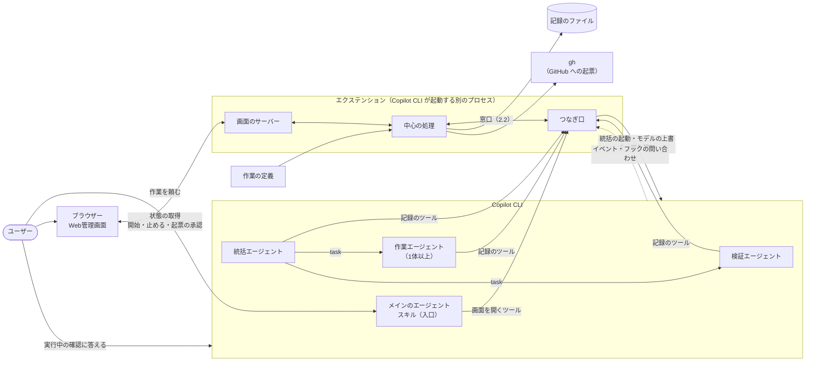
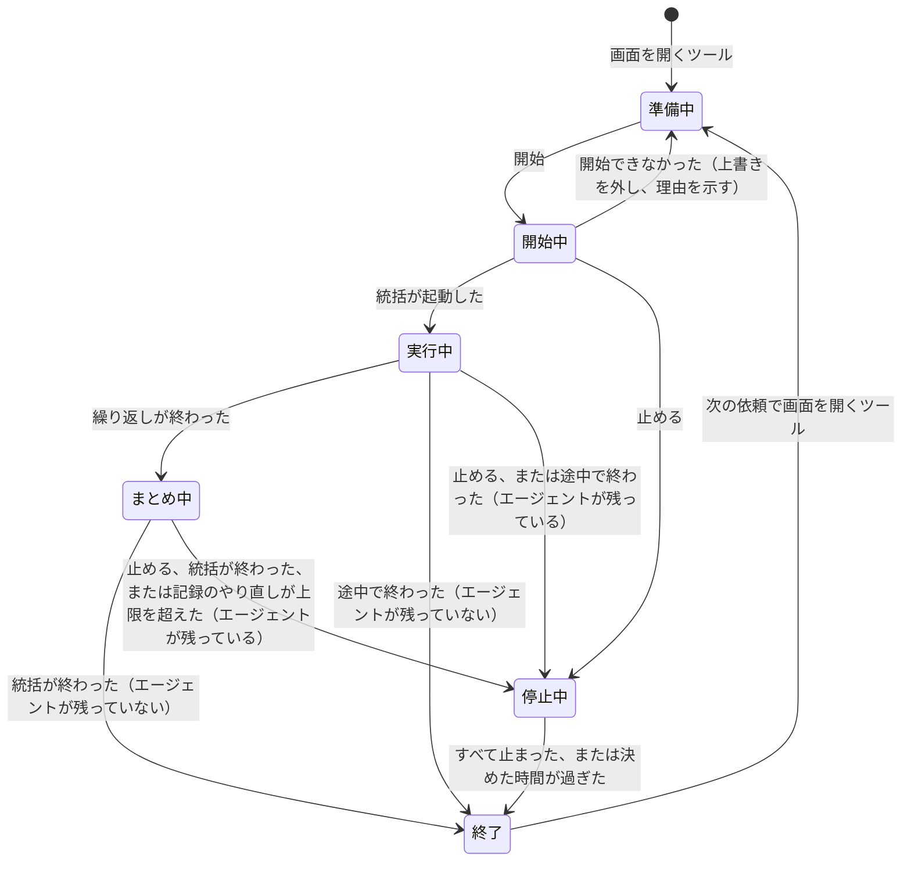

# {{plugin_name}} の設計書

{{plugin_name}} を保守する人のための設計である。仕様は [仕様書](../specs/requirements.md)、上位の決まりは [憲章](../constitution.md) にある。1章〜7章は、plugin-creator が作るどのプラグインにも共通の土台の要点である。作業ごとの設計は 8 章に、要件のたどり方は 9 章にある。

## 1. 部品

土台（`extension.mjs`、`adapter.mjs`、`core/`、`ui/`）は、どのプラグインでも同じ中身で、作業エージェントは書き換えない。

| 部品 | 区分 | 置き場所 | 役割 | 要件 |
| --- | --- | --- | --- | --- |
| マニフェストと README | 土台と値と作業ごと | `plugin.json`、`README.md`、`.github/plugin/marketplace.json` | 名前・版・説明・リポジトリ（Agent Plugins 1.0.0）。README は使う人に向けた説明で、初めに「できること」と「使い方」を置く（この2つは作業ごと）。marketplace.json は、手元のフォルダをマーケットプレイスとして入れるため | REQ-004、REQ-005、REQ-014、REQ-050 |
| スキル（入口） | 土台と作業ごと | `skills/` | メインのエージェントの手順（3.5）。手順は土台、description と作業の説明は作業ごと | REQ-004、REQ-005、REQ-008 |
| 統括エージェント | 土台と作業ごと | `com.github.copilot/agents/orchestrator.agent.md` | 計画・実行・評価の繰り返しと振り返り。手順は土台、作業ごとの指示は作業ごと。定義に `tools` は書かない（3.5） | REQ-010、REQ-011、REQ-013 |
| 作業エージェント | 土台と作業ごと | `com.github.copilot/agents/worker.agent.md`（2体目からは `worker-<名前>.agent.md`） | 成果物を作る | REQ-010 |
| 検証エージェント | 土台と作業ごと | `com.github.copilot/agents/verifier.agent.md` | 評価基準ごとの合否と指摘を記録する | REQ-010、REQ-011 |
| つなぎ口 | 土台 | `com.github.copilot/extensions/{{plugin_name}}/extension.mjs`（入口）、同じフォルダの `adapter.mjs`（つなぎの関数） | Copilot CLI と中心の処理をつなぐ（2.2）。Copilot CLI に依る処理は `adapter.mjs` に集めている | REQ-005、REQ-007〜REQ-009、REQ-029 |
| 中心の処理 | 土台 | 同じフォルダの `core/` | 実行の状態、決まりの確かめ、終わった理由、課題の洗い出し、記録、起票 | REQ-005〜REQ-014 |
| 画面 | 土台 | 同じフォルダの `ui/` | 画面のサーバーと、HTML・CSS・JavaScript の画面（2.4） | REQ-005〜REQ-008、REQ-012〜REQ-014、REQ-025、REQ-030、REQ-031 |
| 作業の定義 | 作業ごと | 同じフォルダの `task.json`（形は `core/task.schema.json`） | 合否の基準、作業ごとの画面、繰り返しの上限の既定（6章） | REQ-007、REQ-011、REQ-031 |
| 作業ごとの部品 | 作業ごと | `mcp.json`、`scripts/` など | 作業に要るスクリプトや MCP サーバー | 作業ごと |
| 文書 | 土台と作業ごと | `docs/` | 憲章・仕様書・設計書 | REQ-001〜REQ-003 |
| テスト | 土台と作業ごと | `tests/` | 試験の入口、1段目、2段目、偽物のつなぎ口、ナレッジの一覧、EVAL の課題（7章） | REQ-001 |

## 2. つなぎ方

### 2.1 部品のつながり

- 統括・作業・検証は、どれもカスタムエージェント（サブエージェント）である。
- メインのエージェントは、依頼を受け取って画面を示すだけで、作業には加わらない。憲章 第19条の構成には数えない。
- 実行中の確認（許可、利用の上限、質問）には、ユーザーがチャットで答える。エクステンションは答えず、待っていることを画面に示すだけである（3.6）。

### 2.2 エクステンションの中の分け方

Copilot CLI に依る部分を薄くし、それ以外を Copilot CLI なしで試せるようにするため、3つに分ける。

| 部分 | 役割 |
| --- | --- |
| つなぎ口 | 入口の `extension.mjs` が Copilot SDK の `joinSession` を `adapter.mjs` に渡す。`adapter.mjs` が、記録のツール、フック、許可の求めの受け口を登録し、Copilot CLI のイベントを中立のイベントに直して中心の処理に渡し、中心の処理の頼みを Copilot CLI の呼び出しに直す。統括が使ってよいツールの一覧も持つ（3.5）。Copilot SDK だけを使う |
| 中心の処理 | 実行の状態、決まりの確かめ、終わった理由、課題の洗い出し、記録、起票。Copilot CLI に依らない |
| 画面 | 画面のサーバーと、HTML・CSS・JavaScript の画面。Copilot CLI に依らない |

- 中心の処理からつなぎ口への窓口：統括を起動する、エージェントを取り消す、動いているエージェントの一覧を取る、サブエージェントのモデルを上書きする・外す、今のモデルと選べるモデルを取る、チャットに書く。
- つなぎ口から中心の処理への中立のイベント：エージェントの開始・終わり・失敗、ツールの開始・終わり、確認の待ちと待ちの終わり、エージェントが手番を終えて待ちに入った、記録のツールの呼び出し、ツールを使ってよいかの問い合わせ。どれもエージェントの番号がつく。
- 窓口の呼び出しには、待ち時間の上限（例：10秒）を付ける。
- 試験では、中心の処理と画面は、つなぎ口を偽物の窓口（`tests/stage2/fake-port.mjs`）に差し替えて動かす。つなぎ口そのもの（`adapter.mjs`）は、`joinSession` を引数で受けるので、偽物の Copilot SDK のセッション（`tests/stage2/adapter/fake-sdk.mjs`）を渡して動かす。プラグイン本体には試験のためだけの機能を入れない。

### 2.3 画面と Copilot CLI のつなぎ方

- 決めたこと：Web管理画面は、エクステンション（`com.github.copilot/extensions/{{plugin_name}}/extension.mjs`）で動かす。開始で動き出す、すぐ止まる、Copilot CLI の終了でサーバーも終わる、の3つを1つの公式の部品で満たせるのは、エクステンションだけである。
- 引き換えになること：
  - 試験的な機能である（Copilot CLI 1.0.102 の時点）。初めて使うときに `copilot --experimental` で起動する。一度付けると設定に残り、次からは付けなくてよい。起動した後なら、チャットで `/settings experimental on` と打つと、Copilot CLI が自動で再起動して有効になる。`/experimental on` も動くが、Copilot CLI が非推奨と示す。Copilot CLI の更新で使い方が変わることがある。
  - 確認を省くツール（3.6）とフック（3.2、3.5）を登録し、許可の求めを見る（3.6）ので、読み込みのときにチャットで確認が出る。題は `Extension "plugin:{{plugin_name}}:{{plugin_name}}" wants elevated permissions`、文は「This extension wants to: skip tool permission prompts, register hooks, handle permission requests. Denying will prevent this extension from loading.」で、断るとエクステンションは読み込まれない。Copilot CLI 1.0.101 から、許可を自動で判定する設定（Assisted の許可）を使っていても、この確認は必ず人に出る。
  - 選択肢は「Yes」「Yes, and always allow "plugin:{{plugin_name}}:{{plugin_name}}" in this directory」（後ろにフォルダの場所が付く。作業フォルダが Git のリポジトリのときは、`in this directory` の代わりに `in this repo` と出る）「No (Esc)」である。フォルダが分からないときは、2つ目の代わりに「Yes, and don't ask again for "…" this session」が出る。「Yes」は起動のたびと `/clear` のたびに出る。「always allow」は、その作業フォルダについて `permissions-config.json` に残り、次から出ない。「don't ask again … this session」は、そのセッションの間だけ出ない。
  - 初めて使うときと、`/settings experimental on` で再起動した後は、フォルダを信頼するかの確認の後に、この確認が続けて2回出ることがある（再起動の後でセッションが切り替わるため）。
  - README と入口のスキルで、確認の意味・許可する理由・選び方の違いを示す。エクステンションのツールがないときは、試験的機能が有効でないか、確認を断ったか、`/extensions mode` が Disabled のどれかとして、3つとも直し方を示して止まる（REQ-004）。Disabled は次のセッションにも残るので、`/extensions mode` で Load & Augment か Load Only に戻す。
- 採らなかった代案：フックとシェルのコマンド（エージェントを取り消せない）、MCP サーバーの中で画面を動かす（ツールの呼び出しが既定で30秒で時間切れ）、canvas（試験的で、GUI のない環境では URL を示すだけ）。
- エクステンションは JavaScript の ES モジュールで、Copilot CLI の実行ファイルで動くので、Node.js を別に入れなくてよい。画面は素の HTML・CSS・JavaScript で、ビルドも CDN も使わない。
- エクステンションは公式のサンドボックスの対象に入っておらず、外で動く見込みである（7章）。

### 2.4 画面のサーバーと画面

- サーバーはエクステンションと同じプロセスで動き、子プロセスを作らない。Copilot CLI を終えると一緒に終わる（REQ-029）。
- 待ち受けるのは 127.0.0.1 だけ（REQ-006）。番号は土台の既定で、ふさがっていたら OS に空いている番号を選ばせる。
- 起動ごとに乱数の合言葉を作り、URL に入れる（例：`http://127.0.0.1:8731/?k=<合言葉>`）。サーバーは、合言葉がない問い合わせと、Host が合わない問い合わせを断る。ほかの Web ページから開始・停止・起票を送られないようにするためである。
- 1つのセッションでは、同時に1つの実行だけを扱う。実行中に画面を開くツールがまた呼ばれたら、新しく始めず、今の URL を返す。頼みの文は受け付けないので、黙って捨てずに、「いまの実行が終わるまで、新しい作業は始められません。…変えた作業を頼むときは、画面で止めてから、もう一度チャットで頼んでください」と知らせる（`core/constants.mjs` の `BUSY_NOTICE`）。終わった後は、新しい実行の準備に戻す。準備中の画面からも、同じセッションの前の結果（なければ、同じ作業フォルダの前の結果）と、承認していない Issue の案を開ける。
- 窓口：`GET /`（画面）、`GET /api/state`（状態の全体）、`GET /api/agents/<番号>/reply`（返事の全文）、`GET /api/files/<番号>`（記録のツールで知らされた、作業フォルダの中のファイル）、`POST /api/start`、`POST /api/stop`、`POST /api/issues/<番号>/file`（承認して起票）。
- ファイルの窓口は、シンボリックリンクをたどった後の場所が作業フォルダの中かを確かめる。画像は png・jpeg・gif・webp だけ返し、SVG と HTML はダウンロードさせる形で返す。どれにもスクリプトを動かさない指定（`Content-Security-Policy: sandbox`、`X-Content-Type-Options: nosniff`）を付ける。
- エージェントや記録から来た文字は、すべて文字として出し、HTML として扱わない。
- 画面は、1秒ごとに状態の全体を取り直す。全体を取り直せば、取り逃しもつなぎ直しの処理も要らない。サーバーにつながらなくなったら、画面にそう示す。
- 計画・実行・評価のどれかは、動いているエージェントで決める（検証が動いていれば評価、作業が動いていれば実行、統括だけなら計画）。AI の申告に頼らないので、表示が実際とずれない。

## 3. 実行の流れ

### 3.1 開始

- 開始を押すと、中心の処理は実行を「開始中」にし、設定を確かめる。つなぎ口が、作業・検証のモデルをこのセッションに限って上書きし、統括を選んだモデルで、裏で動くエージェントとして起動する。結果の番号を、実行のエージェントの木の根にする。起動できたら「実行中」にする。
- 失敗したときは、上書きを外し、準備中に戻して理由を示す。時間切れのときは起動したかが分からないので、その名前のエージェントを探して取り消し、拒む一覧（3.2）に入れる。その後に届いた、どの実行の根でもない統括の開始も同じに扱う。
- 開始ボタンは、押すとすぐに押せなくなる。開始中か実行中の開始は断るので、統括は1体だけ起動する。
- 開始中に止めるが届いたら、届いた時点で受け付けて「停止中」にし、開始の処理は呼び出しを待つたびに止めるが届いていないかを見て、届いていたら統括を探して取り消す。
- 統括への指示文は、中心の処理が決まった形で組み立てる。始めの1文は「あなたの定義の手順で、この実行を進めてください。成果物は作業エージェントに、確かめは検証エージェントに、`task` で頼みます。」（`core/constants.mjs` の `INSTRUCTION_HEAD`）で、統括が作業を自分でしないようにする。続けて、実行の番号、頼まれた作業の文、繰り返しの上限、作業ごとの設定の値、ユーザーと確かめた合否の基準（番号と文をそのまま）が入る。

### 3.2 止める

- 止める範囲は、この実行のエージェント（統括と、その下の作業・検証）だけである。メインのエージェントの手番は中断しない。チャットでしているほかの作業を巻き込まないためである。
- 中心の処理は、イベントとフックの入力から、実行のエージェントの木を持つ（根は統括の番号）。手順は、停止中にする → 統括を取り消す → 木のツールを拒む → 止まったのを確かめて終了にする。統括を取り消すと、その下の作業・検証と、作業が動かしていたシェルの処理まで止まる。
- 止めた実行のために拒むのは、エクステンションのフック（`onPreToolUse`）で、入力のエージェントの番号が拒む一覧に入るツールだけである。一覧は、このセッションの終わったすべての実行の木を合わせたものである。統括が一覧にないツールを使おうとしたときの拒みは別で、3.5 にある。フックの関数は、例外を投げると拒まずに進むので、一覧を引くだけにして例外を投げない。
- 終了にする確かめは、統括の終わりのイベントと、動いているエージェントの一覧の状態で行う。取り消したとき、作業・検証の終わりのイベントは出ないので、イベントだけで待たない。
- 押してから8秒のうちに止まりを確かめられないエージェントは、「止まっていないエージェント」として、止め方（チャットで Esc を2回押す、または Copilot CLI を終える）とあわせて画面に示し、終わった理由に「止めきれなかったエージェントあり」を添える。8秒にするのは、画面の取り直しの間隔（1秒）を足しても10秒のうちに終了の表示にするためである。止めきれなくても、次の開始はできる。
- チャットで確認を待っていた作業も止まるが、チャットの確認は残る。残った確認には、どちらで答えてもツールは動かない。画面と README でそのことを示す。裏に回したシェル（`detach` したもの）は、取り消しても残ることがある。止まらなかったエージェントと処理は、課題の一覧に入れる。

### 3.3 計画・実行・評価の繰り返し

統括は、試行ごとに次を行う（REQ-011）。

1. 計画：記録のツールで、試行の番号、評価基準、計画を知らせる。2回目からは、前の試行の指摘への対応を計画に入れる。頼まれた作業の文が、ユーザーと確かめた合否の基準と食い違うときは、基準を優先する。頼みの文の食い違う部分は使わず、使わない部分と食い違った基準を、計画とまとめに書く（画面で見られる）。基準を変えたいときは、ユーザーが {{plugin_name}} を直す。
2. 実行：作業エージェントに、計画と評価基準とナレッジを渡して頼む。ナレッジは、{{plugin_name}} を作るときにユーザーと確かめた、仕事のやり方や決まりである。
3. 評価：検証エージェントに、評価基準と成果物の場所を渡して頼む。検証エージェントは、評価基準ごとの合否と指摘を、自分で記録のツールに知らせてから統括に返す。
4. すべて合格なら終わる。そうでなければ、上限の回数まで次の試行に進む。

- 作業・検証は `task` の `mode: "sync"` で1体ずつ呼ぶ。試行の順番と画面のフェーズが記録とずれないためである。呼ぶ名前は `{{plugin_name}}:worker` のように、プラグインの名前を付けた形にし、同じ名前のエージェントと取り違えないようにする。裏で動かす呼び方が見つかったら、決まりに合わないこととして記録し、課題に入れる。
- 中心の処理は、記録を受け取るたびに決まりを確かめ、合わないときは、理由の文を入れた失敗の結果（`{ textResultForLlm: '<理由>', resultType: 'failure' }`）をツールの結果として返し、統括に直させる。例外にはしない。ツールの処理が例外を投げると、Copilot CLI 1.0.102 はモデルに「Tool execution failed」だけを返し、理由の文が消えるためである。断られたやり直しには上限（例：3回）がある。超えたら、実行中なら「途中で終わった（記録のやり直しが上限を超えた）」にして統括を取り消し、まとめ中なら、統括を取り消して合否の記録で終わった理由を決め、課題に入れる。
- 確かめる決まり：
  - 計画の評価基準に、ユーザーと確かめた基準が、文言を変えずにすべて入っている。統括が足した基準は認める。
  - 試行の番号が前の試行の次で、上限を超えない。
  - 合否の記録が検証エージェントから来ている（記録のツールを呼んだエージェントの `agentId` で確かめる）。その試行の評価基準がすべてそろっている。その試行の作業エージェントが終わる前の合否は断る。
  - 前の試行がすべて合格なら、次の計画を断り、まとめに進むよう返す。繰り返しの途中の `_review`・`_issue`・`_finish`（振り返り・Issue の案・まとめ）は断る。
- 終わった理由は、AI の申告ではなく、記録とイベントから中心の処理が決める（REQ-012）。

  | 終わった理由 | 決め方 |
  | --- | --- |
  | 評価基準をすべて満たした | 最後の合否の記録ですべて合格 |
  | 上限の回数に達した | 上限の試行で合格しなかった |
  | ユーザーが止めた | 画面で止めた（止めきれなかったときも同じ） |
  | 途中で終わった（理由つき） | 実行中に統括が終わった、記録のやり直しが上限を超えた、エクステンションが再起動した、途中で切れた（3.7） |

  - 途中で終わった理由は、AI クレジットの上限（利用の上限の知らせに、クレジットを足さずに答えたか、答えが出ないまま統括が終わった）、チャットから中断された（画面で止めていないのに統括が取り消された）、統括の失敗、繰り返しを終えないまま統括が終わった、から決める。
  - 画面で止めていないとき、まとめ中に統括が終わっても、きっかけによらず、合否の記録で「評価基準をすべて満たした」か「上限の回数に達した」に決める。

### 3.4 役割ごとのモデル

- 統括は起動時のモデルの指定、作業と検証はセッションに限った上書きで、画面で選んだモデルを効かせる。上書きは `settings.json` に書かれず、`/clear` の後は効かなくなる。実行が終わったら外す。外すと、このセッションのほかのサブエージェントの上書きも消えるので、開始前の設定にそのことを示す。
- 役割ごとの既定は、エージェントの定義の `model`（優先する順のリスト）の1か所にだけ書く。画面の初めの値はそこから読む。統括と検証は思考力の高いモデル、作業は費用の低いモデルである。選択肢は、選べるモデルの一覧から出す。
- Auto のときも同じ手順で行う。上書きが効くかは公式に書かれていないので、画面に「Auto のため、役割ごとのモデルが効かないことがあります」と示す（REQ-007）。
- 実際に動いたモデルを、エージェントごとに画面に出す。選んだモデルと違うときは、課題の一覧にも入れる。

### 3.5 エージェントの構成

| エージェント | 置き場所 | 使えるツール | 役割 |
| --- | --- | --- | --- |
| メイン | スキル（入口） | ユーザーが選んだもの | 依頼を受け取り、画面を開くツールに渡して URL を示す。統括の終わりの知らせを受けたら、結果が画面にあると伝える |
| 統括 | カスタムエージェント | 定義に `tools` を書かず、全ツールを持つ。使ってよいのは、一覧（下）にあるツールだけ | 計画・実行・評価の繰り返しと振り返り。成果物は書かない |
| 作業（1体以上） | カスタムエージェント | `read`、`edit`、`execute`、`search`、作業ごとの MCP のツール、表示の記録のツール | 成果物を作る。自分の成果物を判定しない |
| 検証 | カスタムエージェント | `read`、`search`、作業ごとの確かめの MCP のツール、合否の記録のツール | 合否と指摘を記録し、統括に返す。書き込みのツールがないので、成果物を直せない（REQ-010） |

- 統括の終わりの知らせは、Copilot CLI が届ける。統括が手番を終えると、メインのエージェントが自動で結果を読み、1手番動く。
- メインのエージェントは、URL を示すときに、実行中は `/clear` しないこと、実行中の確認にはチャットで答えること、任せたいツールを前もって許可するしかたが README にあることもあわせて示す。
- 判定にコマンドの結果が要る基準は、成果物を書き換えない確かめのスクリプトを、作業ごとの MCP のツールとして検証エージェントに渡す。検証エージェントに `execute` を持たせると、成果物を書き換えられるためである。
- 統括の定義には `tools` を書かない。書くと、Copilot CLI は統括の下の作業・検証のツールも、統括が持つ範囲に絞ってしまう（更新履歴 1.0.67・1.0.68）。すると、検証が合否の記録のツールを使えず、作業が成果物を書けず、どの実行も途中で終わる（Copilot CLI 1.0.102 で確かめた）。
- そのかわり、統括が使ってよいツールの一覧を `adapter.mjs` に持ち、統括が一覧にないツールを使おうとしたら、フック（`onPreToolUse`。入力の `agentType` が `{{plugin_name}}:orchestrator` のとき）で拒む。一覧にないものを拒む形なので、Copilot CLI の更新で書き込めるツールが増えても、統括が書き込める向きには倒れない。
  - 一覧：`view`（読む）、`grep`・`glob`・`rg`（探す。モデルの族で名前が変わる）、`task`・`read_agent`・`list_agents`・`write_agent`（エージェントを呼ぶ）、統括の記録のツール（`{{plugin_name}}_plan`・`_review`・`_issue`・`_finish`・`_show`。`core/tools.mjs` の定義で、呼ぶものに統括を持つもの）。
  - 統括は、コマンド、編集、スキル（`skill`）、Web、MCP のツール、`extensions_reload` などを使えない。成果物を作る仕事は、`task` で作業エージェントに頼む。
  - 順番は、止めた実行の拒み（3.2）が先、統括の一覧がその次である。中心の処理がフックの中で失敗しても、統括の一覧は効かせる。
  - 拒まれた理由は「Denied by preToolUse hook: <理由>」としてモデルに届く。理由の文は、使えないツールの名前、使えるもの、成果物を作る仕事は作業エージェントに頼むこと、を平易な日本語で書く。
- 作業・検証の `tools` には `skill` を入れない。サブエージェントがスキルを呼び、メインのエージェント向けの手順を始めてしまうのを防ぐためである。`tools` に書かなければ、`skill` ツールは載らない（Copilot CLI 1.0.102 で確かめた）。

### 3.6 実行中の確認

- 記録のツールは、許可の確認を省く設定（`skipPermission: true`）で登録する。画面の状態を書くだけで、ファイルやコマンドなど外を変えないためである。
- 実行中にエージェントが求める確認（ツールの許可、利用の上限の確認、エージェントからの質問）には、ユーザーが Copilot CLI のチャットで答える（REQ-005）。エクステンションは、許可の求めの受け口（`onPermissionRequest`）を、見るためだけに登録する。受けた求めを中心の処理に渡し、いつも `{ kind: 'no-result' }` を返す。例外を投げない（投げると SDK が代わりに答えてしまう）。画面に、確認に答えるボタンは置かない。
- 確認の待ちのイベントが、この実行の木のエージェントのものなら、そのエージェントを「待ち」にし、画面に「チャットで確認を待っています」と、何の確認か（求めたエージェントの役割、確認の種類、許可ならコマンドの全文・触るかもしれないパスや URL・注意）を示す。エージェントの番号のない利用の上限の待ちは、実行全体の待ちとして示す。待ちの終わりを受けたら、同じ `requestId` の待ちを消す。
- 画面に出さないもの：ユーザーがチャットでしているほかの作業の確認、エクステンション自身の権限の求め、別のフックがすでに答えを決めた許可の求め（`resolvedByHook` が真）。
- README と入口のスキルで、任せたいツールを前もって許可するしかた（Copilot CLI の起動時の `--allow-tool` など）を案内する。

### 3.7 読み込み直されたとき

- Copilot CLI は、`/clear` のとき（前に出ているセッションが入れ替わったときも）エクステンションを読み込み直す。メモリの中の状態は消え、画面のサーバーも止まる。このとき、裏の統括と作業、作業のシェルの処理も止まり、モデルの上書きも残らない。
- `/clear` のほかにも、同じセッションのまま、エクステンションだけが起動し直されることがある（エージェントが `extensions_reload` を呼んだとき、`/extensions mode` を切り替えたとき）。このときは、セッションの番号が変わらず、統括・作業・検証は動き続ける。何もしないと、画面に出ず止められないエージェントが残る（憲章 第21条）。
- 中心の処理は、実行の状態を記録のファイル（5.1）に書きながら進める。エクステンションが起動したときに、終わっていない実行を次のように終わらせる（`core/recovery.mjs` の `classifyUnfinishedRun`）。
  - 自分のセッションの実行：木のエージェントを拒む一覧にすぐ入れ、`tasks.list` で動いているものを探して取り消し、「途中で終わった（エクステンションが再起動した）」にする。止まったかは、止める（3.2）と同じ8秒まで確かめ、止まらないものは「止まっていないエージェント」として示す。動いているものが見つからないとき（もう止まっているときなど）は、「途中で終わった（途中で切れた）」にする。
  - ほかのセッションの実行：`alive` が決めた時間（30秒）より古いものだけを、「途中で終わった（途中で切れた）」にする。新しいものは、時間が過ぎてからもう一度確かめる。`/clear` の後はセッションの番号が変わるので、前の実行はこちらになる。
- 次に画面を開いたときに、同じセッションか同じ作業フォルダの実行なら、そのことを示し、課題の一覧にも入れる（ほかの作業フォルダの実行には知らせない）。
- 今の実行に当たらない記録のツールの呼び出しは断り、「画面とのつながりが切れたので作業を終えてください」と返す。
- 実行中は `/clear` しないことを、画面とチャットに示す。

## 4. 状態

| エージェントの状態 | 変わるきっかけ |
| --- | --- |
| 待機 | 実行の始め |
| 実行中 | エージェントの開始、待ちの終わり |
| 待ち（チャットで確認を待っています） | 確認の待ちのイベント |
| 完了 | エージェントの終わり（取り消されていない） |
| 失敗 | エージェントの失敗 |
| 停止 | 取り消されて終わった。止めた後のエージェントの終わりや失敗 |
| 止まっていない | 止めてから決めた時間が過ぎた |

- 状態は、すべて中心の処理が1か所で持つ。画面からの頼みとイベントは、順番待ちの列に入れ、1つずつ最後まで処理する。状態には版の番号を付け、変わるたびに上げる。画面は、版の番号が変わったときだけ描き直す。
- 列の中で待つ Copilot CLI の呼び出しには、すべて待ち時間の上限（例：10秒）を付ける。時間切れのとき、開始中なら準備中に戻して上書きを外し、止める処理なら「止めきれなかったエージェントあり」の扱い（3.2）に進む。
- 列に入れずにすぐ答えるもの：開始中に届いた止める（3.1）、ツールを使ってよいかの問い合わせ（拒む一覧を引くだけ）、許可の求めの受け口（求めを列に入れ、すぐ `no-result` を返す）、停止中や終了の後の記録のツールの呼び出し（断る）、Issue の起票の `gh`（5.3）。
- 統括が終わったら、実行を終える。統括が終わるとは、手番を終えて待ちに入った、失敗した、取り消されて終わった、のどれかである。手番を終えた統括は待ち（idle）のまま残るので、実行が終わったら、残っていれば取り消す。

## 5. 記録

### 5.1 記録のファイル

- 置き場所は、`COPILOT_HOME`（なければ `~/.copilot`）の下の `plugin-data/{{plugin_name}}/runs/<開始の日時>-<番号>/` である。エクステンションには `PLUGIN_ROOT`・`PLUGIN_DATA` が渡らないので、プラグインの場所は入口のファイルの場所（`import.meta.url`）から求める。
- 記録には、ユーザーの作業の中身が入る。手元のフォルダにだけ置き、外へは送らない。古い記録は、終わった実行に限り、件数で消す（例：20件を超えたら古いものから）。
- フォルダの中：
  - `log.jsonl`：イベント、記録、実行の状態の変わり目を、届いた順に1行ずつ（1行に1件の JSON）書く。セッションの番号、作業フォルダ、木に入れたエージェントの番号も書く。最後の行が書きかけなら読み飛ばす。
  - `result.json`：終わったときの状態の全体。一時ファイルに書いてから名前を変えて置く。ない実行が、終わっていない実行である。
  - `alive`：生きている印。実行中のエクステンションが、数秒ごと（例：5秒）に今の時刻を書く。
  - `issues/`：案ごとの起票の印（5.3）。
- 終わっていない実行の扱い（3.7。分かれ目は `core/recovery.mjs` の `classifyUnfinishedRun` の1か所）：自分のセッションの終わっていない実行は、動いているエージェントを取り消して「途中で終わった（エクステンションが再起動した）」にする。同じセッションのままエクステンションだけが起動し直されても、エージェントは動き続けるためである。ほかのセッションの終わっていない実行は、`alive` が決めた時間（例：30秒）より古いものだけを「途中で終わった（途中で切れた）」にする。ほかのセッションで動いている実行を書き換えないためである。
- 拒む一覧（3.2）は、エクステンションが起動したときに、自分のセッションの終わったすべての実行の `log.jsonl` にある、木のエージェントの番号から作り直す。

### 5.2 課題の洗い出し

実行が終わった後、中心の処理が、記録から課題を機械的に洗い出し、決まった形の Issue の案を付ける（REQ-013）。

| 観点 | 見つけるもの |
| --- | --- |
| 実行の失敗 | 失敗したツール、失敗したエージェント、途中で終わった実行 |
| 詰まり・止まり | 決めた時間（例：5分）イベントがないエージェント、同じツールを同じ引数で繰り返した跡、止めても止まらなかったエージェントとシェルの処理 |
| データの流れ | 計画 → 作業 → 検証 → 合否の記録がそろわない試行、まとめのない終わり、選んだモデルと実際のモデルの違い |

- 繰り返しが終わったときは、統括が最後に、記録の要点を記録のツールで受け取って振り返り、Issue の案（題と本文）を足してから、まとめを記録する。
- ユーザーが止めたときと途中で終わったときは、エージェントを動かさず、機械的に分かる課題だけを示す。まとめも中心の処理が記録から作る。まとめ中にユーザーが止めたときは、統括がそれまでに足した案も出さない。まとめ中に統括がまとめを記録しないまま終わったときは、まとめを機械的に作り、足した案は残す。

### 5.3 Issue の起票

- 課題の一覧で、案ごとに承認のボタンを押すと、中心の処理が `gh issue create --repo <OWNER/REPO>` で起票し、できた Issue の URL を画面に出す（REQ-014）。ボタンは押したら押せなくする。題と本文は、シェルを通さず、`gh` に引数の配列と標準入力で渡す。
- 二重の起票を防ぐ。起票の前に、案ごとの印のファイルを「なければ作る」形で作り、作れたときだけ起票する。本文の終わりに、案ごとに一意の印（例：実行の番号と案の番号）を入れる。
- 起票の状態（起票中／起票済みと URL／失敗と理由／起票したか分からない）は、印のファイルに書き、画面はそこから読む。`result.json` には書き足さない。
- `gh` は順番待ちの列の外で動かし、時間の上限（例：60秒）を付ける。上限を超えたときと、起票中のまま5分が過ぎたときは、送信だけ済んでいることがありうるので、印を「起票したか分からない」にする。
- もう一度承認したとき、前の印が「起票したか分からない」なら、起票の前に `gh issue list --state all --json title,url,body` で、本文にその案の印がある Issue を探す。あればその URL を「起票済み」にし、なければ起票する。題の一致は見分けに使わない。探す処理が失敗したら、起票に進まない。
- リポジトリは、`plugin.json` の `repository`（GitHub の URL）から知る。入れ方によっては、プラグインがコピーされて `.git` が残らないことがあるためである（GitHub から入れたとき。Copilot CLI 1.0.57 の更新履歴）。手元のフォルダのマーケットプレイスから入れたプラグインは、コピーされず、そのフォルダを直接読むので、直したファイルは次のセッションで反映される（Copilot CLI 1.0.102 で確かめた）。GitHub から入れたときは、直した `plugin.json` を GitHub に送ってから、入れ直す（コピーの動きは確かめていない）。
- 画面を開いたときに、起票できるかを確かめる。`repository` がない、`gh` がない、`gh` でログインしていない、のどれかのときは、承認のボタンを押せなくし、起票できるようにする手順（REQ-014）を示す。
- 起票は `gh` のログインに任せる。`GITHUB_TOKEN` などの環境変数は求めない。ユーザーが断るとエクステンションごと読み込まれないためである。

### 5.4 記録のツール

エクステンションが Copilot CLI に足すツールである。名前の頭には、プラグインどうしでぶつからないよう、プラグインの名前を付ける。確かめに合わないときの断りは、失敗の結果で理由の文を返す（3.3）。

| ツール | 呼ぶもの | 渡すもの | 中心の処理が確かめること |
| --- | --- | --- | --- |
| `{{plugin_name}}_open` | メイン | 頼まれた作業の文 | 実行中なら新しく始めず、今の URL を返す |
| `{{plugin_name}}_plan` | 統括 | 試行の番号、評価基準、計画 | 3.3 の決まり |
| `{{plugin_name}}_verdict` | 検証 | 試行の番号、評価基準ごとの合否と指摘 | 3.3 の決まり |
| `{{plugin_name}}_show` | 統括、作業 | 作業ごとの表示の番号と値（画像やファイルは場所） | 作業の定義にある表示で、値の形が合うこと。ファイルは作業フォルダの中にあること |
| `{{plugin_name}}_review` | 統括 | なし | 機械的な洗い出しの結果と、記録の要点を返す |
| `{{plugin_name}}_issue` | 統括 | Issue の案（題と本文） | 題と本文があること |
| `{{plugin_name}}_finish` | 統括 | 実行全体のまとめ | 統括が呼んだこと |

## 6. 作業ごとの部分の入れ方

- 作業ごとの画面（開始前の設定、実行中の表示、結果の見せ方）は、作業の定義 `task.json` に決まった形で書く。共通の描画の部品が、土台と同じ見た目で出す。作業エージェントが書くのは定義だけで、HTML は書かない。費用の低いモデルでも、毎回同じ品質の画面になるためである。
- 定義の形は `core/task.schema.json` で決まり、1段目の試験が確かめる。項目は、名前、繰り返しの上限の既定、合否の基準（番号、文、もとになったナレッジの番号）、作業エージェント（名前と画面での呼び名）、開始前の設定の部品、表示の部品である。

- 部品の種類は少なくする。設定は、文字・数・選択・チェック・ファイルやフォルダの場所の入力。表示は、値の一覧・表・進み具合・文章・画像・ファイルへのリンク。グラフなどは、作業エージェントが画像のファイルとして作って見せる。
- 作業ごとの表示の値は、統括や作業エージェントが記録のツール（`{{plugin_name}}_show`）で送り、中心の処理が定義と照らして確かめる。
- 合否の基準は、作業の定義を元とする。統括への指示（3.1）と計画の確かめ（3.3）は、ここから読む。EVAL の課題のファイル（`tests/eval/` の中）には、基準の番号と文を写し、採点のしかたを足す。1段目の試験で、写しが作業の定義と同じかを確かめる。
- 合否の基準に付けるナレッジの番号は、「合否の決め方」のナレッジのものだけにする。ほかのナレッジの番号は、作業の定義とテストのフォルダを除くファイル（エージェントの指示など）に書く。1段目の試験は、ナレッジの一覧（`tests/knowledge.json`）の種類ごとに、この置き場所で番号を突き合わせる。

## 7. 試験

| 段階 | 確かめること | 置き場所 |
| --- | --- | --- |
| 1段目 構造の検査 | 設定ファイル、ファイルの置き場所、フロントマターが公式仕様に沿っているか。エージェントの定義の `tools`（統括は書かない。作業・検証は書き、検証に書き込みとコマンドがない）。作業の定義が決まりの形に合うか。EVAL の課題の基準の写しが作業の定義と同じか。ナレッジの番号がそろっているか。追跡の表（9章）がそろっているか | `tests/stage1/` |
| 2段目 部品の試験 | 中心の処理、画面のサーバー、画面、作業ごとのスクリプトを、偽物のつなぎ口で動かして確かめる。つなぎ口（`adapter.mjs`）は、偽物の Copilot SDK のセッションで動かして確かめる | `tests/stage2/` |
| EVAL | 実際のモデルで課題を実行し、合否の基準で採点する。plugin-creator に試験を頼むと動く。AI クレジットを使う | `tests/eval/<課題>/eval.json` |

- 1段目と2段目は、1つのコマンド `python3 tests/run.py` で動かす。入口は、最初に道具がそろっているかを確かめ、足りなければ足りない道具を示して止まる。段階ごとの合否と、不合格の試験とその理由を出し、同じ内容をファイルにも書く。終了コードでも合否が分かる。モデルを使わないので、AI クレジットを使わない。
- 試験の名前に、確かめる要件の番号を入れる（例：`REQ-009 止めると統括だけが取り消される`）。追跡の表（9章）の突き合わせに使う。
- 置き場所：中心の処理は `tests/stage2/core/*.test.mjs`、サーバーは `tests/stage2/ui/server.test.mjs`、画面は `tests/stage2/ui/screen.test.mjs`、つなぎ口は `tests/stage2/adapter/*.test.mjs`（偽物の Copilot SDK は `tests/stage2/adapter/fake-sdk.mjs`）、作業ごとの部品は `tests/stage2/task/`、偽物のつなぎ口の窓口は `tests/stage2/fake-port.mjs`、ナレッジの一覧（番号と種類つき）は `tests/knowledge.json`。
- 2段目で確かめる土台の振る舞い：
  - 中心の処理（偽物のつなぎ口）：開始（選んだモデルで統括が起動し、指示文に基準と設定の値が入る。開始中に止めても統括が残らない）、記録の決まり（基準が欠けた計画などが断られる）、終わり方（終わった理由が正しく決まる。残った統括が取り消される）、止める、起動し直したとき（自分のセッションの実行は取り消して終わらせる）、確認の待ち、課題。
  - つなぎ口（偽物の Copilot SDK）：記録のツールが `<名前>_<短い名前>` で登録される。断りが、例外ではなく失敗の結果で届く。止めた実行のツールと、統括の一覧にないツールが、フックで拒まれる。許可の求めの受け口はいつも `no-result` を返し、例外を投げない。Copilot CLI のイベントが中立のイベントになる。終了の合図で、画面のサーバーが閉じる。
  - サーバー：127.0.0.1 だけで待ち受ける。合言葉や名前が違う問い合わせを断る。ふさがった番号を避けて起動する。作業フォルダの外のファイルを出さない。偽物の `gh` で、起票が1件だけになる。起票できない状態では、ボタンが押せず手順が出る。
  - 画面（Playwright）：再読み込みなしで表示が変わる。確認の待ちが出て、答えるボタンがない。返事に HTML を入れてもスクリプトが動かない。幅や文字の大きさを変えても崩れない。色の差が十分ある（WCAG 2.2）。状態が文字でも示される。
- 人が確かめること：
  - Issue の案の分かりやすさ（REQ-025）。機械的な案の決まった文と、EVAL の記録に残った統括の案を見る。
  - 作業の定義の見出しと説明。土台の決まった文言（憲章、README）。ひな形を直すときに見る。
  - つなぎ口。Copilot CLI がないと確かめられないので、手元の Copilot CLI で確かめる。確かめていないことは、サンドボックスを有効にしても画面が開けるか、モデルが Auto のとき上書きが効くか、`gh` のログインでエクステンションの中から起票できるか、Copilot CLI を異常終了させても画面のサーバーが残らないか、複数のセッションを並べたときほかのセッションの実行を途中で切れたにしないか、返事の待ちと利用の上限の待ちのイベントが届くか、である。

## 8. 作業ごとの設計

{{plugin_name}} の作業だけに関わる設計である。部品の分け方、作業エージェントへの指示、スクリプトや MCP サーバー、作業の定義の中身、試験を書く。

{{slot:task-design}}

## 9. 要件のたどり方

仕様書の要件の番号から、設計書の箇所・実装資産・テストをたどれるようにする（REQ-003、憲章 第6条3項）。

- 確かめ方は、自動のテスト、EVAL、人が確かめる、のどれかである。同じ要件に確かめ方が複数あるときは、行を分ける。
- ファイルの列とテストの列は、ファイルかフォルダ（末尾が `/`）をバッククォートで囲み、読点で区切って書く。人が確かめる行は、テストの列を「—」にする。
- 1段目の試験が、仕様書のすべての要件の番号が表にあること、表に書いたファイルがあること、確かめ方が書かれていること、確かめ方が自動のテストの行に、その番号を名前に持つテストがあることを確かめる。

| 要件の番号 | 設計書の節 | ファイル | 確かめ方 | テスト |
| --- | --- | --- | --- | --- |
| REQ-001 | 1 | `docs/`、`tests/` | 人が確かめる | — |
| REQ-002 | 1 | `docs/constitution.md` | 人が確かめる | — |
| REQ-003 | 9 | `docs/specs/requirements.md`、`docs/design/design.md` | 自動のテスト | `tests/stage1/` |
| REQ-004 | 1、2.3 | `plugin.json`、`.github/plugin/marketplace.json` | 自動のテスト | `tests/stage1/` |
| REQ-004 | 2.3、3.5 | `README.md`、`skills/` | 人が確かめる | — |
| REQ-005 | 2.2、2.4、3.1、3.6 | `com.github.copilot/extensions/{{plugin_name}}/core/`、`com.github.copilot/extensions/{{plugin_name}}/ui/`、`com.github.copilot/extensions/{{plugin_name}}/adapter.mjs` | 自動のテスト | `tests/stage2/core/*.test.mjs`、`tests/stage2/ui/screen.test.mjs`、`tests/stage2/adapter/*.test.mjs` |
| REQ-005 | 2.3、3.5、3.6 | `README.md`、`skills/`、`com.github.copilot/extensions/{{plugin_name}}/extension.mjs`、`com.github.copilot/extensions/{{plugin_name}}/adapter.mjs` | 人が確かめる | — |
| REQ-029 | 2.2、2.4 | `com.github.copilot/extensions/{{plugin_name}}/ui/server.mjs`、`com.github.copilot/extensions/{{plugin_name}}/adapter.mjs` | 自動のテスト | `tests/stage2/ui/server.test.mjs`、`tests/stage2/adapter/*.test.mjs` |
| REQ-029 | 2.3、2.4 | `com.github.copilot/extensions/{{plugin_name}}/extension.mjs`、`com.github.copilot/extensions/{{plugin_name}}/adapter.mjs` | 人が確かめる | — |
| REQ-006 | 2.4 | `com.github.copilot/extensions/{{plugin_name}}/ui/server.mjs` | 自動のテスト | `tests/stage2/ui/server.test.mjs` |
| REQ-007 | 3.4 | `com.github.copilot/extensions/{{plugin_name}}/core/`、`com.github.copilot/extensions/{{plugin_name}}/ui/`、`com.github.copilot/extensions/{{plugin_name}}/adapter.mjs` | 自動のテスト | `tests/stage2/core/*.test.mjs`、`tests/stage2/ui/screen.test.mjs`、`tests/stage2/adapter/*.test.mjs` |
| REQ-007 | 3.4 | `com.github.copilot/extensions/{{plugin_name}}/extension.mjs`、`com.github.copilot/extensions/{{plugin_name}}/adapter.mjs`、`com.github.copilot/agents/` | 人が確かめる | — |
| REQ-031 | 6 | `com.github.copilot/extensions/{{plugin_name}}/task.json`、`com.github.copilot/extensions/{{plugin_name}}/core/task.schema.json` | 自動のテスト | `tests/stage1/`、`tests/stage2/core/*.test.mjs` |
| REQ-031 | 6 | `com.github.copilot/extensions/{{plugin_name}}/ui/static/render.js` | 自動のテスト | `tests/stage2/ui/screen.test.mjs` |
| REQ-008 | 2.2、2.4、3.7、4 | `com.github.copilot/extensions/{{plugin_name}}/core/`、`com.github.copilot/extensions/{{plugin_name}}/ui/`、`com.github.copilot/extensions/{{plugin_name}}/adapter.mjs` | 自動のテスト | `tests/stage2/core/*.test.mjs`、`tests/stage2/ui/screen.test.mjs`、`tests/stage2/adapter/*.test.mjs` |
| REQ-008 | 3.7 | `com.github.copilot/extensions/{{plugin_name}}/extension.mjs`、`com.github.copilot/extensions/{{plugin_name}}/adapter.mjs` | 人が確かめる | — |
| REQ-009 | 3.2、3.5 | `com.github.copilot/extensions/{{plugin_name}}/core/`、`com.github.copilot/extensions/{{plugin_name}}/adapter.mjs` | 自動のテスト | `tests/stage2/core/*.test.mjs`、`tests/stage2/adapter/*.test.mjs` |
| REQ-009 | 3.2 | `com.github.copilot/extensions/{{plugin_name}}/extension.mjs`、`com.github.copilot/extensions/{{plugin_name}}/adapter.mjs` | 人が確かめる | — |
| REQ-010 | 3.3、3.5 | `com.github.copilot/agents/verifier.agent.md`、`com.github.copilot/extensions/{{plugin_name}}/core/` | 自動のテスト | `tests/stage1/`、`tests/stage2/core/*.test.mjs` |
| REQ-011 | 3.3、6 | `com.github.copilot/agents/orchestrator.agent.md`、`com.github.copilot/extensions/{{plugin_name}}/core/`、`com.github.copilot/extensions/{{plugin_name}}/task.json` | 自動のテスト | `tests/stage1/`、`tests/stage2/core/*.test.mjs` |
| REQ-011 | 3.3 | `com.github.copilot/agents/orchestrator.agent.md` | EVAL | `tests/eval/` |
| REQ-012 | 3.3、4 | `com.github.copilot/extensions/{{plugin_name}}/core/`、`com.github.copilot/extensions/{{plugin_name}}/ui/` | 自動のテスト | `tests/stage2/core/*.test.mjs`、`tests/stage2/ui/screen.test.mjs` |
| REQ-013 | 5.2 | `com.github.copilot/extensions/{{plugin_name}}/core/` | 自動のテスト | `tests/stage2/core/*.test.mjs` |
| REQ-013 | 5.2 | `com.github.copilot/agents/orchestrator.agent.md` | EVAL | `tests/eval/` |
| REQ-014 | 5.3 | `com.github.copilot/extensions/{{plugin_name}}/core/`、`com.github.copilot/extensions/{{plugin_name}}/ui/server.mjs` | 自動のテスト | `tests/stage2/core/*.test.mjs`、`tests/stage2/ui/server.test.mjs` |
| REQ-014 | 5.3 | `README.md` | 人が確かめる | — |
| REQ-030 | 2.4 | `com.github.copilot/extensions/{{plugin_name}}/ui/` | 自動のテスト | `tests/stage2/ui/screen.test.mjs` |
| REQ-030 | 1 | `com.github.copilot/extensions/{{plugin_name}}/ui/` | 人が確かめる | — |
| REQ-025 | 5.2、5.3、6 | `com.github.copilot/extensions/{{plugin_name}}/core/`、`com.github.copilot/extensions/{{plugin_name}}/ui/` | 人が確かめる | — |
| REQ-050 | 1 | `README.md` | 人が確かめる | — |
{{slot:task-trace}}
